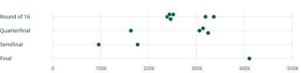

<link rel="stylesheet" href="../resources/world-cup-stage1/report.css">

<article class="wc-report uswnt-brief soccer-study" id="top" markdown="0">

<a href="world-cup.html#report-index">Alpha60 · World Cup research</a>November 24, 2026

<header class="brief-head">
Independent briefing for Jessica Berman and the NWSL
<h1>World Cup, MLS And NWSL Broadcast Rights</h1>
A comparison of the U.S. national teams and club leagues, a forecast for Brazil 2027, and negotiating terms for the NWSL during the World Cup and in its next rights cycle.
<a class="brief-download" href="../downloads/soccer-per-league-team-compares.pdf" download="soccer-per-league-team-compares.pdf">Download the 15-page executive brief</a></header>
<nav class="brief-nav" aria-label="Briefing contents"><a href="#forecast-method">2027 forecast</a><a href="#usa-rights">World Cup rights</a><a href="#club-comparison">Club leagues</a><a href="#fixture-pilot">Match evidence</a><a href="#club-offers">Offers and renewal</a><a href="#sources">Bibliographies</a></nav>
<section class="brief-section" id="executive-decision" aria-labelledby="executive-decision-title">
<h2 id="executive-decision-title">Executive decision</h2>

<strong>Use the 2027 World Cup to sell a return to club soccer.</strong> Ask a distributor to finance eight original features about players and their clubs, guarantee placement during the tournament and carry viewers into the NWSL's late-July restart. The league can negotiate club access, production and promotion with the relevant partners. FIFA controls the tournament pictures. The domestic NWSL live package runs through 2027, including Roku's 25 Sunday night matches.

<strong>Offer the U.S. edition first.</strong> Our proposed opening fee is <strong>$520,000</strong> for an English master and U.S. Spanish edition. Offer U.S.–Canada at $600,000. Add Mexican Spanish in a $660,000 three-country order if one buyer guarantees all three schedules and saves $30,000 in delivery costs. These are costed proposals for original programming, with no offers from buyers on record.

<strong>For 2028 onward, compare guaranteed cash after production.</strong> MLS's reported $200 million 2026 Apple payment covers international distribution. The NWSL's reported $60 million domestic package includes production and marketing. Neither supplies an observed U.S.-only, cash-only price gap. A comparable bid from a buyer is worth more to this negotiation than either headline.

<strong>What the audience evidence can support.</strong> A verified Seattle–Portland recording also has an ESPN-reported match average of 372,000 viewers. No dated Alpha60 swarm window was found for it. The 2026 World Cup knockout sample supports a separate forecast of downloader addresses for Brazil, with one U.S. national-team fixture in the matched sample.

<blockquote>

<strong>Decision for the commissioner.</strong> Authorize costed club-programming offers now. Reserve the live-rights decision for competing guarantees with the same matches, territories and delivery obligations.

</blockquote>

Sources · <a href="https://www.nwslsoccer.com/news/nwsl-announces-landmark-media-partnerships-with-cbs-sports-espn-prime-video-and-scripps-sports">NWSL commitments</a> · <a href="https://www.nwslsoccer.com/news/nwsl-and-roku-expand-partnership-with-sunday-night-streaming-package">Roku</a> · <a href="https://www.sportsbusinessjournal.com/Articles/2023/11/09/nwsl-media-rights/">Reported NWSL economics</a> · <a href="https://bsky.app/profile/ebennovywilliams.bsky.social/post/3m5mejec5rk2d">MLS terms</a> · <a href="https://sports.yahoo.com/articles/espn-capitalizing-nwsl-biggest-decision-100105096.html">Seattle audience</a> · <a href="https://alpha60-devops.github.io/alpha60-results-sports/data/soccer-comparison/forecast.json">Forecast evidence</a>

</section>
<section class="brief-section" id="forecast-method" aria-labelledby="forecast-method-title">
<h2 id="forecast-method-title">What the 2026 archive can measure</h2>

The archive contains 493 distinct World Cup torrents on 128 observation dates, from June 29 through November 3. The 21-match broadcast study identified 285 variants. We rebuilt the windows from 8,243 daily cache files, with each fixture's date as day one. At the end of day seven, 264 variants had appeared. The later count is the number of distinct downloader IPs first observed on those same releases during days eight through 28.

<table>
<thead>
<tr>
<th scope="col">Coverage</th>
<th scope="col">Finding</th>
</tr>
</thead>
<tbody>
<tr>
<td>Shared knockout rounds</td>
<td>13 complete fixtures from the round of 16 through the final. Twenty of all 21 had complete calendars. Canada–South Africa's kickoff preceded collection.</td>
</tr>
<tr>
<td>U.S. national team</td>
<td>USA–Belgium is the only matched USMNT fixture. Fifteen of its 17 releases qualified by day seven. We observed 95,094 early addresses and 243,994 additional addresses worldwide, including 15,476 additional U.S. addresses.</td>
</tr>
<tr>
<td>Forecast validation</td>
<td>At all 13 day-seven cutoffs, no complete earlier-round fixture had yet reached day 28. A fitted within-tournament model would have needed future outcomes.</td>
</tr>
</tbody>
</table>

For a rule that could have run on day seven, assume new addresses continue at the first week's daily rate. Over the next 21 days that predicts three times the early count. Its mean absolute error was <strong>30,307 addresses per fixture</strong>. A retrospective fit using release count and earlier rounds had error of 32,687. The earlier outcomes for that second comparison became available after the forecast dates.

<blockquote>

Keep the distinction between a team on the pitch and an address in its home country. The data record an endpoint and observation date. Team allegiance, viewing and repeat people across IPs remain unknown.

</blockquote>

Sources · <a href="https://alpha60-devops.github.io/alpha60-results-sports/data/soccer-comparison/forecast.json">Calendar windows and error definitions</a> · <a href="#calendar-method">Calendar-window calculation</a> · <a href="#variant-clock">Earlier variant-age study</a> · <a href="https://github.com/alpha60-devops/alpha60-results-sports/blob/35975ca236993c82a4c309aceeb877fdee009c01/data/world-cup-broadcast/fixture-windows.json">Fixture records</a>

</section>
<section class="brief-section" id="fixture-scenarios" aria-labelledby="fixture-scenarios-title">
<h2 id="fixture-scenarios-title">How large might a Brazil knockout replay be?</h2>

For a 2027 knockout fixture with release discovery like the 2026 panel, use <strong>239,341, 251,789 and 319,010</strong> additional worldwide downloader IPs as low, central and high planning cases. These are the lower quartile, median and upper quartile of 13 historical fixtures. They describe the middle half of those observations, with no assigned probability for a women's match. Removing hosting addresses lowers the median to 229,446. Removing VPN addresses separately gives 236,320.

<figure aria-label="Additional worldwide downloader IPs by knockout round"></figure>

<strong>Reading the figure.</strong> Each dot represents one sampled fixture's newly observed addresses in days eight through 28. The final has one observation. The men's tournament scheduled 104 matches and the women's tournament schedules 64 in Brazil. Sampling started during the men's round of 32. The women's group stage has no matched contemporary swarm benchmark here.

For a 2027 knockout fixture, make two estimates at day seven using rates fixed from the 2026 sample. Multiply the number of known releases by 18,144, or multiply the early downloader count by 2.932. Score both once day 28 closes.

<table>
<thead>
<tr>
<th scope="col">U.S. tournament path</th>
<th scope="col">How to use the forecast</th>
</tr>
</thead>
<tbody>
<tr>
<td>No qualification</td>
<td>No USWNT fixture enters the study. Measure U.S.-located addresses for neutral fixtures separately.</td>
</tr>
<tr>
<td>Group-stage exit</td>
<td>Observe the three U.S. group matches as new evidence. Use matched knockout numbers only for the rounds the sample represents.</td>
</tr>
<tr>
<td>Deep run</td>
<td>Update each U.S. fixture at day seven and compare it with same-round neutral opponents. Count unique addresses per fixture. Tournament-wide people cannot be obtained by adding fixture totals.</td>
</tr>
</tbody>
</table>

Sources · <a href="https://alpha60-devops.github.io/alpha60-results-sports/data/soccer-comparison/forecast.json">2026 fixture distribution and network sensitivities</a> · <a href="https://gpcustomersupportfwc2026.tickets.fifa.com/hc/en-gb/articles/28784798873117-10-What-is-the-format-for-the-FIFA-World-Cup-2026-tournament">2026 format</a> · <a href="https://www.netflix.com/tudum/features/fifa-womens-world-cup-2027">Brazil 2027 schedule</a> · <a href="https://www.ussoccer.com/stories/2026/11/federation/key-dates-major-moments-in-november-uswnt-usmnt-world-cup-playoffs">USWNT November 27 qualifier</a>

Inspect all 21 observed fixtures

The same variants and distinct IP definition apply to both windows. The incomplete fixture is excluded from the shared-round scenario and error calculations. <a href="https://alpha60-devops.github.io/alpha60-results-sports/data/soccer-comparison/forecast.json">Download all geographic and network variants</a>

<table>
<thead>
<tr>
<th scope="col">Teams</th>
<th scope="col">Kickoff date</th>
<th scope="col">Round</th>
<th scope="col">Frozen releases</th>
<th scope="col">Early IPs</th>
<th scope="col">Added IPs</th>
<th scope="col">Coverage</th>
</tr>
</thead>
<tbody>
<tr>
<td>CAN–RSA</td>
<td>2026-06-28</td>
<td>R32</td>
<td>9</td>
<td>48,544</td>
<td>189,496</td>
<td>Missing kickoff date</td>
</tr>
<tr>
<td>BRA–JPN</td>
<td>2026-06-29</td>
<td>R32</td>
<td>3</td>
<td>24,628</td>
<td>47,959</td>
<td>Complete</td>
</tr>
<tr>
<td>GER–PAR</td>
<td>2026-06-29</td>
<td>R32</td>
<td>5</td>
<td>18,433</td>
<td>77,153</td>
<td>Complete</td>
</tr>
<tr>
<td>CIV–NOR</td>
<td>2026-06-30</td>
<td>R32</td>
<td>9</td>
<td>34,802</td>
<td>170,273</td>
<td>Complete</td>
</tr>
<tr>
<td>FRA–SWE</td>
<td>2026-06-30</td>
<td>R32</td>
<td>11</td>
<td>41,854</td>
<td>247,644</td>
<td>Complete</td>
</tr>
<tr>
<td>MEX–ECU</td>
<td>2026-06-30</td>
<td>R32</td>
<td>12</td>
<td>53,167</td>
<td>192,139</td>
<td>Complete</td>
</tr>
<tr>
<td>ESP–AUT</td>
<td>2026-07-02</td>
<td>R32</td>
<td>13</td>
<td>55,173</td>
<td>213,511</td>
<td>Complete</td>
</tr>
<tr>
<td>POR–CRO</td>
<td>2026-07-02</td>
<td>R32</td>
<td>13</td>
<td>82,171</td>
<td>230,244</td>
<td>Complete</td>
</tr>
<tr>
<td>CAN–MAR</td>
<td>2026-07-04</td>
<td>R16</td>
<td>11</td>
<td>86,468</td>
<td>251,789</td>
<td>Complete</td>
</tr>
<tr>
<td>BRA–NOR</td>
<td>2026-07-05</td>
<td>R16</td>
<td>11</td>
<td>77,508</td>
<td>246,373</td>
<td>Complete</td>
</tr>
<tr>
<td>MEX–ENG</td>
<td>2026-07-05</td>
<td>R16</td>
<td>12</td>
<td>82,253</td>
<td>239,341</td>
<td>Complete</td>
</tr>
<tr>
<td>POR–ESP</td>
<td>2026-07-06</td>
<td>R16</td>
<td>17</td>
<td>98,413</td>
<td>319,010</td>
<td>Complete</td>
</tr>
<tr>
<td>USA–BEL</td>
<td>2026-07-06</td>
<td>R16</td>
<td>15</td>
<td>95,094</td>
<td>243,994</td>
<td>Complete</td>
</tr>
<tr>
<td>ARG–EGY</td>
<td>2026-07-07</td>
<td>R16</td>
<td>18</td>
<td>133,856</td>
<td>336,250</td>
<td>Complete</td>
</tr>
<tr>
<td>FRA–MAR</td>
<td>2026-07-09</td>
<td>QF</td>
<td>9</td>
<td>37,611</td>
<td>163,336</td>
<td>Complete</td>
</tr>
<tr>
<td>ESP–BEL</td>
<td>2026-07-10</td>
<td>QF</td>
<td>17</td>
<td>93,552</td>
<td>306,493</td>
<td>Complete</td>
</tr>
<tr>
<td>ARG–SUI</td>
<td>2026-07-11</td>
<td>QF</td>
<td>15</td>
<td>117,159</td>
<td>313,900</td>
<td>Complete</td>
</tr>
<tr>
<td>NOR–ENG</td>
<td>2026-07-11</td>
<td>QF</td>
<td>17</td>
<td>96,370</td>
<td>324,564</td>
<td>Complete</td>
</tr>
<tr>
<td>ESP–FRA</td>
<td>2026-07-14</td>
<td>SF</td>
<td>7</td>
<td>46,408</td>
<td>96,275</td>
<td>Complete</td>
</tr>
<tr>
<td>ARG–ENG</td>
<td>2026-07-15</td>
<td>SF</td>
<td>17</td>
<td>56,603</td>
<td>177,403</td>
<td>Complete</td>
</tr>
<tr>
<td>ESP–ARG</td>
<td>2026-07-19</td>
<td>F</td>
<td>23</td>
<td>148,441</td>
<td>410,511</td>
<td>Complete</td>
</tr>
</tbody>
</table>

</section>
<section class="brief-section" id="country-watchpoints" aria-labelledby="country-watchpoints-title">
<h2 id="country-watchpoints-title">Four geographic signals to follow</h2>

At day seven, predict each country's share of newly observed addresses using its share of the early worldwide fixture union. For the 13 comparable fixtures, the mean absolute share error was 0.32 percentage points for the U.S., 0.17 for Canada, 0.73 for Mexico, 1.79 for Brazil and 1.20 for China. The medians below describe the later shares across fixtures. Unknown-country addresses stay in the worldwide denominator.

<table>
<thead>
<tr>
<th scope="col">Geography</th>
<th scope="col">Median later share</th>
<th scope="col">What to observe in 2027</th>
</tr>
</thead>
<tbody>
<tr>
<td>USA</td>
<td>6.33%</td>
<td>Compare U.S. and neutral matches. The median fell to 4.77% without hosting.</td>
</tr>
<tr>
<td>Canada and Mexico</td>
<td>2.92% and 2.07%</td>
<td>Track Canadian French and Mexican Spanish releases alongside both country shares. Record the first verified audio.</td>
</tr>
<tr>
<td>Brazil</td>
<td>4.80%</td>
<td>Test host-country uplift against same-round neutral fixtures. Track the time until verified Brazilian Portuguese audio appears.</td>
</tr>
<tr>
<td>China</td>
<td>8.21%</td>
<td>Retest early share after removing hosting. Forecast error rose from 1.20 to 1.82 points under that exclusion.</td>
</tr>
</tbody>
</table>

China's early signal reduced retrospective error by 42.6% in the previous study, which started each release's clock on its first observation. On the new calendar, an earlier-round historical mean computed with hindsight had 0.95 points of error for China and 0.07 for Canada. Those means had no mature in-tournament training observations at the prediction dates. Freeze the 2026 benchmark before the 2027 tournament, and compare it with simple day-seven persistence as outcomes arrive.

<blockquote>

Publish discovery lag and missing audio beside every national share. Across all 493 torrents, seven had identified Spanish audio, two French, none Portuguese, and 158 had unknown audio.

</blockquote>

Sources · <a href="https://alpha60-devops.github.io/alpha60-results-sports/data/soccer-comparison/forecast.json">Country counts, shares and forecast errors</a> · <a href="https://alpha60-devops.github.io/alpha60-results-sports/docs/world-cup-languages.html">Audio classification</a> · <a href="https://alpha60-devops.github.io/alpha60-results-sports/docs/world-cup-2027-thoughts.html#spanish-portuguese-discovery">Portuguese discovery record</a> · <a href="#variant-clock">Previous China and Canada tests</a>

</section>
<section class="brief-section" id="usa-rights" aria-labelledby="usa-rights-title">
<h2 id="usa-rights-title">Who sells the match in the USA?</h2>

FIFA awards rights to the men's and women's World Cups. U.S. Soccer separately licenses national-team matches it controls. MLS and NWSL license club competitions. A club can arrange player access and create new programming subject to its agreements. None of those transactions on its own transfers footage of a FIFA match.

<table>
<thead>
<tr>
<th scope="col">U.S. property</th>
<th scope="col">Rights and published consideration</th>
<th scope="col">What a buyer could price</th>
</tr>
</thead>
<tbody>
<tr>
<td>2026 men's World Cup</td>
<td>FOX in English and Telemundo in Spanish. Bloomberg assigns about $485m to FOX for 2026. The Wall Street Journal assigns about $485m for FOX and $600m for Telemundo to packages that included 2023 women and 2026 men.</td>
<td>Preserve the competing descriptions. A 2026-only fee for both feeds combined is unknown.</td>
</tr>
<tr>
<td>2027 women's World Cup</td>
<td>Netflix holds all U.S. languages, including Puerto Rico. English and Spanish feeds are announced. The Journal reports about $300m for U.S. rights across 2027 and 2031.</td>
<td>A single-event U.S. fee and a USWNT-specific fee remain undisclosed. An equal split across editions would be an assumption.</td>
</tr>
<tr>
<td>Federation-controlled games</td>
<td>U.S. Soccer's Turner deal includes English-language games. Telemundo's Spanish-language extension runs through 2030. Both agreements cover men's and women's teams.</td>
<td>The federation's FY2026 audited $167.7m combines sponsorships, licensing and fan engagement. The accounting line supplies no standalone team-rights price.</td>
</tr>
</tbody>
</table>

In 2023, U.S.–Netherlands averaged 6.429m on FOX and 1.51m on Spanish-language outlets. Telemundo reported 12.9m total audience delivery on the U.S. Spanish-language coverage of USA–Belgium in 2026. Opponent, kickoff, stage, host market and measurement all changed. These examples support buying a specified telecast and language, with an agreed metric.

Sources · <a href="https://inside.fifa.com/tournament-organisation/commercial/media-releases/fifa-netflix-historic-broadcast-deal-2027-2031-womens-world-cup">FIFA award</a> · <a href="https://www.spokesman.com/stories/2026/jul/29/netflix-is-paying-200-million-for-2027-womens-worl/">Bloomberg</a> · <a href="https://www.kosnermedia.com/news/kosner-wsj-world-cup-future-tv-rights">Wall Street Journal</a> · <a href="https://cdn.sanity.io/files/oyf3dba6/production/ff663ede1fc4ea4281b94f2d5c9a47902cf57fe1.pdf">Federation audit</a> · <a href="https://www.foxsports.com/articles/soccer/us-womens-world-cup-tie-vs-netherlands-draws-combined-audience-of-793-million-on-fox-telemundo">2023 match</a> · <a href="https://nbcuniversalnewsgroup.com/telemundo/2026/07/21/telemundo-and-peacock-redefine-soccer-fandom-in-the-us-with-record-breaking-audiences-for-spanish-language-coverage-of-fifa-world-cup-2026/">2026 match</a> · <a href="https://alpha60-devops.github.io/alpha60-results-sports/data/soccer-comparison/rights.csv">Rights ledger</a>

Inspect the rights and fee ledger

The CSV includes sources, covered inventory and fee definitions. Rows with overlapping territories or events must be reconciled before addition. <a href="https://alpha60-devops.github.io/alpha60-results-sports/data/soccer-comparison/rights.csv">Download the rights ledger</a>

<table>
<thead>
<tr>
<th scope="col">Property</th>
<th scope="col">Buyer</th>
<th scope="col">Territory</th>
<th scope="col">Term</th>
<th scope="col">Fee</th>
</tr>
</thead>
<tbody>
<tr>
<td>Men's World Cup</td>
<td>FOX</td>
<td>USA</td>
<td>2026</td>
<td>$485m reported</td>
</tr>
<tr>
<td>Men's and women's World Cups</td>
<td>FOX</td>
<td>USA</td>
<td>Multi-event including 2023 and 2026</td>
<td>$485m reported</td>
</tr>
<tr>
<td>Men's and women's World Cups</td>
<td>Telemundo</td>
<td>USA</td>
<td>Multi-event including 2023 and 2026</td>
<td>$600m reported</td>
</tr>
<tr>
<td>Women's World Cup</td>
<td>Netflix</td>
<td>USA and Canada</td>
<td>2027</td>
<td>$200m reported</td>
</tr>
<tr>
<td>Women's World Cup</td>
<td>Netflix</td>
<td>USA</td>
<td>2027 and 2031</td>
<td>$300m reported</td>
</tr>
<tr>
<td>Women's World Cup</td>
<td>Netflix</td>
<td>USA including Puerto Rico</td>
<td>2027 and 2031</td>
<td>Undisclosed</td>
</tr>
<tr>
<td>Women's World Cup</td>
<td>Netflix</td>
<td>Canada</td>
<td>2027 and 2031</td>
<td>Undisclosed</td>
</tr>
<tr>
<td>Men's World Cup</td>
<td>Bell Media</td>
<td>Canada</td>
<td>2026</td>
<td>Undisclosed</td>
</tr>
<tr>
<td>Men's World Cup</td>
<td>TelevisaUnivision</td>
<td>Mexico</td>
<td>2026</td>
<td>Undisclosed</td>
</tr>
<tr>
<td>Women's World Cup</td>
<td>TelevisaUnivision</td>
<td>Mexico</td>
<td>2027</td>
<td>Undisclosed</td>
</tr>
<tr>
<td>Men's and women's World Cups</td>
<td>China Media Group</td>
<td>Mainland China</td>
<td>2026 to 2031</td>
<td>Undisclosed</td>
</tr>
<tr>
<td>Men's and women's World Cups</td>
<td>Deutsche Telekom</td>
<td>Germany</td>
<td>2026 and 2027</td>
<td>Undisclosed</td>
</tr>
<tr>
<td>USMNT and USWNT</td>
<td>Turner Sports</td>
<td>USA</td>
<td>2023 to 2030</td>
<td>Undisclosed</td>
</tr>
<tr>
<td>USMNT and USWNT</td>
<td>Telemundo</td>
<td>USA</td>
<td>Through 2030</td>
<td>Undisclosed</td>
</tr>
<tr>
<td>Club competitions</td>
<td>Apple</td>
<td>International</td>
<td>2026</td>
<td>$200m reported</td>
</tr>
<tr>
<td>Club competitions</td>
<td>Apple</td>
<td>International</td>
<td>2027 Sprint</td>
<td>$107.5m reported</td>
</tr>
<tr>
<td>Club competitions</td>
<td>Apple</td>
<td>International</td>
<td>2027–28</td>
<td>$275m reported</td>
</tr>
<tr>
<td>Club competitions</td>
<td>Apple</td>
<td>International</td>
<td>2028–29</td>
<td>$275m reported</td>
</tr>
<tr>
<td>Club competitions</td>
<td>CBS / ESPN / Prime Video / Scripps</td>
<td>USA</td>
<td>2024 to 2027</td>
<td>$60m reported</td>
</tr>
<tr>
<td>Club competitions</td>
<td>Roku</td>
<td>USA</td>
<td>2027</td>
<td>Undisclosed</td>
</tr>
<tr>
<td>Club competitions</td>
<td>Multiple international distributors</td>
<td>International</td>
<td>2026</td>
<td>Undisclosed</td>
</tr>
</tbody>
</table>

</section>
<section class="brief-section" id="north-america" aria-labelledby="north-america-title">
<h2 id="north-america-title">What one North American agreement buys</h2>

Bloomberg reports $200m for Netflix's 2027 women's tournament and describes its U.S. and Canadian footprint. Netflix confirms all 64 matches in both countries. The U.S.-only, two-edition figure on the preceding page covers a different term and territory. Adding it to the $200m would count overlapping rights.

<table>
<thead>
<tr>
<th scope="col">Market</th>
<th scope="col">2026 men's distribution</th>
<th scope="col">2027 women's distribution</th>
</tr>
</thead>
<tbody>
<tr>
<td>USA</td>
<td>FOX in English and Telemundo in Spanish.</td>
<td>Netflix in English and Spanish. The U.S. award covers all languages.</td>
</tr>
<tr>
<td>Canada</td>
<td>Bell's TSN and RDS carried all 104 games, with selected matches on CTV, Noovo and Crave.</td>
<td>Netflix in English and French. The Canadian price within the package is undisclosed.</td>
</tr>
<tr>
<td>Mexico</td>
<td>ViX advertised all 104 games.</td>
<td>TelevisaUnivision announced coverage. Its fee, match count and exclusive inventory remain open in the reviewed announcement.</td>
</tr>
</tbody>
</table>

<strong>A transparent regional sensitivity.</strong> At 64 games, 16 paid spots per game, $10 net CPM and 60% of advertising receipts available for rights, an assumed 0.9m, 1.5m or 2.1m monetizable viewers per game implies $5.5m, $9.2m or $12.9m for Mexico. Adding this once to the reported $200m gives <strong>$205.5m, $209.2m or $212.9m</strong>. The audience, paid inventory and revenue shares here are modeling inputs. A signed Mexican fee would supersede them.

<strong>What share might relate to the USWNT?</strong> Within the same $200m event, weight all other games at one. Three U.S. games at double weight receive $17.9m, five at triple weight $40.5m, and seven at quadruple weight $65.9m. Each figure divides the weighted U.S. games by the total weight across 64 fixtures. Without qualification the U.S.-match allocation is zero. These are alternative allocations inside the same contract.

<blockquote>

For a club commission, make the three countries separate schedules under one guarantee. Identify the actual feed, host, local promotion and next club broadcast for each.

</blockquote>

Sources · <a href="https://www.spokesman.com/stories/2026/jul/29/netflix-is-paying-200-million-for-2027-womens-worl/">Bloomberg fee</a> · <a href="https://www.netflix.com/tudum/features/fifa-womens-world-cup-2027">Netflix feeds</a> · <a href="https://www.bellmedia.ca/the-lede/press/bell-media-is-canadas-destination-for-every-fifa-world-cup-2026-moment/">Bell 2026</a> · <a href="https://corporate.televisaunivision.com/press/2026/01/15/vix-es-el-unico-lugar-para-ver-los-104juegos-de-la-copa-mundial-de-la-fifa-2026tm/">ViX Mexico</a> · <a href="https://www.televisa.com/canal5/que-deportes-transmitira-televisaunivision-el-proximo-ano-esto-se-anuncio-en-el-upfront-2027">Mexican 2027 upfront</a> · <a href="https://alpha60-devops.github.io/alpha60-results-sports/docs/world-cup-2027-uswnt-license-strategy.html#player-ledger">Earlier model and cost definitions</a>

</section>
<section class="brief-section" id="global-rights" aria-labelledby="global-rights-title">
<h2 id="global-rights-title">Global rights and the limits of a price total</h2>

The priced 2027 women's event in the reviewed evidence contributes a reported <strong>$200m U.S.–Canada subtotal</strong>. Germany and mainland China have confirmed carriage through multi-event awards. Mexico has announced coverage. Adding unallocated European package values, assigning private deals a zero, or scaling the subtotal by world population would imply a global fee the sources cannot establish.

<table>
<thead>
<tr>
<th scope="col">Market</th>
<th scope="col">Confirmed distribution</th>
<th scope="col">Implication for NWSL inventory</th>
</tr>
</thead>
<tbody>
<tr>
<td>Germany</td>
<td>Deutsche Telekom acquired men's 2026 and women's 2027 coverage alongside other events. FIFA reserved 30 women's matches for free-TV licensing.</td>
<td>Approach the relevant distributor for companion club stories or promotional placement. Check the free-TV window.</td>
</tr>
<tr>
<td>Mainland China</td>
<td>FIFA awarded China Media Group two men's and two women's tournaments. The standalone women's fee is private.</td>
<td>Offer a separately cleared Mandarin club edition. Confirm home-market rights, placement and local editorial approval.</td>
</tr>
<tr>
<td>Other territories</td>
<td>NWSL publishes its own selected-match carriage by country. FIFA's 2023 women's report documents audience reach and viewing by market.</td>
<td>Verify the 2027 club license and local buyer for each territory. Reach, subscribers, and torrent addresses have different denominators.</td>
</tr>
</tbody>
</table>

For a home-market pilot, the stage-eight delivery allowances support an <strong>$80,000 Korean</strong> or <strong>$120,000 mainland Mandarin</strong> opening quote, at assumed direct costs of $60,000 and $90,000. In the U.S. and Canada the incremental track budgets and terms differ. A $48,000 Korean track at $20 net CPM requires 2.4m paid impressions to recover its fee before other costs. Secure either the guarantee or a committed sponsor before production.

Sources · <a href="https://inside.fifa.com/tournament-organisation/commercial/news/world-cup-2026-womens-2027-media-rights-germany-telekom-magenta">FIFA German package</a> · <a href="https://inside.fifa.com/tournament-organisation/commercial/fifa-tv/media-releases/china-media-group-official-broadcaster-world-cup-2026-2030">FIFA China award</a> · <a href="https://www.nwslsoccer.com/news/how-to-watch-the-nwsl-in-2026-select-matches-by-territory?appView=true">NWSL international carriage</a> · <a href="https://inside.fifa.com/tournament-organisation/audience-reports/australia-new-zealand-2023">2023 women's audiences</a> · <a href="https://alpha60-devops.github.io/alpha60-results-sports/docs/world-cup-2027-uswnt-license-strategy.html#player-ledger">Language budgets</a>

</section>
<section class="brief-section" id="club-comparison" aria-labelledby="club-comparison-title">
<h2 id="club-comparison-title">What MLS and NWSL actually field and earn</h2>

The 2026 regular seasons give a common competition period. A player counts once after appearing for at least one club, including substitute appearances. A match counts once even though two clubs play. Club revenue uses 2025, the latest common season covered by both Forbes studies.

<table>
<thead>
<tr>
<th scope="col">Measure</th>
<th scope="col">MLS</th>
<th scope="col">NWSL</th>
</tr>
</thead>
<tbody>
<tr>
<td>2026 clubs</td>
<td>30</td>
<td>16</td>
</tr>
<tr>
<td>Regular-season fixtures</td>
<td>510</td>
<td>240</td>
</tr>
<tr>
<td>Matches per club</td>
<td>34</td>
<td>30</td>
</tr>
<tr>
<td>Distinct participating players</td>
<td>879</td>
<td>404</td>
</tr>
<tr>
<td>Players appearing for two clubs</td>
<td>37</td>
<td>16</td>
</tr>
<tr>
<td>2025 club revenue · median</td>
<td>$75m</td>
<td>$15m</td>
</tr>
<tr>
<td>Club revenue range · clubs covered</td>
<td>$46m–$200m · 30 clubs</td>
<td>$7m–$38m · 14 clubs</td>
</tr>
</tbody>
</table>

MLS's 18-club postseason, Leagues Cup and national cup entries expand its competition inventory. The 2026 Leagues Cup involved 18 MLS clubs and 18 Liga MX clubs. The NWSL has eight playoff teams, seven playoff matches and a separate Challenge Cup. Its 2027 regular season has 30 games per club with a World Cup break. MLS has a 14-game-per-club spring Sprint Season before the summer-to-spring season begins in July. Keep those partial and full seasons in separate columns.

The estimated MLS median of <strong>$75m per club</strong> is five times the $15m NWSL median, a $60m difference. Forbes excludes playoffs and player transfers in both studies. MLS also excludes shared league distributions and other non-guaranteed competitions. NWSL excludes non-league games. Club values, expansion fees and league-office accounts measure different things. The 2025 NWSL revenue sample predates its two 2026 expansion teams.

Sources · <a href="https://alpha60-devops.github.io/alpha60-results-sports/data/soccer-comparison/clubs.json">Club records and scope</a> · <a href="https://www.forbes.com/sites/justinbirnbaum/2026/02/13/the-most-valuable-mls-teams-2026/">MLS revenue methodology</a> · <a href="https://www.forbes.com/sites/brettknight/2026/04/22/the-nwsls-most-valuable-teams-2026/">NWSL revenue methodology</a> · <a href="https://www.mlssoccer.com/2027mlssprintseason/faq">Sprint calendar</a> · <a href="https://www.nwslsoccer.com/news/nwsl-announces-2027-schedule-footprint">NWSL 2027 calendar</a>

Inspect club-by-club revenue and participation
<h3>MLS clubs</h3>

2025 revenue estimates and 2026 participating players are separate series. The MLS player total deduplicates midseason moves.

<table>
<thead>
<tr>
<th scope="col">Club, 2025</th>
<th scope="col">Estimated revenue (USD millions)</th>
</tr>
</thead>
<tbody>
<tr>
<td>Atlanta United FC</td>
<td>105</td>
</tr>
<tr>
<td>Austin FC</td>
<td>94</td>
</tr>
<tr>
<td>CF Montréal</td>
<td>48</td>
</tr>
<tr>
<td>Charlotte FC</td>
<td>85</td>
</tr>
<tr>
<td>Chicago Fire FC</td>
<td>64</td>
</tr>
<tr>
<td>Colorado Rapids</td>
<td>50</td>
</tr>
<tr>
<td>Columbus Crew</td>
<td>80</td>
</tr>
<tr>
<td>D.C. United</td>
<td>99</td>
</tr>
<tr>
<td>FC Cincinnati</td>
<td>82</td>
</tr>
<tr>
<td>FC Dallas</td>
<td>59</td>
</tr>
<tr>
<td>Houston Dynamo FC</td>
<td>72</td>
</tr>
<tr>
<td>Inter Miami CF</td>
<td>200</td>
</tr>
<tr>
<td>LA Galaxy</td>
<td>106</td>
</tr>
<tr>
<td>LAFC</td>
<td>167</td>
</tr>
<tr>
<td>Minnesota United FC</td>
<td>68</td>
</tr>
<tr>
<td>Nashville SC</td>
<td>70</td>
</tr>
<tr>
<td>New England Revolution</td>
<td>60</td>
</tr>
<tr>
<td>New York City FC</td>
<td>90</td>
</tr>
<tr>
<td>New York Red Bulls</td>
<td>75</td>
</tr>
<tr>
<td>Orlando City SC</td>
<td>50</td>
</tr>
<tr>
<td>Philadelphia Union</td>
<td>80</td>
</tr>
<tr>
<td>Portland Timbers</td>
<td>69</td>
</tr>
<tr>
<td>Real Salt Lake</td>
<td>54</td>
</tr>
<tr>
<td>San Diego FC</td>
<td>93</td>
</tr>
<tr>
<td>San Jose Earthquakes</td>
<td>68</td>
</tr>
<tr>
<td>Seattle Sounders FC</td>
<td>100</td>
</tr>
<tr>
<td>Sporting Kansas City</td>
<td>81</td>
</tr>
<tr>
<td>St. Louis City SC</td>
<td>75</td>
</tr>
<tr>
<td>Toronto FC</td>
<td>74</td>
</tr>
<tr>
<td>Vancouver Whitecaps FC</td>
<td>46</td>
</tr>
</tbody>
</table>

<table>
<thead>
<tr>
<th scope="col">Club, 2026</th>
<th scope="col">Players who appeared</th>
</tr>
</thead>
<tbody>
<tr>
<td>Atlanta</td>
<td>35</td>
</tr>
<tr>
<td>Austin</td>
<td>28</td>
</tr>
<tr>
<td>Charlotte</td>
<td>26</td>
</tr>
<tr>
<td>Chicago</td>
<td>32</td>
</tr>
<tr>
<td>Cincinnati</td>
<td>29</td>
</tr>
<tr>
<td>Colorado</td>
<td>32</td>
</tr>
<tr>
<td>Columbus</td>
<td>33</td>
</tr>
<tr>
<td>D.C. United</td>
<td>27</td>
</tr>
<tr>
<td>Dallas</td>
<td>28</td>
</tr>
<tr>
<td>Houston</td>
<td>27</td>
</tr>
<tr>
<td>Kansas City</td>
<td>30</td>
</tr>
<tr>
<td>LA Galaxy</td>
<td>30</td>
</tr>
<tr>
<td>LAFC</td>
<td>34</td>
</tr>
<tr>
<td>Miami</td>
<td>29</td>
</tr>
<tr>
<td>Minnesota</td>
<td>30</td>
</tr>
<tr>
<td>Montréal</td>
<td>32</td>
</tr>
<tr>
<td>Nashville</td>
<td>24</td>
</tr>
<tr>
<td>New England</td>
<td>32</td>
</tr>
<tr>
<td>New York</td>
<td>34</td>
</tr>
<tr>
<td>New York City</td>
<td>30</td>
</tr>
<tr>
<td>Orlando</td>
<td>31</td>
</tr>
<tr>
<td>Philadelphia</td>
<td>30</td>
</tr>
<tr>
<td>Portland</td>
<td>26</td>
</tr>
<tr>
<td>Salt Lake</td>
<td>35</td>
</tr>
<tr>
<td>San Diego</td>
<td>33</td>
</tr>
<tr>
<td>San Jose</td>
<td>29</td>
</tr>
<tr>
<td>Seattle</td>
<td>32</td>
</tr>
<tr>
<td>St. Louis</td>
<td>32</td>
</tr>
<tr>
<td>Toronto</td>
<td>34</td>
</tr>
<tr>
<td>Vancouver</td>
<td>32</td>
</tr>
</tbody>
</table>

<h3>NWSL clubs</h3>

2025 revenue estimates and 2026 participating players are separate series. The NWSL player total deduplicates midseason moves.

<table>
<thead>
<tr>
<th scope="col">Club, 2025</th>
<th scope="col">Estimated revenue (USD millions)</th>
</tr>
</thead>
<tbody>
<tr>
<td>Angel City FC</td>
<td>38</td>
</tr>
<tr>
<td>Bay FC</td>
<td>23</td>
</tr>
<tr>
<td>Chicago Stars FC</td>
<td>7</td>
</tr>
<tr>
<td>Gotham FC</td>
<td>11</td>
</tr>
<tr>
<td>Houston Dash</td>
<td>10</td>
</tr>
<tr>
<td>Kansas City Current</td>
<td>38</td>
</tr>
<tr>
<td>North Carolina Courage</td>
<td>12</td>
</tr>
<tr>
<td>Orlando Pride</td>
<td>11</td>
</tr>
<tr>
<td>Portland Thorns</td>
<td>24</td>
</tr>
<tr>
<td>Racing Louisville FC</td>
<td>10</td>
</tr>
<tr>
<td>San Diego Wave FC</td>
<td>24</td>
</tr>
<tr>
<td>Seattle Reign FC</td>
<td>18</td>
</tr>
<tr>
<td>Utah Royals</td>
<td>9</td>
</tr>
<tr>
<td>Washington Spirit</td>
<td>18</td>
</tr>
</tbody>
</table>

<table>
<thead>
<tr>
<th scope="col">Club, 2026</th>
<th scope="col">Players who appeared</th>
</tr>
</thead>
<tbody>
<tr>
<td>Angel City FC</td>
<td>24</td>
</tr>
<tr>
<td>Bay FC</td>
<td>28</td>
</tr>
<tr>
<td>Boston Legacy FC</td>
<td>27</td>
</tr>
<tr>
<td>Chicago Stars FC</td>
<td>28</td>
</tr>
<tr>
<td>Denver Summit FC</td>
<td>22</td>
</tr>
<tr>
<td>Gotham FC</td>
<td>31</td>
</tr>
<tr>
<td>Houston Dash</td>
<td>26</td>
</tr>
<tr>
<td>Kansas City Current</td>
<td>26</td>
</tr>
<tr>
<td>North Carolina Courage</td>
<td>29</td>
</tr>
<tr>
<td>Orlando Pride</td>
<td>28</td>
</tr>
<tr>
<td>Portland Thorns FC</td>
<td>28</td>
</tr>
<tr>
<td>Racing Louisville FC</td>
<td>23</td>
</tr>
<tr>
<td>San Diego Wave FC</td>
<td>27</td>
</tr>
<tr>
<td>Seattle Reign FC</td>
<td>23</td>
</tr>
<tr>
<td>Utah Royals FC</td>
<td>26</td>
</tr>
<tr>
<td>Washington Spirit</td>
<td>24</td>
</tr>
</tbody>
</table>

<a href="https://alpha60-devops.github.io/alpha60-results-sports/data/soccer-comparison/clubs.json">Download the source definitions and club data</a>

</section>
<section class="brief-section" id="audience-measurement" aria-labelledby="audience-measurement-title">
<h2 id="audience-measurement-title">Which audience can be compared?</h2>

Nielsen supplies identifiable U.S. TV measurements for both leagues. Public releases are selective. Match, geography, feed, measurement product, denominator and window all matter. Retain uncertainty where a distributor combines several platforms or leaves the underlying measurement product unnamed.

<table>
<thead>
<tr>
<th scope="col">Source</th>
<th scope="col">Published observation</th>
<th scope="col">Use in a decision</th>
</tr>
</thead>
<tbody>
<tr>
<td>MLS and FOX</td>
<td>Preliminary 994,000 across FOX and Fox Deportes, whistle-to-whistle, 2025 MLS Cup, Nielsen panel only. Nashville–Atlanta drew 587,000 on FOX on July 17, 2026.</td>
<td>The league's 7.2m is estimated gross weekly cross-platform viewing in 2026. An Apple-only match audience needs its own extract.</td>
</tr>
<tr>
<td>NWSL and ESPN</td>
<td>Kansas City–Portland averaged 610,000 people ages two and up on ABC and ESPN+ in March 2025, Nielsen Big Data + Panel. The 17-match average was 228,000. Gotham reported 1.184m for the CBS final.</td>
<td>Request the same networks, period and viewer universe. Scripps/ION separately reports cumulative reach with a one-minute qualifier.</td>
</tr>
<tr>
<td>Canada and Mexico</td>
<td>Numeris measures Canadian television and Nielsen IBOPE measures Mexican television. Public, season-wide club telecast series were unavailable in the reviewed sources.</td>
<td>Request a dated TSN/RDS or Mexican telecast extract. Record language, out-of-home treatment, simulcasts and geography.</td>
</tr>
</tbody>
</table>

Apple TV, Prime Video, Paramount+, Roku and NWSL+ are first-party sources for the matches they carry. Ask for starts, minutes, average concurrent audience where available, and the definition of a returning viewer. Compare qualified minutes or average audiences only with a common time base. Award value to a multilingual feed when the partner can report selected language and the denominator.

Sources · <a href="https://www.mlssoccer.com/news/mls-cup-delivers-record-viewership-and-social-engagement">MLS Cup measurement</a> · <a href="https://www.mlssoccer.com/news/historic-attendance-surging-viewership-and-record-digital-engagement-highlight-2026-mls-regular-season">MLS 2026</a> · <a href="https://espnpressroom.com/press-release/nwsl-on-espn-scores-61-percent-increase-in-viewership-for-the-2025-regular-season/">ESPN match ratings</a> · <a href="https://www.gothamfc.com/news/gotham-fcs-nwsl-championship-win-the-mostwatched-match-in-league-history">CBS final</a> · <a href="https://ir.scripps.com/news-releases/news-release-details/scripps-sports-builds-upon-successful-first-year-nwsl-ion">ION definition</a> · <a href="https://www.numeris.ca/data/television-audience-measurement">Numeris</a> · <a href="https://www.nielsen.com/insights/2024/2024-evolution-measurement-mexico/">Nielsen IBOPE</a>

</section>
<section class="brief-section" id="fixture-pilot" aria-labelledby="fixture-pilot-title">
<h2 id="fixture-pilot-title">What the fixture search found</h2>

Seattle Reign–Portland Thorns on July 12, 2026 supplies a known match for checking the search method. Its <strong>192.1-minute</strong> archive recording has verified torrent metadata and broadcast previews from both halves. Seattle's club report confirms the 2–0 score. ESPN reported <strong>372,000 average viewers</strong> to The Athletic. This pairs a release with licensed viewing. Dated downloader counts for the recording are unknown.

<table>
<thead>
<tr>
<th scope="col">Evidence at November 24</th>
<th scope="col">MLS</th>
<th scope="col">NWSL</th>
</tr>
</thead>
<tbody>
<tr>
<td>Fixtures selected</td>
<td>12</td>
<td>12</td>
</tr>
<tr>
<td>Played and searched</td>
<td>11</td>
<td>12</td>
</tr>
<tr>
<td>Match release with verified metainfo</td>
<td>2</td>
<td>0</td>
</tr>
<tr>
<td>Other fixtures with release notes only</td>
<td>5</td>
<td>0</td>
</tr>
<tr>
<td>Public U.S. fixture rating found</td>
<td>0</td>
<td>2</td>
</tr>
<tr>
<td>Both a release and a rating</td>
<td>0</td>
<td>0</td>
</tr>
<tr>
<td>Dated Alpha60 swarm available</td>
<td>0</td>
<td>0</td>
</tr>
</tbody>
</table>

Each league contributed eight regular-season fixtures and four playoff places. MLS Cup was still ahead. Orlando–Cincinnati and New England–Philadelphia have reported runtimes of 112 and 107 minutes and video sizes that match the verified torrents. For five other MLS fixtures only the release notes surfaced. Washington–Utah averaged 560,000 on CBS and Gotham–Kansas City averaged 512,000 on ABC. All 11 played MLS selections aired on Apple TV in the U.S. The Seattle control is outside both samples.

Outside the fixed sample, five Internet Archive torrent files were independently verified, three NWSL and two MLS. The older records include Portland–Chicago in 2015, Portland–Orlando in 2017 and two 1996 MLS matches. Their 2020–22 archive publication dates come years after kickoff. Three further public catalog entries identify likely releases, including NYCFC–LAFC on October 17, 2026. The catalog descriptions have weaker evidence than a parsed file list.

<blockquote>

Record a missed search, inaccessible catalog, missing rating and unobserved swarm as different outcomes. Preserve the distinct match and release identifiers before estimating any relationship.

</blockquote>

Sources · <a href="https://alpha60-devops.github.io/alpha60-results-sports/data/soccer-comparison/pilot.json">Fixed fixture ledger</a> · <a href="https://frontofficesports.com/article/nwsl-tv-ratings-soccer-cbs-abc/">2026 semifinal ratings</a> · <a href="https://archive.org/metadata/portland-thorns-vs-seattle-reign">Seattle archive metadata</a> · <a href="https://www.reignfc.com/news/match-recap-seattle-reign-fc-beats-portland-2-0-in-front-of-fourth-largest-crowd-in-club-history">Seattle recap</a> · <a href="https://sports.yahoo.com/articles/espn-capitalizing-nwsl-biggest-decision-100105096.html">ESPN interview</a> · <a href="https://help.archive.org/help/archive-bittorrents/">Archive torrent method</a>

Inspect the 24 selected fixtures and their evidence

Coverage records contain the actual queries, evidence checks and source limitations. <a href="https://alpha60-devops.github.io/alpha60-results-sports/data/soccer-comparison/pilot.json">Download the complete search record</a>

<table>
<thead>
<tr>
<th scope="col">League</th>
<th scope="col">Date (Eastern)</th>
<th scope="col">Stage</th>
<th scope="col">Official fixture</th>
<th scope="col">U.S. carriage</th>
<th scope="col">Release</th>
<th scope="col">U.S. viewers</th>
</tr>
</thead>
<tbody>
<tr>
<td>MLS</td>
<td>2026-03-01</td>
<td>Regular season</td>
<td><a href="https://www.mlssoccer.com/competitions/mls-regular-season/2026/matches/atxvsdc-03-01-2026/">Austin FC – D.C. United</a></td>
<td>Apple TV</td>
<td><a href="https://www.srrdb.com/release/details/MLS.2026.03.01.Austin.FC.vs.DC.United.1080p.WEB.h264-BILLIE">Release notes only</a></td>
<td>None located</td>
</tr>
<tr>
<td>MLS</td>
<td>2026-03-07</td>
<td>Regular season</td>
<td><a href="https://www.mlssoccer.com/competitions/mls-regular-season/2026/matches/porvsvan-03-07-2026/">Portland Timbers – Vancouver Whitecaps</a></td>
<td>Apple TV</td>
<td><a href="https://www.srrdb.com/release/details/MLS.2026.03.08.Portland.Timbers.vs.Vancouver.Whitecaps.FC.1080p.WEB.h264-BILLIE">Release notes only</a></td>
<td>None located</td>
</tr>
<tr>
<td>MLS</td>
<td>2026-05-02</td>
<td>Regular season</td>
<td><a href="https://www.mlssoccer.com/competitions/mls-regular-season/2026/matches/torvssj-05-02-2026/">Toronto FC – San Jose Earthquakes</a></td>
<td>Apple TV</td>
<td>None located</td>
<td>None located</td>
</tr>
<tr>
<td>MLS</td>
<td>2026-05-03</td>
<td>Regular season</td>
<td><a href="https://www.mlssoccer.com/competitions/mls-regular-season/2026/matches/atxvsstl-05-03-2026/">Austin FC – St. Louis CITY SC</a></td>
<td>Apple TV</td>
<td>None located</td>
<td>None located</td>
</tr>
<tr>
<td>MLS</td>
<td>2026-07-16</td>
<td>Regular season</td>
<td><a href="https://www.mlssoccer.com/competitions/mls-regular-season/2026/matches/mtlvstor-07-16-2026/">CF Montréal – Toronto FC</a></td>
<td>Apple TV</td>
<td>None located</td>
<td>None located</td>
</tr>
<tr>
<td>MLS</td>
<td>2026-07-22</td>
<td>Regular season</td>
<td><a href="https://www.mlssoccer.com/competitions/mls-regular-season/2026/matches/sjvsorl-07-22-2026/">San Jose Earthquakes – Orlando City SC</a></td>
<td>Apple TV</td>
<td>None located</td>
<td>None located</td>
</tr>
<tr>
<td>MLS</td>
<td>2026-10-01</td>
<td>Regular season</td>
<td><a href="https://www.mlssoccer.com/competitions/mls-regular-season/2026/matches/seavsskc-10-01-2026/">Seattle Sounders FC – Sporting Kansas City</a></td>
<td>Apple TV</td>
<td><a href="https://www.srrdb.com/release/details/MLS.2026.10.01.Seattle.Sounders.FC.vs.Sporting.Kansas.City.1080p.WEB.h264-BILLIE">Release notes only</a></td>
<td>None located</td>
</tr>
<tr>
<td>MLS</td>
<td>2026-10-06</td>
<td>Regular season</td>
<td><a href="https://www.mlssoccer.com/competitions/mls-regular-season/2026/matches/chivsvan-10-06-2026/">Chicago Fire FC – Vancouver Whitecaps</a></td>
<td>Apple TV</td>
<td><a href="https://www.srrdb.com/release/details/MLS.2026.10.06.Chicago.Fire.FC.vs.Vancouver.Whitecaps.FC.1080p.WEB.h264-BILLIE">Release notes only</a></td>
<td>None located</td>
</tr>
<tr>
<td>MLS</td>
<td>2026-11-19</td>
<td>Wild Card</td>
<td><a href="https://www.mlssoccer.com/competitions/mls-cup-playoffs/2026/matches/orlvscin-11-19-2026/">Orlando City SC – FC Cincinnati</a></td>
<td>Apple TV</td>
<td><a href="https://torrentela.com/torrent/36888696/mls-2026-11-19-orlando-city-vs-fc-cincinnati-1080p-web-h264-billie.html">Verified torrent metadata</a></td>
<td>None located</td>
</tr>
<tr>
<td>MLS</td>
<td>2026-11-19</td>
<td>Wild Card</td>
<td><a href="https://www.mlssoccer.com/competitions/mls-cup-playoffs/2026/matches/seavsrsl-11-19-2026/">Seattle Sounders FC – Real Salt Lake</a></td>
<td>Apple TV</td>
<td><a href="https://www.srrdb.com/release/details/MLS.2026.11.19.Seattle.Sounders.FC.vs.Real.Salt.Lake.1080p.WEB.h264-BILLIE">Release notes only</a></td>
<td>None located</td>
</tr>
<tr>
<td>MLS</td>
<td>2026-11-21</td>
<td>Round One</td>
<td><a href="https://www.mlssoccer.com/competitions/mls-cup-playoffs/2026/matches/nevsphi-11-21-2026/">New England Revolution – Philadelphia Union</a></td>
<td>Apple TV</td>
<td><a href="https://torrentela.com/torrent/36927380/mls-2026-11-21-new-england-revolution-vs-philadelphia-union-1080p-web-h264-billie.html">Verified torrent metadata</a></td>
<td>None located</td>
</tr>
<tr>
<td>MLS</td>
<td>2026-12-18</td>
<td>Final</td>
<td><a href="https://www.mlssoccer.com/news/major-league-soccer-announces-audi-2026-mls-cup-playoffs-schedule">Finalists pending</a></td>
<td>FOX, Apple TV</td>
<td>Pending</td>
<td>Pending</td>
</tr>
<tr>
<td>NWSL</td>
<td>2026-03-13</td>
<td>Regular season</td>
<td><a href="https://www.nwslsoccer.com/match/834675f37cea4328bece6743d94c7d2d/washington-spirit-vs-portland-thorns-fc">Washington Spirit – Portland Thorns FC</a></td>
<td>Prime Video</td>
<td>None located</td>
<td>None located</td>
</tr>
<tr>
<td>NWSL</td>
<td>2026-03-15</td>
<td>Regular season</td>
<td><a href="https://www.nwslsoccer.com/match/49defb2be0664b1e9f9b5ac09f4040a5/angel-city-fc-vs-chicago-stars-fc">Angel City FC – Chicago Stars FC</a></td>
<td>Victory+</td>
<td>None located</td>
<td>None located</td>
</tr>
<tr>
<td>NWSL</td>
<td>2026-05-01</td>
<td>Regular season</td>
<td><a href="https://www.nwslsoccer.com/match/a135330bf54743fb92529e9d6dd2441d/houston-dash-vs-seattle-reign-fc">Houston Dash – Seattle Reign FC</a></td>
<td>Victory+</td>
<td>None located</td>
<td>None located</td>
</tr>
<tr>
<td>NWSL</td>
<td>2026-05-06</td>
<td>Regular season</td>
<td><a href="https://www.nwslsoccer.com/match/c6fb70ead63643ceac5aecc6bb4f652d/utah-royals-fc-vs-houston-dash">Utah Royals FC – Houston Dash</a></td>
<td>CBS Sports Network</td>
<td>None located</td>
<td>None located</td>
</tr>
<tr>
<td>NWSL</td>
<td>2026-07-03</td>
<td>Regular season</td>
<td><a href="https://www.nwslsoccer.com/match/6576393993da4f0786f4a2a53b87ca8e/washington-spirit-vs-houston-dash">Washington Spirit – Houston Dash</a></td>
<td>Victory+</td>
<td>None located</td>
<td>None located</td>
</tr>
<tr>
<td>NWSL</td>
<td>2026-07-05</td>
<td>Regular season</td>
<td><a href="https://www.nwslsoccer.com/match/51daec146700426fb6d0ae139b352449/portland-thorns-fc-vs-racing-louisville-fc">Portland Thorns FC – Racing Louisville FC</a></td>
<td>Victory+</td>
<td>None located</td>
<td>None located</td>
</tr>
<tr>
<td>NWSL</td>
<td>2026-10-02</td>
<td>Regular season</td>
<td><a href="https://www.nwslsoccer.com/match/ebba373c52b345638106b556d564573a/orlando-pride-vs-san-diego-wave-fc">Orlando Pride – San Diego Wave FC</a></td>
<td>Prime Video</td>
<td>None located</td>
<td>None located</td>
</tr>
<tr>
<td>NWSL</td>
<td>2026-10-04</td>
<td>Regular season</td>
<td><a href="https://www.nwslsoccer.com/match/9dae366cd55b408394886b5a75df15a8/houston-dash-vs-washington-spirit">Houston Dash – Washington Spirit</a></td>
<td>Roku Sports Channel</td>
<td>None located</td>
<td>None located</td>
</tr>
<tr>
<td>NWSL</td>
<td>2026-11-06</td>
<td>Quarterfinal</td>
<td><a href="https://www.nwslsoccer.com/match/ab44c399908d43bbb941b1bfd719f4b1/san-diego-wave-fc-vs-utah-royals-fc">San Diego Wave FC – Utah Royals FC</a></td>
<td>Prime Video</td>
<td>None located</td>
<td>None located</td>
</tr>
<tr>
<td>NWSL</td>
<td>2026-11-14</td>
<td>Semifinal</td>
<td><a href="https://www.nwslsoccer.com/match/c733f201115343e7b349fde6d0191abc/washington-spirit-vs-utah-royals-fc">Washington Spirit – Utah Royals FC</a></td>
<td>CBS, Paramount+</td>
<td>None located</td>
<td><a href="https://frontofficesports.com/article/nwsl-tv-ratings-soccer-cbs-abc/">560,000 · CBS</a></td>
</tr>
<tr>
<td>NWSL</td>
<td>2026-11-15</td>
<td>Semifinal</td>
<td><a href="https://www.nwslsoccer.com/match/ea9afae6c16144fdb57d009eb0122761/gotham-fc-vs-kansas-city-current">Gotham FC – Kansas City Current</a></td>
<td>ABC, ESPN App, ESPN Deportes</td>
<td>None located</td>
<td><a href="https://frontofficesports.com/article/nwsl-tv-ratings-soccer-cbs-abc/">512,000 · ABC</a></td>
</tr>
<tr>
<td>NWSL</td>
<td>2026-11-21</td>
<td>Final</td>
<td><a href="https://www.nwslsoccer.com/match/2fd8ff59c8774f53a590ce6db625bd12/washington-spirit-vs-kansas-city-current">Washington Spirit – Kansas City Current</a></td>
<td>CBS, Paramount+</td>
<td>None located</td>
<td>None located</td>
</tr>
</tbody>
</table>

</section>
<section class="brief-section" id="club-offers" aria-labelledby="club-offers-title">
<h2 id="club-offers-title">What to offer for the 2027 club restart</h2>

Eighteen of the 23 players on November's U.S. qualifying roster represented 13 NWSL clubs. Refresh affiliations when the tournament roster is named. Commission eight 12-minute features, each with two promotional edits and a link to the next club broadcast. Offer a nonexclusive window from May through August 2027. Player consent, club access, music, sponsor categories and any tournament footage need their own clearances.

<table>
<thead>
<tr>
<th scope="col">Prospective buyer</th>
<th scope="col">Opening fee and inventory</th>
<th scope="col">Minimum cash and condition</th>
</tr>
</thead>
<tbody>
<tr>
<td>Roku</td>
<td>$520,000 for U.S. English and U.S. Spanish. Feature the July restart in its Sunday package.</td>
<td>$459,000 on $390,000 cost. Contract for visible placement and referral reporting.</td>
</tr>
<tr>
<td>Netflix</td>
<td>$600,000 for English in U.S.–Canada, U.S. Spanish and Canadian French. An alternative to the overlapping Roku order.</td>
<td>$530,000 on $450,000 cost. Require commissioned originals, named placement and territory reporting.</td>
</tr>
<tr>
<td>Bell Media</td>
<td>$80,000 for Canadian French with a funded master.</td>
<td>$71,000 on $60,000 cost. Require francophone editorial control and a TSN/RDS restart referral.</td>
</tr>
<tr>
<td>TelevisaUnivision</td>
<td>$100,000 for Mexican Spanish with a funded master.</td>
<td>$89,000 on $75,000 cost. Secure local sponsor clearance and a named Mexican outlet.</td>
</tr>
<tr>
<td>China Media Group</td>
<td>$120,000 for a mainland Mandarin license with a funded master.</td>
<td>$106,000 on $90,000 cost. Confirm local acceptance and a placement guarantee.</td>
</tr>
</tbody>
</table>

Asks target 25% contribution before overhead and tax. Floors preserve at least 15%, rounded up to a whole $1,000. Separate core-country orders total $700,000 on $525,000 cost. One $660,000 regional order on $495,000 cost yields $165,000 contribution. It gives up $10,000 against separate orders. Accept that trade only for a guarantee or distribution commitment worth the difference. Replace planning allowances with written quotes before signing.

Sources · <a href="https://alpha60-devops.github.io/alpha60-results-sports/docs/world-cup-2027-uswnt-license-strategy.html#player-ledger">Prior delivery budget and terms</a> · <a href="https://www.ussoccer.com/stories/2026/11/uswnt/hayes-names-23-player-roster-concacaf-w-championship-world-cup-qualifiers">Qualifying roster</a> · <a href="https://www.nwslsoccer.com/news/nwsl-and-roku-expand-partnership-with-sunday-night-streaming-package">Roku window</a> · <a href="https://www.nwslplayers.com/cba">NWSL players’ agreement</a> · <a href="https://www.nwslsoccer.com/news/how-to-watch-the-nwsl-in-2026-select-matches-by-territory?appView=true">International carriage</a>

</section>
<section class="brief-section" id="renewal" aria-labelledby="renewal-title">
<h2 id="renewal-title">How to compare the renewal bids</h2>

The 2026 headline difference is <strong>$140m</strong> between Apple's reported $200m international MLS payment and the original NWSL domestic package's reported $60m, which includes production and marketing. Apple then reportedly pays $107.5m for the 2027 Sprint and $275m for each of the next two full seasons. U.S. allocation, incremental NWSL contracts and net domestic cash remain undisclosed. The NWSL collective bargaining agreement deducts promotional value and broadcast production expense when calculating media revenue for team revenue sharing.

For scale only, assume 40–80% of Apple's $200m belongs to U.S. rights and 50–90% of the NWSL's $60m is fee cash. The implied U.S. difference ranges from <strong>$26m to $130m</strong>. The middle assumptions, 60% and 70%, give $78m. These inputs are unobserved. They establish what a buyer would need to disclose to calculate a defensible gap.

<strong>Illustrative annual bid comparison, USD millions.</strong> Assume the same 240 NWSL regular-season fixtures, platforms and windows in each territory. Cash is guaranteed. Cost is the league's incremental production and sales obligation. Net is before revenue sharing, overhead and tax. The overseas row covers all remaining eligible territories in this exercise.

<table>
<thead>
<tr>
<th scope="col">Scope or bid</th>
<th scope="col" style="text-align: right;">Cash</th>
<th scope="col" style="text-align: right;">Cost</th>
<th scope="col" style="text-align: right;">Net</th>
</tr>
</thead>
<tbody>
<tr>
<td>USA</td>
<td style="text-align: right;">42.0</td>
<td style="text-align: right;">7.0</td>
<td style="text-align: right;">35.0</td>
</tr>
<tr>
<td>Canada</td>
<td style="text-align: right;">3.6</td>
<td style="text-align: right;">0.8</td>
<td style="text-align: right;">2.8</td>
</tr>
<tr>
<td>Mexico</td>
<td style="text-align: right;">2.4</td>
<td style="text-align: right;">0.6</td>
<td style="text-align: right;">1.8</td>
</tr>
<tr>
<td>Three-country offer</td>
<td style="text-align: right;">46.0</td>
<td style="text-align: right;">6.2</td>
<td style="text-align: right;">39.8</td>
</tr>
<tr>
<td>Remaining territories</td>
<td style="text-align: right;">5.0</td>
<td style="text-align: right;">1.3</td>
<td style="text-align: right;">3.7</td>
</tr>
<tr>
<td>Worldwide offer</td>
<td style="text-align: right;">50.0</td>
<td style="text-align: right;">7.0</td>
<td style="text-align: right;">43.0</td>
</tr>
</tbody>
</table>

The three-country deal beats $39.6m from separate bids by $0.2m. Combining it with the remaining territories yields $43.5m. A world buyer bearing the same scope must guarantee <strong>$50.5m</strong> if it leaves $7.0m of costs with the league. At $50.0m, prefer the regional split unless contractual placement or a guaranteed make-good covers the $0.5m difference.

Sources · <a href="https://www.sportico.com/leagues/soccer/2025/apple-mls-streaming-contract-change-1234876902/">Apple payments</a> · <a href="https://www.sportsbusinessjournal.com/Articles/2026/02/16/as-mls-enters-new-phase-with-apple-the-clock-is-ticking-toward-complex-media-rights-negotiations/">Contract revision</a> · <a href="https://www.sportsbusinessjournal.com/Articles/2023/11/09/nwsl-media-rights/">NWSL package economics</a> · <a href="https://alpha60-devops.github.io/alpha60-results-sports/data/soccer-comparison/rights.csv">Public fee ledger</a> · <a href="https://www.nwslplayers.com/_files/ugd/84dade_0b675d2ffb2048f8b89257555a35f231.pdf#page=30">CBA section 8.14</a>

</section>
<section class="brief-section" id="decision-calendar" aria-labelledby="decision-calendar-title">
<h2 id="decision-calendar-title">What to sign and what to measure</h2>

Negotiate one free-access national window, explicit feed and clip rights, fixture-level measurement and the ability to regain unused territories. Put promotion commitments in writing alongside any exclusivity. Count a fee increase only against a defined incremental outcome and an agreed reporting schedule.

<table>
<thead>
<tr>
<th scope="col">Decision date</th>
<th scope="col">Owner and action</th>
<th scope="col">Evidence that changes the decision</th>
</tr>
</thead>
<tbody>
<tr>
<td>November–December 2026</td>
<td>Commercial and football staff refresh the U.S. roster after November 27 qualification and the December 11 draw. Ask buyers for territory and placement commitments.</td>
<td>An early exit or absence changes which club stories travel. Obtain a named match window for every referral.</td>
</tr>
<tr>
<td>January–May 2027</td>
<td>Finance prices production, language, rights and access. Legal signs separate territory schedules. Producers commission only covered editions.</td>
<td>Replace assumed costs with bids. Open with the 25% margin price and renegotiate scope before crossing the 15% floor.</td>
</tr>
<tr>
<td>June 24–July 25</td>
<td>At seven days after each kickoff, freeze observed releases. Request partner reports for licensed matches, campaign placements and track selections.</td>
<td>Record per-fixture early volume, supply and geography. A wider group-stage discovery effort establishes its own baseline.</td>
</tr>
<tr>
<td>Late July–September</td>
<td>Measure the first club matches following promotion. Use comparable unpromoted matches or a randomized placement holdout.</td>
<td>Compare qualified minutes per exposed eligible account and follow-through to live club play, split by territory and selected language. Require denominators, costs and uncertainty.</td>
</tr>
<tr>
<td>2028+ renewal</td>
<td>Compare written bids on the same territorial and match inventory. Add a guaranteed minimum, annual review and an independently verifiable step-up.</td>
<td>Ask the buyer to pay an extra 5% of incremental collected ad cash above a signed baseline, after agreed selling costs. Exclude inventory already credited to the guarantee or sponsor.</td>
</tr>
</tbody>
</table>

<blockquote>

Return a language or territory to market if a buyer misses its placement or reporting covenant. Give the counterparty a cure period and specify the next eligible club window in the term sheet.

</blockquote>

Sources · <a href="https://www.nwslsoccer.com/news/nwsl-announces-2027-schedule-footprint">NWSL restart</a> · <a href="https://www.netflix.com/tudum/features/fifa-womens-world-cup-2027">FIFA calendar and draw</a> · <a href="https://www.ussoccer.com/stories/2026/11/federation/key-dates-major-moments-in-november-uswnt-usmnt-world-cup-playoffs">Qualifying schedule</a> · <a href="https://alpha60-devops.github.io/alpha60-results-sports/docs/world-cup-2027-uswnt-license-strategy.html#player-ledger">2027 delivery assumptions</a> · <a href="https://alpha60-devops.github.io/alpha60-results-sports/data/soccer-comparison/pilot.json">Fixture study</a>

</section>
<section class="brief-section" id="sources"><h2>Annotated research bibliographies</h2>
Evidence checked November 24, 2026. Each entry identifies the territory, measurement or decision it supports.

<h3>Swarm observations and tournament benchmarks</h3><ul>
<li>Alpha60's inventory and fixture analyses give the observation dates, release coverage, language classification and units used for the forecast. The two fixture files permit an independent count of USA–Belgium variants. <a href="https://alpha60-devops.github.io/alpha60-results-sports/docs/world-cup.html">Stage 1 inventory</a> · <a href="#variant-clock">Stage 9 methods and results</a> · <a href="https://github.com/alpha60-devops/alpha60-results-sports/blob/35975ca236993c82a4c309aceeb877fdee009c01/data/world-cup-broadcast/fixture-windows.json">19 original fixtures</a> · <a href="https://github.com/alpha60-devops/alpha60-results-sports/blob/35975ca236993c82a4c309aceeb877fdee009c01/data/world-cup-eur-27/broadcast/additional-fixture-windows.json">Two additional fixtures</a> · <a href="https://alpha60-devops.github.io/alpha60-results-sports/docs/world-cup-languages.html">Audio inventory</a> · <a href="https://alpha60-devops.github.io/alpha60-results-sports/docs/world-cup-2027-thoughts.html#spanish-portuguese-discovery">Portuguese discovery</a></li>
<li>FIFA supplies the historical women's broadcast audience definitions and the 2026 men's format. U.S. Soccer dates the qualification decision, and Netflix gives the Brazil match count, draw date and languages. <a href="https://inside.fifa.com/tournament-organisation/audience-reports/australia-new-zealand-2023">FIFA 2023 audience report</a> · <a href="https://gpcustomersupportfwc2026.tickets.fifa.com/hc/en-gb/articles/28784798873117-10-What-is-the-format-for-the-FIFA-World-Cup-2026-tournament">FIFA 2026 tournament format</a> · <a href="https://www.ussoccer.com/stories/2026/11/federation/key-dates-major-moments-in-november-uswnt-usmnt-world-cup-playoffs">U.S. Soccer qualification schedule</a> · <a href="https://www.netflix.com/tudum/features/fifa-womens-world-cup-2027">Netflix tournament guide</a></li>
<li>The earlier briefing documents the player and club ledger, language options, buyer shortlist and cost assumptions. <a href="https://alpha60-devops.github.io/alpha60-results-sports/docs/world-cup-2027-uswnt-license-strategy.html#player-ledger">Stage 8 player ledger</a> · <a href="https://alpha60-devops.github.io/alpha60-results-sports/docs/world-cup-2027-uswnt-license-strategy.html">Original briefing</a> · <a href="https://alpha60-devops.github.io/alpha60-results-sports/downloads/world-cup-2027-uswnt-license-strategy.pdf">Original executive PDF</a> · <a href="#edition-notes">Edition notes</a></li>
<li>The November 24 rebuild freezes releases at day seven and records the per-fixture totals, coverage and error for each network definition. <a href="https://alpha60-devops.github.io/alpha60-results-sports/data/soccer-comparison/forecast.json">Calendar-window results</a> · <a href="#calendar-method">Calendar-window calculation</a></li>
</ul>
<h3>National-team and tournament rights</h3><ul>
<li>Rights-holder and distributor notices document the U.S. award, Canadian language feeds, announced Mexican carriage and an example of a separately licensed global market. <a href="https://inside.fifa.com/tournament-organisation/commercial/media-releases/fifa-netflix-historic-broadcast-deal-2027-2031-womens-world-cup">FIFA U.S. award</a> · <a href="https://www.netflix.com/tudum/features/fifa-womens-world-cup-2027">Netflix U.S. and Canada guide</a> · <a href="https://www.televisa.com/canal5/que-deportes-transmitira-televisaunivision-el-proximo-ano-esto-se-anuncio-en-el-upfront-2027">TelevisaUnivision’s Canal 5 upfront</a> · <a href="https://inside.fifa.com/tournament-organisation/commercial/fifa-tv/media-releases/china-media-group-official-broadcaster-world-cup-2026-2030">FIFA China Media Group award</a></li>
<li>U.S. Soccer documents the federation's joint men's and women's packages, finances and qualifying roster. <a href="https://www.ussoccer.com/stories/2022/03/turner-sports-and-united-states-soccer-federation-reach-multimedia-rights-agreement">Turner English-language agreement</a> · <a href="https://www.ussoccer.com/stories/2026/05/federation/nbcuniversal-telemundo-extend-spanish-language-media-rights-agreement-through-2030">Telemundo Spanish-language extension</a> · <a href="https://www.ussoccer.com/governance/financial-information">Federation financial information</a> · <a href="https://www.ussoccer.com/stories/2026/11/uswnt/hayes-names-23-player-roster-concacaf-w-championship-world-cup-qualifiers">November USWNT roster by club</a></li>
<li>Bloomberg's original reporting, republished by The Spokesman-Review, and The Wall Street Journal's reporting, reproduced by interviewee John Kosner, assign different scopes to reported fees. Preserve both attributions. <a href="https://www.spokesman.com/stories/2026/jul/29/netflix-is-paying-200-million-for-2027-womens-worl/">Bloomberg's 2027 fee report</a> · <a href="https://www.kosnermedia.com/news/kosner-wsj-world-cup-future-tv-rights">Wall Street Journal package comparison</a></li>
<li>Broadcasters document 2026 Canadian and Mexican carriage and FIFA describes the German multi-event package. The rights ledger retains country, term and fee status. <a href="https://www.bellmedia.ca/the-lede/press/bell-media-is-canadas-destination-for-every-fifa-world-cup-2026-moment/">Bell World Cup coverage</a> · <a href="https://corporate.televisaunivision.com/press/2026/01/15/vix-es-el-unico-lugar-para-ver-los-104juegos-de-la-copa-mundial-de-la-fifa-2026tm/">ViX in Mexico</a> · <a href="https://inside.fifa.com/tournament-organisation/commercial/news/world-cup-2026-womens-2027-media-rights-germany-telekom-magenta">FIFA German agreement</a> · <a href="https://alpha60-devops.github.io/alpha60-results-sports/data/soccer-comparison/rights.csv">Rights ledger</a></li>
</ul>
<h3>Club schedules, revenue and media agreements</h3><ul>
<li>The league schedules define season length, unique fixtures, the MLS calendar change and the NWSL World Cup break. Use player statistics for actual appearances. <a href="https://www.mlssoccer.com/news/mls-announces-2026-regular-season-schedule">MLS 2026</a> · <a href="https://www.mlssoccer.com/2027mlssprintseason/faq">MLS Sprint FAQ</a> · <a href="https://www.nwslsoccer.com/news/the-2026-nwsl-schedule-is-here">NWSL 2026</a> · <a href="https://www.nwslsoccer.com/news/nwsl-announces-2027-schedule-footprint">NWSL 2027</a> · <a href="https://www.mlssoccer.com/stats/players/">MLS player statistics</a> · <a href="https://www.nwslsoccer.com/stats/players/all">NWSL player statistics</a></li>
<li>Forbes's two 2026 club studies describe their 2025 revenue estimates and exclusions. The revenue and valuation columns measure different things. <a href="https://www.forbes.com/sites/justinbirnbaum/2026/02/13/the-most-valuable-mls-teams-2026/">MLS club study</a> · <a href="https://www.forbes.com/sites/brettknight/2026/04/22/the-nwsls-most-valuable-teams-2026/">NWSL club study</a></li>
<li>Sportico reports the revised Apple payments. Co-author Eben Novy-Williams also published a public summary. Sports Business Journal documents the shortened MLS term and what the original NWSL package price includes. <a href="https://www.sportico.com/leagues/soccer/2025/apple-mls-streaming-contract-change-1234876902/">Sportico on Apple payments</a> · <a href="https://bsky.app/profile/ebennovywilliams.bsky.social/post/3m5mejec5rk2d">Reporter’s summary</a> · <a href="https://www.sportsbusinessjournal.com/Articles/2026/02/16/as-mls-enters-new-phase-with-apple-the-clock-is-ticking-toward-complex-media-rights-negotiations/">Sports Business Journal on MLS</a> · <a href="https://www.sportsbusinessjournal.com/Articles/2023/11/09/nwsl-media-rights/">Sports Business Journal on NWSL</a></li>
<li>NWSL announcements identify buyers, windows and territories, including the change to Sunday night streaming. <a href="https://www.nwslsoccer.com/news/nwsl-announces-landmark-media-partnerships-with-cbs-sports-espn-prime-video-and-scripps-sports">Original domestic agreements</a> · <a href="https://www.nwslsoccer.com/news/nwsl-and-roku-expand-partnership-with-sunday-night-streaming-package">Roku's 2027 package</a> · <a href="https://www.nwslsoccer.com/news/how-to-watch-the-nwsl-in-2026-select-matches-by-territory?appView=true">International carriage by territory</a></li>
<li>Club records reconcile participants and estimated revenue. The federation's audited statement defines its combined commercial revenue. The NWSL players' agreement informs access and approvals. <a href="https://alpha60-devops.github.io/alpha60-results-sports/data/soccer-comparison/clubs.json">Club-level data and definitions</a> · <a href="https://cdn.sanity.io/files/oyf3dba6/production/ff663ede1fc4ea4281b94f2d5c9a47902cf57fe1.pdf">U.S. Soccer FY2026 audit</a> · <a href="https://www.nwslplayers.com/cba">NWSL players’ agreement</a> · <a href="https://www.nwslplayers.com/_files/ugd/84dade_0b675d2ffb2048f8b89257555a35f231.pdf#page=30">Agreement section 8.14</a></li>
</ul>
<h3>Ratings and audience measurement</h3><ul>
<li>MLS gives the 2025 Cup's Nielsen methodology and a 2026 example with separate match and weekly measures. <a href="https://www.mlssoccer.com/news/mls-cup-delivers-record-viewership-and-social-engagement">2025 MLS Cup measurement note</a> · <a href="https://www.mlssoccer.com/news/historic-attendance-surging-viewership-and-record-digital-engagement-highlight-2026-mls-regular-season">2026 MLS regular-season report</a></li>
<li>ESPN names its Nielsen product. Gotham identifies the CBS final audience. Scripps specifies its reach threshold and which streaming services its figures omit. <a href="https://espnpressroom.com/press-release/nwsl-on-espn-scores-61-percent-increase-in-viewership-for-the-2025-regular-season/">ESPN regular-season report</a> · <a href="https://www.gothamfc.com/news/gotham-fcs-nwsl-championship-win-the-mostwatched-match-in-league-history">Gotham's championship audience report</a> · <a href="https://ir.scripps.com/news-releases/news-release-details/scripps-sports-builds-upon-successful-first-year-nwsl-ion">Scripps/ION methodology</a></li>
<li>Melanie Anzidei's interview with ESPN for The Athletic gives the July 12, 2026 Seattle–Portland match average, separately from the season and Sunday-series averages. <a href="https://www.nytimes.com/athletic/7739039/2026/10/31/espn-nwsl-decision-day-program/">Original article</a> · <a href="https://sports.yahoo.com/articles/espn-capitalizing-nwsl-biggest-decision-100105096.html">Syndicated full text</a></li>
<li>The national measurement providers describe Canadian and Mexican TV measurement. The carriage guides identify relevant channels to query about a particular telecast. <a href="https://www.numeris.ca/data/television-audience-measurement">Numeris television measurement</a> · <a href="https://www.nielsen.com/insights/2024/2024-evolution-measurement-mexico/">Nielsen IBOPE Mexico</a> · <a href="https://www.bellmedia.ca/the-lede/press/mls-announces-tsn-and-rds-broadcast-schedules-for-the-2025-regular-season/">Bell Media TSN/RDS schedule</a> · <a href="https://www.nwslsoccer.com/news/how-to-watch-the-nwsl-in-2026-select-matches-by-territory?appView=true">NWSL international carriage</a></li>
<li>FOX and Telemundo identify the U.S. audiences for selected national-team fixtures. Match-level measures and their scopes are also preserved in the earlier broadcast study. <a href="https://www.foxsports.com/articles/soccer/us-womens-world-cup-tie-vs-netherlands-draws-combined-audience-of-793-million-on-fox-telemundo">2023 U.S.–Netherlands</a> · <a href="https://nbcuniversalnewsgroup.com/telemundo/2026/07/21/telemundo-and-peacock-redefine-soccer-fandom-in-the-us-with-record-breaking-audiences-for-spanish-language-coverage-of-fifa-world-cup-2026/">2026 Spanish-language match audiences</a> · <a href="https://alpha60-devops.github.io/alpha60-results-sports/docs/world-cup-ott-vendors.html">Alpha60 broadcast measurements</a></li>
</ul>
<h3>Torrent discovery and fixture corroboration</h3><ul>
<li>Internet Archive documents how it creates item torrents. The Seattle–Portland item exposes the torrent checksum, file sizes and duration. Its published frames at match clocks 44:30 and 73:57 show the score in both halves. <a href="https://help.archive.org/help/archive-bittorrents/">Archive torrent documentation</a> · <a href="https://archive.org/details/portland-thorns-vs-seattle-reign">Seattle–Portland item</a> · <a href="https://archive.org/metadata/portland-thorns-vs-seattle-reign">Item metadata</a> · <a href="https://archive.org/download/portland-thorns-vs-seattle-reign/portland-thorns-vs-seattle-reign.thumbs/portland%20thorns%20vs%20seattle%20reign_005760.jpg">First-half frame</a> · <a href="https://archive.org/download/portland-thorns-vs-seattle-reign/portland-thorns-vs-seattle-reign.thumbs/portland%20thorns%20vs%20seattle%20reign_008640.jpg">Second-half frame</a> · <a href="https://www.reignfc.com/news/match-recap-seattle-reign-fc-beats-portland-2-0-in-front-of-fourth-largest-crowd-in-club-history">Seattle match report</a></li>
<li>Two historical NWSL items identify the Lifetime and Fox Sports 1 broadcasts. The clubs corroborate the fixtures. <a href="https://archive.org/details/porvorl1">Portland–Orlando item</a> · <a href="https://www.orlandocitysc.com/news/pride-drop-2017-season-opener-portland-thorns-fc">Orlando report</a> · <a href="https://archive.org/details/nwsl-on-fs-1-chicago-red-stars-at-portland-thorns-debut-game">Portland–Chicago item</a> · <a href="https://www.thorns.com/video/paul-riley-allie-long-kaylyn-kyle-thorns-fc-2-red-stars-1-postgame">Portland postgame</a></li>
<li>Two MLS items contain recordings from the inaugural season. The league and D.C. United describe the original matches. <a href="https://archive.org/details/mlsinauguralmatch">Inaugural match item</a> · <a href="https://www.mlssoccer.com/news/league-born-oral-history-inaugural-mls-match">MLS oral history</a> · <a href="https://archive.org/details/dc-united-vs.-la-galaxy-mls-cup-1996">1996 Cup item</a> · <a href="https://www.dcunited.com/news/relive-mls-cup-1996-its-24th-anniversary">D.C. United retrospective</a></li>
<li>MLS, October 17, 2026. Public listing paired with the home and away teams, date and score in LAFC's report. <a href="https://ext.to/mls-2026-10-17-new-york-city-football-club-vs-los-angeles-football-club-1080p-web-h264-recleaguesocc-23507199/">Indexed release</a> · <a href="https://www.lafc.com/news/recap-nycfc-1-1-lafc-2026-mls-season-october-17">LAFC match report</a></li>
<li>NWSL, June 4, 2023. File listing paired with Gotham's match report and the opposing club's contemporary broadcast announcement. <a href="https://ext.to/nwsl-2023-06-04-nj-ny-gotham-fc-vs-san-diego-wave-fc-xvid-10396970/">Indexed release</a> · <a href="https://www.gothamfc.com/news/njny-gotham-fc-plays-in-front-of-club-record-crowd-of-more-than-15000">Gotham match report</a> · <a href="https://sandiegowavefc.com/cbs-sports-network-to-air-gotham-fc-vs-san-diego-wave-on-june-4/">San Diego carriage announcement</a></li>
<li>NWSL, September 14, 2022. File listing paired with the Chicago club's historical report under its then-current Red Stars name. <a href="https://ext.to/nwsl-2022-09-14-chicago-red-stars-vs-kansas-city-current-4-9417126/">Indexed release</a> · <a href="https://chicagostars.com/news/chicago-red-stars-take-down-kansas-city-current-4-0/">Chicago match report</a></li>
<li>Local archive scope and the most recent NWSL final used as a public search check. <a href="#recording-method">Alpha60 discovery research</a> · <a href="https://www.kansascitycurrent.com/news/match-recap-kansas-city-current-wins-nwsl-championship-with-2-1-victory-over-washington-spirit">Kansas City 2026 championship report</a></li>
<li>The pilot records match searches, ratings and release checks. The MLS release notes give the exact video sizes and advertised runtimes. <a href="https://alpha60-devops.github.io/alpha60-results-sports/data/soccer-comparison/pilot.json">Fixture ledger</a> · <a href="https://frontofficesports.com/article/nwsl-tv-ratings-soccer-cbs-abc/">NWSL semifinal ratings</a> · <a href="https://www.srrdb.com/release/details/MLS.2026.11.19.Orlando.City.vs.FC.Cincinnati.1080p.WEB.h264-BILLIE">Orlando–Cincinnati release notes</a> · <a href="https://www.srrdb.com/release/details/MLS.2026.11.21.New.England.Revolution.vs.Philadelphia.Union.1080p.WEB.h264-BILLIE">New England–Philadelphia release notes</a></li>
</ul>

The v1 infohash identifies the file list and piece hashes checked for each archive torrent. Alpha60 calculates it from the original encoded info dictionary. These identifiers allow a later study to recognize the same releases if archive metadata changes. <a href="#torrent-identity">How the release identity was verified</a>

<table>
<thead>
<tr>
<th scope="col">Verified archive item</th>
<th scope="col">BitTorrent v1 infohash on November 24, 2026</th>
</tr>
</thead>
<tbody>
<tr>
<td>Seattle–Portland, 2026</td>
<td><code>5c045be695a81b63e07fced04e8eeb31316f6f16</code></td>
</tr>
<tr>
<td>Portland–Orlando, 2017</td>
<td><code>f75b381428d452ecb97852561f5ed9a238853575</code></td>
</tr>
<tr>
<td>Portland–Chicago, 2015</td>
<td><code>6c60ae1ee9b22f6bde4529e259c625c292b32f98</code></td>
</tr>
<tr>
<td>San Jose–D.C., 1996</td>
<td><code>ac4ede82e02791259c7770c83591e0e2941eeff3</code></td>
</tr>
<tr>
<td>D.C.–LA Galaxy, 1996</td>
<td><code>4ceec9c9facf6cbee130b6d2f5d4b5a74932812f</code></td>
</tr>
</tbody>
</table>

</section><section class="brief-section" id="methods"><h2>How to check the evidence</h2><h3 id="calendar-method">Kickoff-date calculation</h3>

Treat the kickoff date as day one. Keep the releases already observed by the end of day seven. Count distinct downloader IPs across them once per fixture. For days eight through 28, remove any IP already seen in that fixture’s first week. For each country, divide its remaining count by the worldwide remaining count, including addresses with unknown country. Repeat the calculation after separately excluding hosting and VPN addresses.

In the downloadable fixture records, filter for complete round-of-16, quarterfinal, semifinal and final matches. Sort the 13 worldwide additions. Their fourth, seventh and tenth values give the quartiles shown on the chart page. To check the 30,307-address error, multiply each early count by three, take the absolute difference from that match’s additions, then average the 13 differences. The evidence file contains aggregate counts, the input fingerprints, country shares and both sets of network exclusions. <a href="https://alpha60-devops.github.io/alpha60-results-sports/data/soccer-comparison/forecast.json">Calendar evidence</a>

<h3 id="variant-clock">Earlier variant-age comparison</h3>

The earlier study started the clock on each release's first observation and included all 285 eventual variants. Across 21 fixtures it held out one match at a time and fitted two models to the other 20. For China, the mean later share from the training set gave a root mean squared error of 0.944 percentage points. A straight-line fit of later share against early share gave 0.542 points, a 42.6% reduction using the unrounded errors. Later fixtures could enter those training sets. Both public files contain the count windows by country. <a href="https://github.com/alpha60-devops/alpha60-results-sports/blob/35975ca236993c82a4c309aceeb877fdee009c01/data/world-cup-broadcast/fixture-windows.json">19 original fixtures</a> · <a href="https://github.com/alpha60-devops/alpha60-results-sports/blob/35975ca236993c82a4c309aceeb877fdee009c01/data/world-cup-eur-27/broadcast/additional-fixture-windows.json">Two additional fixtures</a>

<h3 id="recording-method">How the club fixtures were searched</h3>

The search used both clubs’ names and the event date. It covered the Alpha60 collection inventory, Internet Archive moving-image metadata and public release catalogs. Ratings searches checked both teams, the date and the outlet. The fixture ledger includes the selection rule, the actual searches, match IDs, broadcaster sources and the records for the two controls. An empty result records where this search ended. <a href="https://alpha60-devops.github.io/alpha60-results-sports/data/soccer-comparison/pilot.json">Club fixture ledger</a>

<h3 id="torrent-identity">How to recognize the same recording</h3>

For a v1 torrent, calculate SHA-1 over the original bencoded bytes of its info dictionary. Match that identifier against the catalog or archive record. The checksum of the entire torrent file identifies a different object. Check the listed video filename, teams and event date against a fixture report. A file size alone cannot establish running time or a complete broadcast. The Seattle–Portland archive also supplies duration and frames from both halves. <a href="https://archive.org/metadata/portland-thorns-vs-seattle-reign">Archive metadata</a> · <a href="https://archive.org/download/portland-thorns-vs-seattle-reign/portland-thorns-vs-seattle-reign.thumbs/portland%20thorns%20vs%20seattle%20reign_005760.jpg">First-half frame</a> · <a href="https://archive.org/download/portland-thorns-vs-seattle-reign/portland-thorns-vs-seattle-reign.thumbs/portland%20thorns%20vs%20seattle%20reign_008640.jpg">Second-half frame</a> · <a href="https://alpha60-devops.github.io/alpha60-results-sports/data/soccer-comparison/pilot.json">Pilot release checks</a>

<h3 id="edition-notes">Edition and data files</h3>

The November 24 web report and 15-page brief use the same analytical text, tables and annotated bibliography. The web edition also provides each selected fixture, club and rights record for inspection. The November 22 edition preserves the original proposed commissions and roster ledger. <a href="https://alpha60-devops.github.io/alpha60-results-sports/data/soccer-comparison/forecast.json">Forecast data</a> · <a href="https://alpha60-devops.github.io/alpha60-results-sports/data/soccer-comparison/clubs.json">Club data</a> · <a href="https://alpha60-devops.github.io/alpha60-results-sports/data/soccer-comparison/pilot.json">Fixture search record</a> · <a href="https://alpha60-devops.github.io/alpha60-results-sports/data/soccer-comparison/rights.csv">Rights and fees CSV</a> · <a href="https://alpha60-devops.github.io/alpha60-results-sports/docs/world-cup-2027-uswnt-license-strategy.html">November 22 briefing</a>

</section><footer>
<a class="brief-download" href="../downloads/soccer-per-league-team-compares.pdf" download="soccer-per-league-team-compares.pdf">Download the 15-page executive brief</a>
<a href="world-cup.html#report-index">World Cup research index</a> · <a href="#top">Back to top</a></footer></article>
