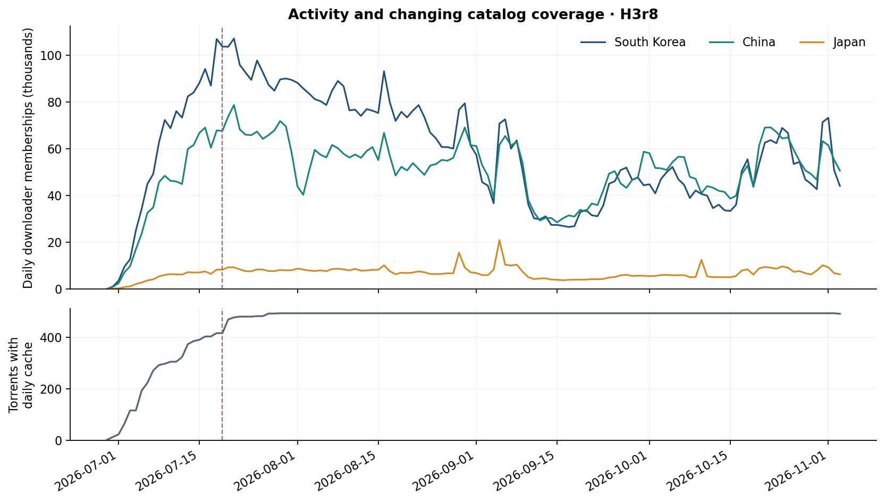
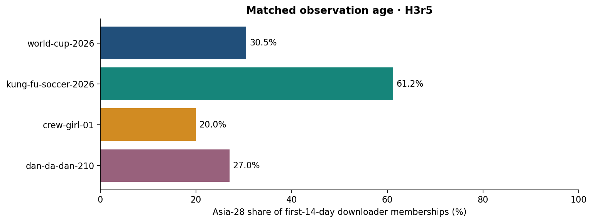

<link rel="stylesheet" href="../resources/world-cup-stage1/report.css">
<article class="wc-report" markdown="1">

<nav class="wc-nav" aria-label="World Cup reports"><a href="world-cup.html">Overview</a><a href="world-cup-swarm-media.html">Formats and resolution</a><a href="world-cup-languages.html">Audio and subtitles</a><a href="world-cup-distro-en-es-fr.html">Language and geography</a><a href="world-cup-distro-usa-mex.html">North America and matches</a><a href="world-cup-ott-vendors.html">Broadcasters and services</a><a href="world-cup-asia-28.html" aria-current="page">Asia-28 and China</a><a href="world-cup-2027-thoughts.html">Preparing for 2027</a></nav>

World Cup 2026 · Stage one · November 6, 2026

# Asia-28, China, and the long distribution tail

South Korea and China lead observed Asia-28 distribution. Matched-age comparisons show different geographic patterns across media objects, while team-tagged files do not identify fandom.

## Largest observed distributions

**South Korea and China lead Asia-28 in retained downloader memberships**, followed by Japan. They remain the top two when hosting, VPN, proxy or mobile flags are excluded separately. This is a ranking of observed distribution, not a ranking of national fandom or per-capita popularity.

<table>
<thead><tr><th scope="col">Rank</th><th scope="col">Location</th><th scope="col">ISO code</th><th scope="col">Downloader memberships</th><th scope="col">Asia-28 D share</th><th scope="col">Uploader memberships</th></tr></thead>
<tbody>
<tr><td>1</td><td>South Korea</td><td>KOR</td><td>6,360,863</td><td>46.5%</td><td>2,908</td></tr>
<tr><td>2</td><td>China</td><td>CHN</td><td>4,768,612</td><td>34.8%</td><td>49,626</td></tr>
<tr><td>3</td><td>Japan</td><td>JPN</td><td>779,835</td><td>5.7%</td><td>3,480</td></tr>
<tr><td>4</td><td>Taiwan</td><td>TWN</td><td>328,306</td><td>2.4%</td><td>1,783</td></tr>
<tr><td>5</td><td>Hong Kong</td><td>HKG</td><td>290,091</td><td>2.1%</td><td>3,233</td></tr>
<tr><td>6</td><td>India</td><td>IND</td><td>242,333</td><td>1.8%</td><td>11,222</td></tr>
<tr><td>7</td><td>Pakistan</td><td>PAK</td><td>231,838</td><td>1.7%</td><td>721</td></tr>
<tr><td>8</td><td>Singapore</td><td>SGP</td><td>144,829</td><td>1.1%</td><td>3,144</td></tr>
<tr><td>9</td><td>Thailand</td><td>THA</td><td>132,421</td><td>1.0%</td><td>3,567</td></tr>
<tr><td>10</td><td>Malaysia</td><td>MYS</td><td>106,388</td><td>0.8%</td><td>1,204</td></tr>
<tr><td>11</td><td>Philippines</td><td>PHL</td><td>91,201</td><td>0.7%</td><td>1,194</td></tr>
<tr><td>12</td><td>Vietnam</td><td>VNM</td><td>64,889</td><td>0.5%</td><td>1,249</td></tr>
<tr><td>13</td><td>Indonesia</td><td>IDN</td><td>60,522</td><td>0.4%</td><td>1,891</td></tr>
<tr><td>14</td><td>Bangladesh</td><td>BGD</td><td>23,648</td><td>0.2%</td><td>2,428</td></tr>
<tr><td>15</td><td>Mongolia</td><td>MNG</td><td>22,862</td><td>0.2%</td><td>101</td></tr>
<tr><td>16</td><td>Macao</td><td>MAC</td><td>13,594</td><td>0.1%</td><td>306</td></tr>
<tr><td>17</td><td>Iran</td><td>IRN</td><td>8,548</td><td>0.1%</td><td>412</td></tr>
<tr><td>18</td><td>Cambodia</td><td>KHM</td><td>5,525</td><td>0.0%</td><td>363</td></tr>
<tr><td>19</td><td>Nepal</td><td>NPL</td><td>3,865</td><td>0.0%</td><td>469</td></tr>
<tr><td>20</td><td>Sri Lanka</td><td>LKA</td><td>3,183</td><td>0.0%</td><td>182</td></tr>
<tr><td>21</td><td>Maldives</td><td>MDV</td><td>2,809</td><td>0.0%</td><td>56</td></tr>
<tr><td>22</td><td>Myanmar</td><td>MMR</td><td>2,359</td><td>0.0%</td><td>72</td></tr>
<tr><td>23</td><td>Laos</td><td>LAO</td><td>1,426</td><td>0.0%</td><td>52</td></tr>
<tr><td>24</td><td>Brunei</td><td>BRN</td><td>671</td><td>0.0%</td><td>17</td></tr>
<tr><td>25</td><td>Afghanistan</td><td>AFG</td><td>579</td><td>0.0%</td><td>13</td></tr>
<tr><td>26</td><td>Bhutan</td><td>BTN</td><td>481</td><td>0.0%</td><td>2</td></tr>
<tr><td>27</td><td>Timor-Leste</td><td>TLS</td><td>37</td><td>0.0%</td><td>1</td></tr>
<tr><td>28</td><td>North Korea</td><td>PRK</td><td>0</td><td>0.0%</td><td>0</td></tr>
</tbody></table>

Asia-28 uses the repository's fixed 28-code definition. Macao (`MAC`) and Taiwan (`TWN`) each appear once. Its geographic membership is an analytical convention, not a statement about political status.

## Timing, duration, and coverage

<figure><a href="../resources/world-cup-stage1/asia-activity-coverage.svg"><picture></picture></a><figcaption>The dashed line marks the July 19 final. Catalog coverage grows from two torrents on June 29 to 416 on July 19. Memberships are counted anew each day; the lower panel shows availability coverage, not viewer counts. <a href="../resources/world-cup-stage1/asia-activity-coverage.svg">Open full-size chart (SVG)</a>.</figcaption></figure>

<table>
<thead><tr><th scope="col">Location</th><th scope="col">Peak observed date</th><th scope="col">Peak daily D</th><th scope="col">Daily mass after final</th><th scope="col">Days with retained D</th></tr></thead>
<tbody>
<tr><td>South Korea</td><td>2026-07-21</td><td>107,171</td><td>84.5%</td><td>127</td></tr>
<tr><td>China</td><td>2026-07-21</td><td>78,727</td><td>87.4%</td><td>127</td></tr>
<tr><td>Japan</td><td>2026-09-05</td><td>20,847</td><td>88.8%</td><td>127</td></tr>
<tr><td>Taiwan</td><td>2026-09-05</td><td>4,832</td><td>88.2%</td><td>127</td></tr>
</tbody></table>

Across Asia-28, **86.1% of summed daily downloader memberships occur after the final**. That period lasts 107 of the 128 sampled dates and includes a much larger torrent catalog. It is evidence of a long observed distribution tail, not proof that demand rose after the event. Country peak dates may reflect discovery, network infrastructure, repeated peers or changing version supply.

## Urban and rural interpretation

IPinfo often assigns many addresses to a city center. A fine H3 grid cannot turn those centroids into a defensible urban–rural split. No such population split is claimed here. The following is **concentration in labeled IPinfo locations**, which should be checked against hosting flags and geographic uncertainty before any urban interpretation.

<table>
<thead><tr><th scope="col">Country</th><th scope="col">IPinfo city</th><th scope="col">D</th><th scope="col">Country share</th><th scope="col">Hosting flagged</th></tr></thead>
<tbody>
<tr><td>South Korea</td><td>Seoul</td><td>2,318,205</td><td>36.4%</td><td>3.5%</td></tr>
<tr><td>South Korea</td><td>Incheon</td><td>565,614</td><td>8.9%</td><td>1.4%</td></tr>
<tr><td>South Korea</td><td>Busan</td><td>257,856</td><td>4.1%</td><td>0.1%</td></tr>
<tr><td>China</td><td>Nanjing</td><td>1,064,350</td><td>22.3%</td><td>0.1%</td></tr>
<tr><td>China</td><td>Shanghai</td><td>881,917</td><td>18.5%</td><td>19.9%</td></tr>
<tr><td>China</td><td>Hangzhou</td><td>790,537</td><td>16.6%</td><td>0.9%</td></tr>
<tr><td>Japan</td><td>Tokyo</td><td>205,902</td><td>26.4%</td><td>19.2%</td></tr>
<tr><td>Japan</td><td>Osaka</td><td>78,714</td><td>10.1%</td><td>17.5%</td></tr>
<tr><td>Japan</td><td>Yokohama</td><td>58,207</td><td>7.5%</td><td>0.8%</td></tr>
</tbody></table>

## Compare the first 14 observed days

All four objects are compared at **H3r5**, with the same recorded IPinfo location database epoch and minimum of three downloaders. The primary measure sums each object's first 14 daily intervals: **IP–torrent–day memberships**, not 14-day unique people or unique peers. Full collection lengths differ, so their cumulative totals are not the primary comparison.

<table>
<thead><tr><th scope="col">Object</th><th scope="col">Observation dates</th><th scope="col">Active torrents</th><th scope="col">World D-days</th><th scope="col">Asia-28 D-days</th><th scope="col">Asia-28 share</th></tr></thead>
<tbody>
<tr><td>world-cup-2026</td><td>2026-06-29 to 2026-07-12</td><td>323</td><td>3,474,174</td><td>1,059,971</td><td>30.5%</td></tr>
<tr><td>kung-fu-soccer-2026</td><td>2026-10-03 to 2026-10-16</td><td>34</td><td>732,951</td><td>448,725</td><td>61.2%</td></tr>
<tr><td>crew-girl-01</td><td>2026-09-10 to 2026-09-23</td><td>195</td><td>1,454,905</td><td>290,505</td><td>20.0%</td></tr>
<tr><td>dan-da-dan-210</td><td>2025-09-04 to 2025-09-17</td><td>164</td><td>1,932,896</td><td>521,871</td><td>27.0%</td></tr>
</tbody></table>

<figure><a href="../resources/world-cup-stage1/asia-cohort-comparison.svg"><picture></picture></a><figcaption>The comparison controls observation age and grid resolution. Different release types, collection dates, discovery practices and active torrent supplies remain confounders. <a href="../resources/world-cup-stage1/asia-cohort-comparison.svg">Open full-size chart (SVG)</a>.</figcaption></figure>
Kung Fu Soccer has the largest Asia-28 share at 61.2%, compared with 30.5% for the World Cup. Its regional activity is heavily concentrated in China. The World Cup has a larger South Korean contribution. These are differences between the sampled media objects, not estimates of comparative fan populations.

The historical Dan Da Dan headers do not record a selection-policy label. An explicit check of its first 14 daily products found all 47,218 serialized cells at or above three downloaders, including 14,760 cells with zero uploaders, consistent with the downloader threshold used here. The underlying historical sample was not regenerated in this task.

## China, Haaland, and Japan-related matches

NBC's July 9 report describes Haaland's Chinese social-media following and the nickname “Ha Bao,” translated as “Baby Ha.” This provides context for a hypothesis about player-centered interest; it does not establish an effect on torrent distribution. [NBC News reporting](https://www.nbcbayarea.com/world-cup/soccer-fans-china-rooting-norway-erling-haaland-ha-bao/4111229/)

<table>
<thead><tr><th scope="col">Cohort</th><th scope="col">Torrents</th><th scope="col">China D</th><th scope="col">China share of world D</th><th scope="col">China U</th></tr></thead>
<tbody>
<tr><td>All torrents</td><td>493</td><td>4,741,759</td><td>9.06%</td><td>49,490</td></tr>
<tr><td>Norway-tagged eligible match torrents</td><td>38</td><td>414,482</td><td>8.93%</td><td>3,549</td></tr>
<tr><td>Japan-tagged eligible match torrents</td><td>4</td><td>20,972</td><td>8.74%</td><td>324</td></tr>
</tbody></table>

China's downloader share is **8.93% for Norway-tagged matches**, versus **9.06% across all torrents** under the same per-torrent filtering. That does not show an elevated China share in this comparison, and it does not disprove Haaland fandom. Match timing, torrent supply and source differences remain uncontrolled.

The Japan-tagged cohort has four torrents, all for **Brazil–Japan in the Round of 32**. Its 20,972 China-located downloader memberships demonstrate circulation of that match's files. They do not reveal whether peers favored Japan, Brazil, a player, or neither. Four versions of one match are not four independent observations of fandom.

## Supported findings and next tests

1. **Descriptive finding:** South Korea leads this Asia-28 distribution and China is second; the ordering survives each separate network exclusion examined.
2. **Descriptive finding:** the collection has a long post-final tail, accompanied by substantial catalog growth. Compare fixed torrent cohorts and equal post-discovery windows to separate those effects.
3. **Inference limit:** neither the Norway nor Japan comparison identifies a causal fandom or meme effect. A stronger test needs match-level cohorts, comparable opponents and stages, source/language controls, and uncertainty clustered by match rather than by millions of dependent peer observations. No population significance claim is made from these data.

Sources, downloads, and counting rules

[Asia-28 and temporal CSV](../data/world-cup-stage1/daily-country-memberships.csv) · [Cohort comparisons](../data/world-cup-stage1/supplement.json) · [Daily catalog coverage](../data/world-cup-stage1/daily-catalog-coverage.json) · [Region definition](../data/world-cup-stage1/region-ranking-definitions.json)

All content joins use the [shared inventory](../data/world-cup-stage1/torrent-inventory.json.gz): **493 canonical BTIHA**, with verified hybrid-hash aliases. Alpha60 sampling began **June 29, 2026 — Round of 32**, and ends November 3 in this snapshot. Earlier-event media found later does not establish earlier sampling.

Geographic counts are **IP–torrent memberships**, with an IP counted once per canonical torrent and role within the stated interval. They are not unique people, viewing choices, completed downloads, transferred bytes, or ratings. An address can occur in both roles. Daily sums count the same membership again on another day.

Main geography uses **IPinfo and H3 resolution 8**, the highest resolution used here. The native minimum is **three downloaders per cell**; uploaders are retained only where that downloader threshold passes. Content comparisons filter each torrent separately. Overall country and city comparisons filter after aggregating torrents, so their totals differ. Country and city labels are representative locations within cells, and the finer grid does not improve IPinfo accuracy. Hosting, VPN, proxy and mobile flags overlap; each sensitivity exclusion is applied separately.

See the [H3r8 manifest](../H3r8/manifest.json), [generation and validation evidence](../data/world-cup-stage1/validation-summary.json), [complete analytical reductions](../data/world-cup-stage1/analysis.json.gz), and [methods and coverage](world-cup.html#methods). Source hashes make the published snapshot inspectable.

</article>
