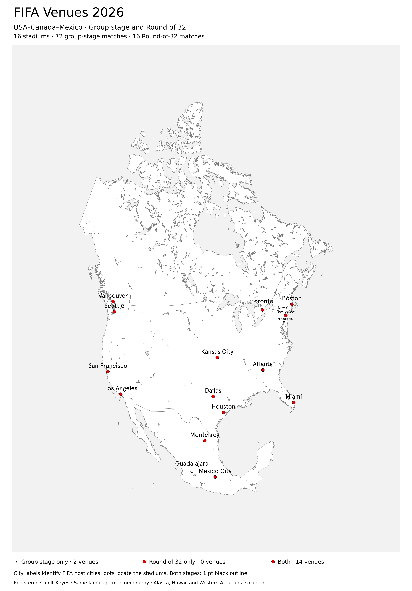
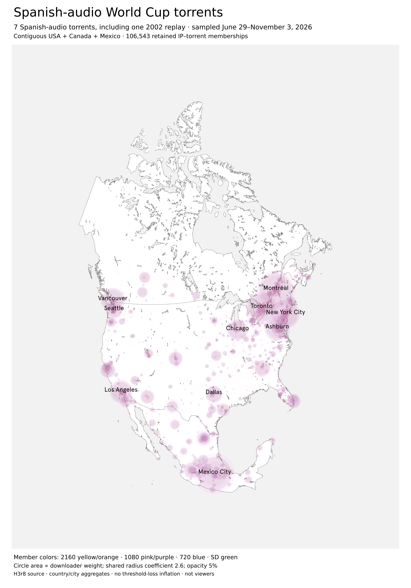
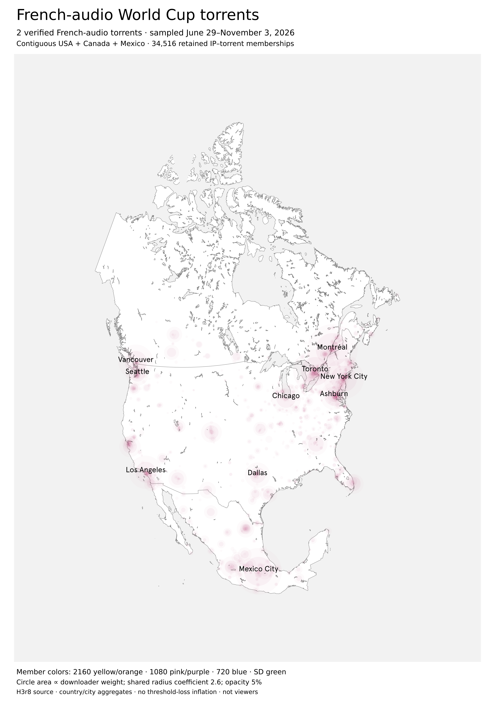
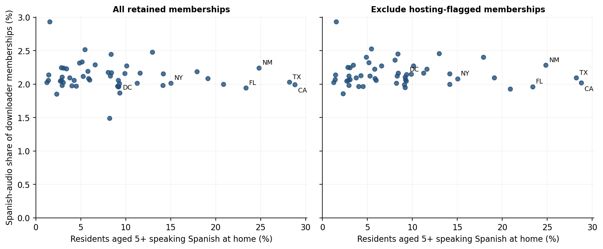

<link rel="stylesheet" href="../resources/world-cup-stage1/report.css">
<article class="wc-report" markdown="1">

<nav class="wc-nav" aria-label="World Cup reports"><a href="world-cup.html">Overview</a><a href="world-cup-swarm-media.html">Formats and resolution</a><a href="world-cup-languages.html">Audio and subtitles</a><a href="world-cup-distro-en-es-fr.html" aria-current="page">Language and geography</a><a href="world-cup-distro-usa-mex.html">North America and matches</a><a href="world-cup-ott-vendors.html">Broadcasters and services</a><a href="world-cup-asia-28.html">Asia-28 and China</a><a href="world-cup-southern.html">Latin America and South America</a><a href="world-cup-2027-thoughts.html">Preparing for 2027</a></nav>

World Cup 2026 · Stage one · November 6, 2026

# Language and North American geography

English-audio files circulate in Mexico. The seven identified Spanish-audio torrents do not support a stable positive geographic association with Spanish-speaking or Hispanic populations.

<!-- BEGIN world-cup-venues -->

## FIFA Venues 2026

All sixteen stadiums that hosted group-stage or Round-of-32 matches, on the
same USA–Canada–Mexico map as the language plates below. Alaska, Hawaii and
the Western Aleutians are excluded. City names are centered above the stadium dots.

<figure data-venue-map="fifa-venues-2026"><figcaption>Black: group stage only. Larger red: Round of 32 only. Larger red with a 1 pt black outline: both. Guadalajara and Philadelphia hosted only the group stage; the other fourteen venues hosted both. There are no Round-of-32-only venues. <a href="../resources/world-cup-venues/fifa-venues-2026.svg">Full-size SVG</a> · <a href="../resources/world-cup-venues/fifa-venues-2026.png">PNG</a> · <a href="../resources/world-cup-venues/fifa-venues-2026.webp">WebP</a>.</figcaption></figure>

<!-- END world-cup-venues -->

<!-- BEGIN world-cup-language-maps -->

## Spanish- and French-audio maps

USA, Canada and Mexico, excluding Alaska, Hawaii and the Western Aleutians.
These plates select verified audio tracks and cover June 29–November 3, 2026.
Circle area shows retained downloader IP–torrent memberships, including hosting
networks; it does not measure viewers or which audio track was played.

### Spanish audio

<figure data-language-map="spanish-north-america"><figcaption>Seven torrents, including the historical 2002 Spain–South Korea replay. 106,543 memberships: USA 56,568, Canada 28,283, Mexico 21,692. <a href="../resources/world-cup-language-maps/spanish-north-america.svg">Full-size SVG</a> · <a href="../resources/world-cup-language-maps/spanish-north-america.png">PNG</a> · <a href="../data/world-cup-language-maps/spanish-north-america-cities.csv">City counts</a> · <a href="../data/world-cup-language-maps/spanish-north-america.geojson.gz">Selected geography</a></figcaption></figure>

### French audio

<figure data-language-map="french-north-america"><figcaption>Two verified French-audio torrents: South Africa–Canada and France–Sweden, both with M6 branding. 34,516 memberships: USA 18,513, Canada 9,467, Mexico 6,536. <a href="../resources/world-cup-language-maps/french-north-america.svg">Full-size SVG</a> · <a href="../resources/world-cup-language-maps/french-north-america.png">PNG</a> · <a href="../data/world-cup-language-maps/french-north-america-cities.csv">City counts</a> · <a href="../data/world-cup-language-maps/french-north-america.geojson.gz">Selected geography</a></figcaption></figure>

The maps use the native Cahill–Keyes projection and country/city aggregates
of H3r8 cells retained at a minimum of three downloaders per torrent. Suppressed
cells are not restored. The country table below retains full national coverage,
including Alaska and Hawaii in its U.S. totals.
[Torrent names, selection and source hashes](../data/world-cup-language-maps/manifest.json) ·
[Map verification](../data/world-cup-language-maps/verification.json).

<!-- END world-cup-language-maps -->

## Where identified languages circulate

**English-audio torrents are observed in Mexico**, with 384,652 retained downloader memberships. This establishes distribution of files containing English audio; it cannot establish whether anyone listened to that track, spoke English, or watched the match.

<table>
<caption>D = retained IP–torrent downloader memberships; per-torrent H3r8 threshold</caption>
<thead><tr><th scope="col">Country</th><th scope="col">All torrents: D</th><th scope="col">EN: D</th><th scope="col">EN share</th><th scope="col">ES: D</th><th scope="col">ES share</th><th scope="col">FR: D</th><th scope="col">FR share</th></tr></thead>
<tbody>
<tr><td>United States</td><td>2,881,163</td><td>1,092,583</td><td>37.9%</td><td>56,672</td><td>2.0%</td><td>18,553</td><td>0.6%</td></tr>
<tr><td>Mexico</td><td>1,023,951</td><td>384,652</td><td>37.6%</td><td>21,692</td><td>2.1%</td><td>6,536</td><td>0.6%</td></tr>
<tr><td>Canada</td><td>1,410,387</td><td>526,678</td><td>37.3%</td><td>28,283</td><td>2.0%</td><td>9,467</td><td>0.7%</td></tr>
<tr><td>Spain</td><td>1,533,258</td><td>569,327</td><td>37.1%</td><td>31,943</td><td>2.1%</td><td>9,623</td><td>0.6%</td></tr>
<tr><td>Argentina</td><td>413,361</td><td>155,806</td><td>37.7%</td><td>8,875</td><td>2.1%</td><td>2,452</td><td>0.6%</td></tr>
<tr><td>Colombia</td><td>165,975</td><td>62,597</td><td>37.7%</td><td>3,575</td><td>2.2%</td><td>974</td><td>0.6%</td></tr>
<tr><td>France</td><td>2,102,681</td><td>777,139</td><td>37.0%</td><td>42,334</td><td>2.0%</td><td>13,016</td><td>0.6%</td></tr>
</tbody></table>

Spanish-audio share is 2.1% in Mexico, 2.1% in Spain, and 2.1% in Argentina, versus 2.0% in the USA and Canada. These differences are small compared with the coverage limitation: **only seven Spanish-audio torrents and two French-audio torrents are identified**. Unknown-language torrents remain in each country's denominator. The categories overlap because one torrent may contain several languages.

## Does Spanish-audio distribution track US language or ethnicity?

We joined IPinfo's GeoNames city identifiers to its state fields, then compared state aggregates with **2024 ACS one-year estimates**. Language is Spanish spoken at home among residents aged five or older (`C16001`); ethnicity is Hispanic or Latino origin among residents of all ages (`B03003`). The two measures are analyzed separately. These are ecological comparisons across 50 states and DC, not classifications of peers. [ACS tables and documentation](https://www.census.gov/programs-surveys/acs/data/summary-file.2024.html)

<table>
<thead><tr><th scope="col">Excluded network flag</th><th scope="col">Census measure</th><th scope="col">Spearman rho</th><th scope="col">Leave-one-Spanish-torrent-out range</th></tr></thead>
<tbody>
<tr><td>none</td><td>Spanish at home</td><td>-0.117</td><td>-0.238 to 0.079</td></tr>
<tr><td>none</td><td>Hispanic / Latino origin</td><td>-0.132</td><td>-0.265 to 0.047</td></tr>
<tr><td>hosting</td><td>Spanish at home</td><td>0.010</td><td>-0.118 to 0.102</td></tr>
<tr><td>hosting</td><td>Hispanic / Latino origin</td><td>-0.007</td><td>-0.149 to 0.073</td></tr>
<tr><td>vpn</td><td>Spanish at home</td><td>-0.025</td><td>-0.153 to 0.082</td></tr>
<tr><td>vpn</td><td>Hispanic / Latino origin</td><td>-0.042</td><td>-0.178 to 0.055</td></tr>
<tr><td>proxy</td><td>Spanish at home</td><td>-0.112</td><td>-0.237 to 0.084</td></tr>
<tr><td>proxy</td><td>Hispanic / Latino origin</td><td>-0.127</td><td>-0.264 to 0.051</td></tr>
<tr><td>mobile</td><td>Spanish at home</td><td>-0.083</td><td>-0.227 to 0.117</td></tr>
<tr><td>mobile</td><td>Hispanic / Latino origin</td><td>-0.114</td><td>-0.270 to 0.071</td></tr>
</tbody></table>

<figure><a href="../resources/world-cup-stage1/spanish-state-census.svg"><picture><source media="(max-width: 700px)" srcset="../resources/world-cup-stage1/spanish-state-census-mobile.png"></picture></a><figcaption>Each point is a state or DC. Census language measures describe residents; torrent shares describe observed distribution. ACS uncertainty and shared matches among torrent versions prevent an independence-based significance claim. <a href="../resources/world-cup-stage1/spanish-state-census.svg">Open full-size chart (SVG)</a>.</figcaption></figure>
The association is **not a stable positive one**: the unfiltered network comparison has rho −0.118 for Spanish at home and −0.132 for Hispanic origin. Removing hosting flags moves both close to zero. Omitting one of the seven Spanish-tagged torrents can change the sign. These are descriptive sensitivity results, not confidence intervals or a population hypothesis test. ACS margins of error are retained in the downloadable data but are not propagated into these coefficients.

## Canada and Mexico require different demographic definitions

Quebec accounts for **38.6% of Canadian French-audio memberships**, compared with **38.5% of all Canadian memberships**. This sample offers little French-specific geographic concentration. In Canada's 2021 census, French alone is the language most often spoken at home for 77.5% of Quebec's population under the table's undistributed multiple-response definition. That resident measure is not the same denominator as Quebec's share of Canadian torrent memberships. [Statistics Canada, table 15-10-0033-01](https://www150.statcan.gc.ca/t1/tbl1/en/tv.action?pid=1510003301)

The Canadian table groups non-official languages and does not supply a Spanish-only provincial comparison here. US Hispanic-origin categories are not transferred to Canada or Mexico. No quantitative claim about a “high Latino population” area outside the USA is made without a compatible local measure.

<!-- BEGIN world-cup-venue-swarms -->

## CAN-MEX-USA Venues and Downloaders

**Fifteen of the sixteen venue metros have more observed downloader memberships
per resident than their country; nine have more uploader memberships per
resident.** This all-network comparison covers June 29–November 3, 2026 and
all 493 torrents, without a language or hosted-match filter. Houston is below
the U.S. downloader baseline at **0.66×**; Philadelphia is close to it at **1.04×**.

Each stadium is assigned to its official surrounding metropolitan area.
The rate is retained IP–torrent memberships per **100,000 residents**, divided
by the same country's rate. **1.0× is the national baseline.** These are
memberships accumulated across torrents, not unique residents or the percentage
of people downloading; a higher rate does not establish an effect of hosting matches.

<link rel="stylesheet" href="../resources/world-cup-izzi.css">
<link rel="stylesheet" href="../resources/world-cup-venue-swarms/venue-swarms.css">
<section id="venue-swarm-explorer" markdown="1" data-analysis="../data/world-cup-venue-swarms/analysis.json" data-assets="../resources/world-cup-venue-swarms/">

<label>Swarm role <select id="venue-swarm-role"><option value="downloaders">Downloaders</option><option value="uploaders">Uploaders</option></select></label><label>Network selection <select id="venue-swarm-network"><option value="all">All retained memberships</option><option value="exclude-hosting">Exclude hosting flags</option><option value="exclude-vpn">Exclude VPN flags</option></select></label>

Downloaders · all retained memberships. The same network selection applies to the metro and its country.

<figure class="wc-izzi-figure">

<figcaption id="venue-swarm-caption">Country-grouped venue metros. Bar length shows the population-normalized rate divided by the national rate; the dashed line marks 1.0×. The linear scale adjusts to the selected view. Values are printed on the bars and in the table. On small screens, scroll the chart and tables sideways. <a id="venue-swarm-svg" href="../resources/world-cup-venue-swarms/downloaders-all.svg">Full-size SVG</a>.</figcaption></figure>

<table id="venue-swarm-table"><caption>Venue metros · all networks · June 29–November 3, 2026</caption><thead><tr><th scope="col">Country</th><th scope="col">Venue host city</th><th scope="col">Metro residents</th><th scope="col">Downloaders</th><th scope="col">Uploaders</th><th scope="col">Downloaders per 100,000</th><th scope="col">Downloader rate / country</th></tr></thead><tbody><tr><td>CAN</td><td>Toronto</td><td>7,108,874</td><td>371,501</td><td>7,483</td><td>5,225.9</td><td>1.43×</td></tr><tr><td>CAN</td><td>Vancouver</td><td>3,088,036</td><td>189,390</td><td>3,491</td><td>6,133.0</td><td>1.68×</td></tr><tr><td>MEX</td><td>Guadalajara</td><td>5,110,617</td><td>90,895</td><td>140</td><td>1,778.6</td><td>2.11×</td></tr><tr><td>MEX</td><td>Mexico City</td><td>21,436,911</td><td>338,366</td><td>1,451</td><td>1,578.4</td><td>1.87×</td></tr><tr><td>MEX</td><td>Monterrey</td><td>5,322,117</td><td>101,256</td><td>334</td><td>1,902.6</td><td>2.26×</td></tr><tr><td>USA</td><td>Atlanta</td><td>6,482,182</td><td>93,600</td><td>1,804</td><td>1,444.0</td><td>1.33×</td></tr><tr><td>USA</td><td>Boston</td><td>5,034,221</td><td>65,668</td><td>1,413</td><td>1,304.4</td><td>1.20×</td></tr><tr><td>USA</td><td>Dallas</td><td>8,477,157</td><td>136,369</td><td>2,960</td><td>1,608.7</td><td>1.48×</td></tr><tr><td>USA</td><td>Houston</td><td>7,904,627</td><td>56,741</td><td>1,056</td><td>717.8</td><td>0.66×</td></tr><tr><td>USA</td><td>Kansas City</td><td>2,270,682</td><td>37,839</td><td>867</td><td>1,666.4</td><td>1.53×</td></tr><tr><td>USA</td><td>Los Angeles</td><td>12,844,441</td><td>225,568</td><td>8,654</td><td>1,756.2</td><td>1.61×</td></tr><tr><td>USA</td><td>Miami</td><td>6,391,072</td><td>123,824</td><td>3,045</td><td>1,937.5</td><td>1.78×</td></tr><tr><td>USA</td><td>New York New Jersey</td><td>20,112,448</td><td>406,594</td><td>6,661</td><td>2,021.6</td><td>1.86×</td></tr><tr><td>USA</td><td>Philadelphia</td><td>6,329,118</td><td>71,833</td><td>431</td><td>1,135.0</td><td>1.04×</td></tr><tr><td>USA</td><td>San Francisco <small>San Jose metro</small></td><td>1,984,473</td><td>94,055</td><td>8,171</td><td>4,739.5</td><td>4.36×</td></tr><tr><td>USA</td><td>Seattle</td><td>4,161,883</td><td>124,482</td><td>2,584</td><td>2,991.0</td><td>2.75×</td></tr></tbody></table>

Population dates: July 2025 for Canada and the USA; the 2020 census for Mexico. Both metro and country denominators use the same vintage within each country. Mexico's figures are a comparison against its 2020 population distribution, not an estimate of its 2026 per-capita rate.

### Read the venue geography carefully

The **San Francisco venue is in Santa Clara**, inside the **San Jose–Sunnyvale–Santa Clara**
metro. That metro has the largest all-network indices: **4.36× for downloaders
and 11.29× for uploaders**. Its San Jose city label accounts for **7,502 of
8,171 uploader memberships (91.8%)**. This concentration in mapped network
locations does not identify stadium users or establish that the peers reside there.

Network sensitivity can change an above/below-country result. **Atlanta's
downloader index falls from 1.33× to 0.90× when hosting flags are excluded**
from both the metro and national counts. Uploader comparisons can also rise
when the national denominator falls faster than the local one. Excluding a
flag does not establish residential traffic, and hosting and VPN flags are
tested separately because they overlap.

### National baselines

<table id="venue-national-table"><caption>National baselines · all networks · same retained geography as the venue counts</caption><thead><tr><th scope="col">Country</th><th scope="col">Population date</th><th scope="col">Residents</th><th scope="col">Downloaders</th><th scope="col">Uploaders</th><th scope="col">D per 100,000</th><th scope="col">U per 100,000</th></tr></thead><tbody><tr><td>CAN</td><td>2025-07-01</td><td>41,651,653</td><td>1,522,492</td><td>19,782</td><td>3,655.3</td><td>47.5</td></tr><tr><td>MEX</td><td>2020-03-15</td><td>126,014,024</td><td>1,061,746</td><td>3,711</td><td>842.6</td><td>2.9</td></tr><tr><td>USA</td><td>2025-07-01</td><td>341,784,857</td><td>3,718,099</td><td>124,603</td><td>1,087.8</td><td>36.5</td></tr></tbody></table>

### Three complementary approaches

1. **Uploader-to-downloader balance.** Compare uploader memberships per 100
   downloader memberships locally and nationally. The San Jose metro has
   **8.69 versus 3.35 nationally** in the all-network view. This is a role
   balance, not upload bandwidth or individual sharing behavior.
2. **Hosting and VPN sensitivity.** Use the network selector above to check
   whether the comparison survives each exclusion. The calculations keep
   the local and national filters aligned.
3. **Similarly sized non-host metros.** A useful next comparison would match
   venue metros to non-host metros in the same country by population and
   internet access. That would help distinguish venue-specific patterns
   from the broader concentration of swarm activity in cities. It has not
   been estimated here; the sample also lacks a pre-tournament baseline for
   a causal hosting claim.

<a href="#venue-swarm-sources">Sources, downloads, boundaries and counting rules</a>.

</section>

<!-- END world-cup-venue-swarms -->

## Findings and improvements

1. **Language-bearing files cross national language boundaries.** English-tagged files circulate in Mexico; this does not reveal listening behavior.
2. **Spanish-specific regional enrichment is weak in the identified sample.** Country shares cluster near 2.0%, and the state association is sensitive to network flags and individual torrents.
3. **French supply is too sparse for strong market conclusions.** Two identified torrents cannot represent the Canadian or French-language broadcast market.
4. **Prioritize better supply coverage and match controls.** Probe every file and every audio/subtitle track, deliberately monitor Spanish and French release sources, record discovery time, and compare versions of the same match over the same observation age. Add compatible Canadian Spanish-language and Mexican language measures before extending the demographic analysis.

Sources, downloads, and counting rules

<!-- BEGIN world-cup-venue-swarm-sources -->

### Venue metro population comparison

[All venue/role/network comparisons (CSV)](../data/world-cup-venue-swarms/venue-comparisons.csv) ·
[National baselines (CSV)](../data/world-cup-venue-swarms/national-baselines.csv) ·
[Population denominators (CSV)](../data/world-cup-venue-swarms/population-denominators.csv) ·
[Role balance (CSV)](../data/world-cup-venue-swarms/role-balance.csv) ·
[Assigned retained points (CSV.gz)](../data/world-cup-venue-swarms/retained-point-assignments.csv.gz) ·
[Selected official metro boundaries (GeoJSON.gz)](../data/world-cup-venue-swarms/metropolitan-boundaries.geojson.gz) ·
[Complete analysis and source hashes](../data/world-cup-venue-swarms/analysis.json) ·
[Build manifest](../data/world-cup-venue-swarms/manifest.json) · [Verification](../data/world-cup-venue-swarms/verification.json)

The numerator is the [existing cumulative all-torrent H3r8 aggregate](../H3r8/world-cup-2026-cumulative-aggregate.geojson.gz),
with the native aggregate threshold of three downloader memberships. Its
country totals reconcile with the [published analysis](../data/world-cup-stage1/analysis.json.gz).
The denominator is a population count or estimate for the same geographic
unit as the numerator. Rates equal `100000 × memberships / population`;
the comparison index divides the metro rate by its own country's rate.
National totals retain full country coverage, including Alaska and Hawaii.

Geolocation points are selected by their coordinates within an official metro
polygon and by their source country code. All sixteen stadium points pass
containment checks. An independent spatial join reproduces every assignment;
no retained point belongs to two selected venue metros. City labels,
coordinates, counts and network flags in the point download are already
aggregated native products; they contain no individual IP addresses.

Population sources and geometry:

- **USA population:** Census Bureau Vintage 2025 [metro estimates](https://www2.census.gov/programs-surveys/popest/datasets/2020-2025/metro/totals/cbsa-est2025-alldata.csv) and [national estimates](https://www2.census.gov/programs-surveys/popest/datasets/2020-2025/state/totals/NST-EST2025-ALLDATA.csv), July 1, 2025. Use the metro-total rows, not county or metropolitan-division rows.
- **USA boundaries:** [TIGER/Line 2025 CBSAs](https://www2.census.gov/geo/tiger/TIGER2025/CBSA/tl_2025_us_cbsa.zip). Codes and names match the population rows. Both use the July 2023 OMB metro delineations; [population file documentation](https://www2.census.gov/programs-surveys/popest/technical-documentation/file-layouts/2020-2025/CBSA-EST2025-ALLDATA.pdf).
- **Canada population:** Statistics Canada [table 17-10-0148-01](https://www150.statcan.gc.ca/t1/tbl1/en/tv.action?pid=1710014801), [full CSV download](https://www150.statcan.gc.ca/n1/tbl/csv/17100148-eng.zip). July 1, 2025; all ages; total gender; Canada and the Toronto and Vancouver CMAs on 2021 boundaries.
- **Canada boundaries:** Statistics Canada's [2021 digital CMA boundaries](https://geo.statcan.gc.ca/geo_wa/rest/services/2021/Digital_boundary_files/MapServer/6), Toronto CMA 535 and Vancouver CMA 933. Both are contained in one province; the selected provincial-part geometries cover the complete CMAs.
- **Mexico metro population and boundaries:** CONAPO/INEGI/SEDATU [Metrópolis de México 2020](https://www.gob.mx/conapo/documentos/las-metropolis-de-mexico-2020?idiom=es), [population dataset](https://www.datos.gob.mx/dataset/metropolis_mexico_2020), and [original shapefile archive](https://conapo.segob.gob.mx/work/models/CONAPO/Datos_Abiertos/DT/Metropolis.rar). The metro polygons are unions of the same component municipalities used in the 2020 population totals; municipality identifiers and population sums reconcile exactly. The 2020 statistical definition is held fixed, including Mexico City, rather than mixing later planning boundaries with its census denominator.
- **Mexico national population:** INEGI's [2020 national census release](https://www.inegi.org.mx/contenidos/saladeprensa/boletines/2021/EstSociodemo/ResultCenso2020_Nal.pdf), 126,014,024 residents. The metro and national denominators share the March 15, 2020 census reference.

All external sources were acquired November 11, 2026. Original download hashes,
exact denominator values, source identifiers and geometry are retained in the
downloads above. Countries define metropolitan areas differently. Internet
access, urbanization, sampling coverage, IP-location accuracy and network
infrastructure remain possible explanations for the differences.

For Mexico's older population base, the analysis also records the change in a
metro's share of national population required to reach parity while holding
memberships fixed. Guadalajara's uploader index is **0.93×**: only a **7.0% decrease**
in its population share would bring it to 1.0×. That close result should not
be treated as a precise 2026 classification. No current population has been
invented or extrapolated. Hosting/VPN exclusions subtract each flagged count
separately from both local and national totals; the flags are not additive.
These exclusions preserve the original retained point universe and do not
reapply the downloader threshold after subtraction.

<!-- END world-cup-venue-swarm-sources -->

<!-- BEGIN world-cup-venue-sources -->

### FIFA venue map

[Venue roster CSV](../data/world-cup-venues/venues.csv) · [Venue GeoJSON](../data/world-cup-venues/venues.geojson) ·
[Selected fixtures CSV](../data/world-cup-venues/fixtures.csv) · [Frozen source data](../data/world-cup-venues/source-data.json) ·
[Rendering and source manifest](../data/world-cup-venues/manifest.json) · [Verification](../data/world-cup-venues/verification.json)

The venue layer contains **sixteen stadiums: eleven in the USA, two in Canada
and three in Mexico**. Its flags are derived from **72 group-stage fixtures
(match IDs 1–72) and sixteen Round-of-32 fixtures (IDs 73–88)**. Dates in the
fixture download follow FIFA's Eastern Time schedule columns. Every stadium
hosted group matches; Guadalajara and Philadelphia hosted no Round-of-32 match.
There is one point per stadium, even where a stadium hosted two Round-of-32 matches.
Dot size encodes the stage category, not attendance, match count or downloads.

Coordinates come from FIFA's stadium map data. Labels use FIFA host-city names;
the roster separately records stadium municipalities such as Foxborough,
Arlington, Inglewood, East Rutherford and Santa Clara. The native registered
Cahill–Keyes projection, viewport and country outlines match the language maps.

- [FIFA World Cup 2026 match schedule, version 31, July 16, 2026](https://digitalhub.fifa.com/m/1be9ce37eb98fcc5/original/FWC26-Match-Schedule_English.pdf). Read the PDF visually and extract 104 unique match-number spans. Assign each to its host-city row and Eastern Time date column. Select IDs 1–72 (group) and 73–88 (Round of 32).
- [FIFA official stadium addresses and maps](https://gpcustomersupportfwc2026.tickets.fifa.com/hc/en-gb/articles/28784010437021-2-What-are-the-official-addresses-stadium-capacities-and-maps-of-the-FIFA-World-Cup-2026-stadiums). Checked the 16 named stadium addresses in FIFA’s July 19, 2026 register. Preserve stadium municipalities separately from host-city labels.
- [FIFA interactive venue maps: official landing-map coordinates](https://maps.fifa.com/static/js/main.1a6d1791.js). Extract the 16 literal name, coordinates and navmap URL objects whose imageUrl contains FWC203/. Coordinates are longitude, latitude stadium locations, not geocoded city centers.
- [MLS: FIFA World Cup 2026 schedule, every game by city and stadium](https://www.mlssoccer.com/news/fifa-world-cup-2026-schedule-every-game-by-city-stadium). Independently reconcile all 16 venue stage counts and selected match dates against the league’s per-stadium schedule.

Sources checked November 11, 2026; acquired-file hashes are in the manifest.

<!-- END world-cup-venue-sources -->

[State census comparison CSV](../data/world-cup-stage1/usa-census-language.csv) · [Country memberships by torrent](../data/world-cup-stage1/torrent-country-memberships.csv) · [Census calculations and sensitivity](../data/world-cup-stage1/supplement.json)

All content joins use the [shared inventory](../data/world-cup-stage1/torrent-inventory.json.gz): **493 canonical BTIHA**, with verified hybrid-hash aliases. Alpha60 sampling began **June 29, 2026 — Round of 32**, and ends November 3 in this snapshot. Earlier-event media found later does not establish earlier sampling.

Geographic counts are **IP–torrent memberships**, with an IP counted once per canonical torrent and role within the stated interval. They are not unique people, viewing choices, completed downloads, transferred bytes, or ratings. An address can occur in both roles. Daily sums count the same membership again on another day.

Main geography uses **IPinfo and H3 resolution 8**, the highest resolution used here. The native minimum is **three downloaders per cell**; uploaders are retained only where that downloader threshold passes. Content comparisons filter each torrent separately. Overall country and city comparisons filter after aggregating torrents, so their totals differ. Country and city labels are representative locations within cells, and the finer grid does not improve IPinfo accuracy. Hosting, VPN, proxy and mobile flags overlap; each sensitivity exclusion is applied separately.

See the [H3r8 manifest](../H3r8/manifest.json), [generation and validation evidence](../data/world-cup-stage1/validation-summary.json), [complete analytical reductions](../data/world-cup-stage1/analysis.json.gz), and [methods and coverage](world-cup.html#methods). Source hashes make the published snapshot inspectable.

</article>
