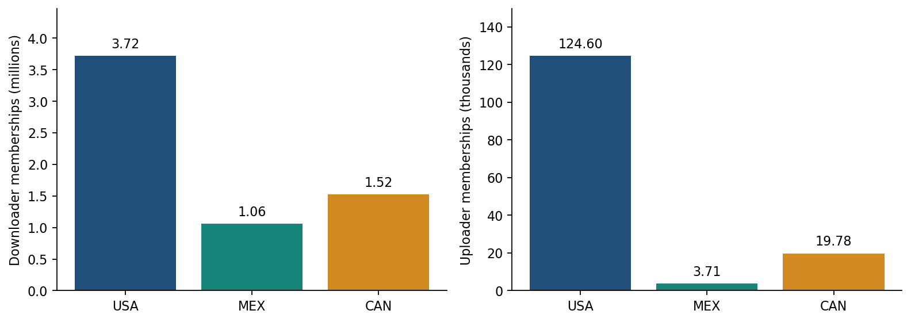

<link rel="stylesheet" href="../resources/world-cup-stage1/report.css">
<article class="wc-report" markdown="1">

<nav class="wc-nav" aria-label="World Cup reports"><a href="world-cup.html">Overview</a><a href="world-cup-swarm-media.html">Formats and resolution</a><a href="world-cup-languages.html">Audio and subtitles</a><a href="world-cup-distro-en-es-fr.html">Language and geography</a><a href="world-cup-distro-usa-mex.html" aria-current="page">North America and matches</a><a href="world-cup-ott-vendors.html">Broadcasters and services</a><a href="world-cup-asia-28.html">Asia-28 and China</a><a href="world-cup-southern.html">Latin America and South America</a><a href="world-cup-2027-thoughts.html">Preparing for 2027</a></nav>

World Cup 2026 · Stage one · November 6, 2026

# North America and two knockout matches

The USA leads the three hosts in observed memberships. Equal-age windows show different downloader and uploader patterns for USA–Belgium and Mexico–England.

## Overall observed distribution

The USA has the largest observed downloader and uploader membership totals among the three hosts. Canada exceeds Mexico on both roles in this sample. These totals describe sampled peer-to-peer distribution through November 3, including the post-tournament tail; they are not television audiences.

<table>
<thead><tr><th scope="col">Location</th><th scope="col">Downloader memberships</th><th scope="col">World share</th><th scope="col">Uploader memberships</th><th scope="col">World share</th></tr></thead>
<tbody>
<tr><td>United States</td><td>3,718,099</td><td>6.6%</td><td>124,603</td><td>23.1%</td></tr>
<tr><td>Mexico</td><td>1,061,746</td><td>1.9%</td><td>3,711</td><td>0.7%</td></tr>
<tr><td>Canada</td><td>1,522,492</td><td>2.7%</td><td>19,782</td><td>3.7%</td></tr>
<tr><td>World</td><td>56,407,686</td><td>100.0%</td><td>539,629</td><td>100.0%</td></tr>
</tbody></table>

<figure><a href="../resources/world-cup-stage1/north-america-memberships.svg"><picture><source media="(max-width: 700px)" srcset="../resources/world-cup-stage1/north-america-memberships-mobile.png"></picture></a><figcaption>Cumulative June 29–November 3; H3r8 aggregate threshold. The two panels have different units and scales. Memberships can repeat across torrents and roles. <a href="../resources/world-cup-stage1/north-america-memberships.svg">Open full-size chart (SVG)</a>.</figcaption></figure>
<!-- BEGIN network-comparison -->

## Are the host countries unusually hosting-heavy?

**High hosting shares are common across these sampled media objects. World Cup downloader shares are lower than all three comparators in the USA and Canada.** In the first 14 collection days, US hosting shares are 56.6% for World Cup, 68.2% for Crew Girl, 65.5% for Dan Da Dan, and 73.6% for Kung Fu Soccer. Canada's corresponding shares are 39.0%, 47.6%, 51.1%, and 43.9%. Mexico stays much lower, at 0.7%–5.4% across the four collections.

These comparisons align **collection observation age**, not release time, broadcast time or torrent discovery age. Each total sums daily memberships; it is not a unique 14-day population. Series, films and a tournament have different catalogs, audiences, discovery paths and observation dates. H3r8 and the same frozen IPinfo inputs are used throughout.

<table>
<caption>Observation windows and unequal catalog coverage</caption>
<thead><tr><th scope="col">Collection</th><th scope="col">First 14 observed dates</th><th scope="col">Canonical catalog</th><th scope="col">Daily cached catalog range</th><th scope="col">Scope</th></tr></thead>
<tbody>
<tr><td>World Cup</td><td>2026-06-29 to 2026-07-12</td><td>493</td><td>2–323</td><td>June 29 — Round of 32; all sampled World Cup media</td></tr>
<tr><td>Crew Girl</td><td>2026-09-10 to 2026-09-23</td><td>195</td><td>153–195</td><td>Season one; eight episodes and packs; final sample-date metainfo</td></tr>
<tr><td>Dan Da Dan</td><td>2025-09-04 to 2025-09-17</td><td>301</td><td>14–145</td><td>Season two episodes 10–12 and season packs; not the whole franchise</td></tr>
<tr><td>Kung Fu Soccer</td><td>2026-10-03 to 2026-10-16</td><td>35</td><td>12–34</td><td>Film release collection</td></tr>
</tbody></table>

### Why the full-snapshot city tables look different

The existing location rankings above and below cover June 29–November 3, and some top locations are hosting hubs. Their individual percentages should not be read as countrywide shares. The whole-country cumulative figures are:

<table>
<thead><tr><th scope="col">Country</th><th scope="col">Cumulative D</th><th scope="col">D hosting</th><th scope="col">Cumulative U</th><th scope="col">U hosting</th></tr></thead>
<tbody>
<tr><td>United States</td><td>3,718,099</td><td>33.2%</td><td>124,603</td><td>76.5%</td></tr>
<tr><td>Mexico</td><td>1,061,746</td><td>1.0%</td><td>3,711</td><td>14.0%</td></tr>
<tr><td>Canada</td><td>1,522,492</td><td>21.7%</td><td>19,782</td><td>51.8%</td></tr>
</tbody></table>

The comparisons that follow use the first 14 dates for every object. They should not be substituted for those full-snapshot totals.

### Hosting among downloaders

<figure class="wc-izzi-figure" id="north-hosting-downloaders-figure">



<figcaption>Within-country shares, first 14 collection dates; H3r8 daily aggregate memberships. Four collections share one zero-based scale. Flags can overlap. <a href="../resources/north-hosting-downloaders.svg">Open full-size izzi chart (SVG)</a>. <a href="../data/world-cup-izzi/north-hosting-downloaders.json">Chart values and rendering specification (JSON)</a>.</figcaption></figure>
### Hosting among uploaders

<figure class="wc-izzi-figure" id="north-hosting-uploaders-figure">



<figcaption>Within-country shares, first 14 collection dates; H3r8 daily aggregate memberships. Four collections share one zero-based scale. Flags can overlap. <a href="../resources/north-hosting-uploaders.svg">Open full-size izzi chart (SVG)</a>. <a href="../data/world-cup-izzi/north-hosting-uploaders.json">Chart values and rendering specification (JSON)</a>.</figcaption></figure>
US uploader shares are high in all four collections: 70.3% World Cup, 71.3% Crew Girl, 69.8% Dan Da Dan and 78.4% Kung Fu Soccer. Canada varies more: 53.7%, 38.4%, 56.3% and 30.0%. Mexico's Crew Girl uploader share is 27.9%, compared with World Cup's 10.2%, but it rests on only 362 daily memberships. Kung Fu Soccer has only 36 Mexican uploader memberships; three flagged memberships produce its 8.3% hosting share.

### VPN, mobile, satellite and the other network flags

**Dan Da Dan has the strongest VPN signal in the USA and Canada:** 51.1% and 51.2% of downloader memberships, versus World Cup's 26.0% and 27.2%. Its uploader shares are 62.4% and 61.2%. Hosting and VPN can describe the same address, so these columns cannot be added or subtracted as exclusive categories.

Canadian mobile downloader shares are similar across the collections, at 8.6%–10.0%, compared with 1.4%–3.1% in the USA and 0.3%–0.6% in Mexico. Satellite downloader flags remain below 0.6%. Uploader percentages for rare flags are sensitive to small denominators; the exact counts remain downloadable.

United States: all nine network flags and denominators

<table>
<caption>United States · downloaders · share of daily memberships</caption>
<thead><tr><th scope="col">Collection</th><th scope="col">Memberships</th><th scope="col">Hosting</th><th scope="col">VPN</th><th scope="col">Mobile</th><th scope="col">Satellite</th><th scope="col">Proxy</th><th scope="col">Relay</th><th scope="col">Tor (IPinfo)</th><th scope="col">Tor exit list</th><th scope="col">Service</th></tr></thead>
<tbody>
<tr><td>World Cup</td><td>244,369</td><td>56.60%</td><td>26.02%</td><td>2.49%</td><td>0.224%</td><td>0.024%</td><td>0.041%</td><td>0.113%</td><td>0.000%</td><td>23.918%</td></tr>
<tr><td>Crew Girl</td><td>113,352</td><td>68.17%</td><td>27.05%</td><td>1.63%</td><td>0.288%</td><td>0.011%</td><td>0.094%</td><td>0.254%</td><td>0.000%</td><td>25.309%</td></tr>
<tr><td>Dan Da Dan</td><td>199,105</td><td>65.53%</td><td>51.10%</td><td>3.08%</td><td>0.244%</td><td>0.032%</td><td>0.383%</td><td>0.095%</td><td>0.001%</td><td>49.431%</td></tr>
<tr><td>Kung Fu Soccer</td><td>22,864</td><td>73.59%</td><td>19.10%</td><td>1.45%</td><td>0.232%</td><td>0.022%</td><td>0.241%</td><td>0.127%</td><td>0.000%</td><td>17.849%</td></tr>
</tbody></table>

<table>
<caption>United States · uploaders · share of daily memberships</caption>
<thead><tr><th scope="col">Collection</th><th scope="col">Memberships</th><th scope="col">Hosting</th><th scope="col">VPN</th><th scope="col">Mobile</th><th scope="col">Satellite</th><th scope="col">Proxy</th><th scope="col">Relay</th><th scope="col">Tor (IPinfo)</th><th scope="col">Tor exit list</th><th scope="col">Service</th></tr></thead>
<tbody>
<tr><td>World Cup</td><td>19,046</td><td>70.29%</td><td>31.09%</td><td>4.39%</td><td>0.158%</td><td>0.016%</td><td>0.063%</td><td>0.032%</td><td>0.000%</td><td>28.877%</td></tr>
<tr><td>Crew Girl</td><td>15,777</td><td>71.30%</td><td>20.80%</td><td>1.12%</td><td>0.317%</td><td>0.006%</td><td>0.051%</td><td>1.230%</td><td>0.000%</td><td>19.332%</td></tr>
<tr><td>Dan Da Dan</td><td>64,379</td><td>69.78%</td><td>62.36%</td><td>2.39%</td><td>0.373%</td><td>0.005%</td><td>0.308%</td><td>0.113%</td><td>0.000%</td><td>61.559%</td></tr>
<tr><td>Kung Fu Soccer</td><td>1,016</td><td>78.44%</td><td>15.16%</td><td>0.49%</td><td>1.083%</td><td>0.000%</td><td>0.591%</td><td>0.098%</td><td>0.000%</td><td>15.157%</td></tr>
</tbody></table>

Mexico: all nine network flags and denominators

<table>
<caption>Mexico · downloaders · share of daily memberships</caption>
<thead><tr><th scope="col">Collection</th><th scope="col">Memberships</th><th scope="col">Hosting</th><th scope="col">VPN</th><th scope="col">Mobile</th><th scope="col">Satellite</th><th scope="col">Proxy</th><th scope="col">Relay</th><th scope="col">Tor (IPinfo)</th><th scope="col">Tor exit list</th><th scope="col">Service</th></tr></thead>
<tbody>
<tr><td>World Cup</td><td>39,087</td><td>2.67%</td><td>2.77%</td><td>0.36%</td><td>0.353%</td><td>0.005%</td><td>0.003%</td><td>0.000%</td><td>0.000%</td><td>2.615%</td></tr>
<tr><td>Crew Girl</td><td>23,200</td><td>1.33%</td><td>1.62%</td><td>0.28%</td><td>0.155%</td><td>0.004%</td><td>0.000%</td><td>0.000%</td><td>0.000%</td><td>1.336%</td></tr>
<tr><td>Dan Da Dan</td><td>21,172</td><td>5.42%</td><td>5.40%</td><td>0.53%</td><td>0.600%</td><td>0.000%</td><td>0.019%</td><td>0.000%</td><td>0.000%</td><td>5.026%</td></tr>
<tr><td>Kung Fu Soccer</td><td>5,839</td><td>0.74%</td><td>0.87%</td><td>0.62%</td><td>0.171%</td><td>0.000%</td><td>0.034%</td><td>0.000%</td><td>0.000%</td><td>0.736%</td></tr>
</tbody></table>

<table>
<caption>Mexico · uploaders · share of daily memberships</caption>
<thead><tr><th scope="col">Collection</th><th scope="col">Memberships</th><th scope="col">Hosting</th><th scope="col">VPN</th><th scope="col">Mobile</th><th scope="col">Satellite</th><th scope="col">Proxy</th><th scope="col">Relay</th><th scope="col">Tor (IPinfo)</th><th scope="col">Tor exit list</th><th scope="col">Service</th></tr></thead>
<tbody>
<tr><td>World Cup</td><td>1,462</td><td>10.19%</td><td>10.26%</td><td>0.89%</td><td>0.274%</td><td>0.000%</td><td>0.000%</td><td>0.000%</td><td>0.000%</td><td>9.713%</td></tr>
<tr><td>Crew Girl</td><td>362</td><td>27.90%</td><td>29.28%</td><td>2.76%</td><td>0.552%</td><td>0.000%</td><td>0.000%</td><td>0.000%</td><td>0.000%</td><td>27.901%</td></tr>
<tr><td>Dan Da Dan</td><td>4,271</td><td>8.22%</td><td>8.55%</td><td>0.54%</td><td>1.100%</td><td>0.000%</td><td>0.000%</td><td>0.000%</td><td>0.000%</td><td>8.195%</td></tr>
<tr><td>Kung Fu Soccer</td><td>36</td><td>8.33%</td><td>8.33%</td><td>8.33%</td><td>0.000%</td><td>0.000%</td><td>0.000%</td><td>0.000%</td><td>0.000%</td><td>8.333%</td></tr>
</tbody></table>

Canada: all nine network flags and denominators

<table>
<caption>Canada · downloaders · share of daily memberships</caption>
<thead><tr><th scope="col">Collection</th><th scope="col">Memberships</th><th scope="col">Hosting</th><th scope="col">VPN</th><th scope="col">Mobile</th><th scope="col">Satellite</th><th scope="col">Proxy</th><th scope="col">Relay</th><th scope="col">Tor (IPinfo)</th><th scope="col">Tor exit list</th><th scope="col">Service</th></tr></thead>
<tbody>
<tr><td>World Cup</td><td>100,224</td><td>39.02%</td><td>27.21%</td><td>8.70%</td><td>0.073%</td><td>1.022%</td><td>0.063%</td><td>0.043%</td><td>0.331%</td><td>25.809%</td></tr>
<tr><td>Crew Girl</td><td>39,446</td><td>47.58%</td><td>38.21%</td><td>8.97%</td><td>0.406%</td><td>1.468%</td><td>0.071%</td><td>0.051%</td><td>0.309%</td><td>36.610%</td></tr>
<tr><td>Dan Da Dan</td><td>69,883</td><td>51.13%</td><td>51.23%</td><td>8.60%</td><td>0.232%</td><td>1.465%</td><td>0.086%</td><td>0.074%</td><td>0.465%</td><td>49.556%</td></tr>
<tr><td>Kung Fu Soccer</td><td>7,570</td><td>43.86%</td><td>25.75%</td><td>10.03%</td><td>0.185%</td><td>1.096%</td><td>0.026%</td><td>0.079%</td><td>0.330%</td><td>24.690%</td></tr>
</tbody></table>

<table>
<caption>Canada · uploaders · share of daily memberships</caption>
<thead><tr><th scope="col">Collection</th><th scope="col">Memberships</th><th scope="col">Hosting</th><th scope="col">VPN</th><th scope="col">Mobile</th><th scope="col">Satellite</th><th scope="col">Proxy</th><th scope="col">Relay</th><th scope="col">Tor (IPinfo)</th><th scope="col">Tor exit list</th><th scope="col">Service</th></tr></thead>
<tbody>
<tr><td>World Cup</td><td>6,472</td><td>53.69%</td><td>38.27%</td><td>4.45%</td><td>0.015%</td><td>0.278%</td><td>0.077%</td><td>0.031%</td><td>1.035%</td><td>36.990%</td></tr>
<tr><td>Crew Girl</td><td>4,742</td><td>38.36%</td><td>36.04%</td><td>12.65%</td><td>1.012%</td><td>0.970%</td><td>0.021%</td><td>0.000%</td><td>0.253%</td><td>35.259%</td></tr>
<tr><td>Dan Da Dan</td><td>24,670</td><td>56.34%</td><td>61.19%</td><td>7.97%</td><td>0.373%</td><td>1.407%</td><td>0.081%</td><td>0.105%</td><td>0.815%</td><td>59.562%</td></tr>
<tr><td>Kung Fu Soccer</td><td>220</td><td>30.00%</td><td>24.55%</td><td>13.18%</td><td>0.000%</td><td>1.818%</td><td>0.000%</td><td>0.000%</td><td>0.000%</td><td>22.727%</td></tr>
</tbody></table>

### Does country mix explain the pooled result?

Pooling the three countries changes the comparison because each collection has a different country mix. Applying **World Cup's first-14-day country weights separately for each role** gives a common mixture. Uploader hosting shares then converge near 63.0% for World Cup, Dan Da Dan and Kung Fu Soccer; Crew Girl is 61.1%. Downloader differences remain. This adjustment controls country composition only.

<table>
<caption>downloaders · USA, Mexico and Canada</caption>
<thead><tr><th scope="col">Collection</th><th scope="col">Pooled hosting</th><th scope="col">Common-country-weight hosting</th></tr></thead>
<tbody>
<tr><td>World Cup</td><td>46.5%</td><td>46.5%</td></tr>
<tr><td>Crew Girl</td><td>54.7%</td><td>56.0%</td></tr>
<tr><td>Dan Da Dan</td><td>57.7%</td><td>55.6%</td></tr>
<tr><td>Kung Fu Soccer</td><td>55.7%</td><td>58.4%</td></tr>
</tbody></table>

<table>
<caption>uploaders · USA, Mexico and Canada</caption>
<thead><tr><th scope="col">Collection</th><th scope="col">Pooled hosting</th><th scope="col">Common-country-weight hosting</th></tr></thead>
<tbody>
<tr><td>World Cup</td><td>63.1%</td><td>63.1%</td></tr>
<tr><td>Crew Girl</td><td>63.1%</td><td>61.0%</td></tr>
<tr><td>Dan Da Dan</td><td>63.4%</td><td>63.2%</td></tr>
<tr><td>Kung Fu Soccer</td><td>68.1%</td><td>63.0%</td></tr>
</tbody></table>

### Observation age, calendar dates and geography sensitivity

The age-aligned daily lines show how each collection changes within its own first 14 dates. Empty country-days are omitted, not converted into a zero rate. World Cup begins with only two cached torrents, making the earliest daily percentages especially sensitive to coverage. Different calendar dates remain a limitation.

<figure class="wc-izzi-figure" id="north-hosting-by-observation-age-figure">



<figcaption>Collection age is aligned; release timing and torrent availability are not. Focus a line for exact daily values. <a href="../resources/north-hosting-by-observation-age.svg">Open full-size izzi chart (SVG)</a>. <a href="../data/world-cup-izzi/north-hosting-by-observation-age.json">Chart values and rendering specification (JSON)</a>.</figcaption></figure>

Same-calendar check: World Cup versus Crew Girl and Kung Fu Soccer

Compare September 10–23 for Crew Girl and October 3–16 for Kung Fu Soccer. This aligns calendar dates but compares late-circulating World Cup media with newly observed collections. Dan Da Dan was observed in 2025, so it has no overlapping World Cup dates.

<table>
<thead><tr><th scope="col">Comparator</th><th scope="col">Country</th><th scope="col">World Cup D hosting</th><th scope="col">Comparator D hosting</th></tr></thead>
<tbody>
<tr><td>Crew Girl</td><td>USA</td><td>50.5%</td><td>68.2%</td></tr>
<tr><td>Crew Girl</td><td>MEX</td><td>0.9%</td><td>1.3%</td></tr>
<tr><td>Crew Girl</td><td>CAN</td><td>41.3%</td><td>47.6%</td></tr>
<tr><td>Kung Fu Soccer</td><td>USA</td><td>53.7%</td><td>73.6%</td></tr>
<tr><td>Kung Fu Soccer</td><td>MEX</td><td>1.1%</td><td>0.7%</td></tr>
<tr><td>Kung Fu Soccer</td><td>CAN</td><td>39.7%</td><td>43.9%</td></tr>
</tbody></table>

H3r8 versus H3r5: the hosting comparison

The finer grid changes retained membership and approximate country assignment. The USA and Canada ordering—World Cup below all three comparator downloader shares—holds at both resolutions. H3r8 remains the primary analysis.

<table>
<thead><tr><th scope="col">Country</th><th scope="col">Collection</th><th scope="col">H3r8 hosting</th><th scope="col">H3r5 hosting</th><th scope="col">Difference (percentage points)</th></tr></thead>
<tbody>
<tr><td>USA</td><td>World Cup</td><td>56.6%</td><td>54.9%</td><td>+1.67</td></tr>
<tr><td>USA</td><td>Crew Girl</td><td>68.2%</td><td>65.9%</td><td>+2.26</td></tr>
<tr><td>USA</td><td>Dan Da Dan</td><td>65.5%</td><td>63.2%</td><td>+2.30</td></tr>
<tr><td>USA</td><td>Kung Fu Soccer</td><td>73.6%</td><td>69.8%</td><td>+3.81</td></tr>
<tr><td>MEX</td><td>World Cup</td><td>2.7%</td><td>2.7%</td><td>-0.02</td></tr>
<tr><td>MEX</td><td>Crew Girl</td><td>1.3%</td><td>1.3%</td><td>-0.00</td></tr>
<tr><td>MEX</td><td>Dan Da Dan</td><td>5.4%</td><td>5.4%</td><td>+0.04</td></tr>
<tr><td>MEX</td><td>Kung Fu Soccer</td><td>0.7%</td><td>0.7%</td><td>-0.01</td></tr>
<tr><td>CAN</td><td>World Cup</td><td>39.0%</td><td>38.9%</td><td>+0.08</td></tr>
<tr><td>CAN</td><td>Crew Girl</td><td>47.6%</td><td>47.2%</td><td>+0.41</td></tr>
<tr><td>CAN</td><td>Dan Da Dan</td><td>51.1%</td><td>51.0%</td><td>+0.13</td></tr>
<tr><td>CAN</td><td>Kung Fu Soccer</td><td>43.9%</td><td>43.0%</td><td>+0.85</td></tr>
</tbody></table>

### How much does torrent weighting matter?

The weekly check gives each retained torrent equal weight instead of allowing larger torrents to dominate. It uses **two per-torrent weekly intervals**, so its rates must be compared within this check. The US downloader hosting means become tightly grouped: 76.4% World Cup, 77.2% Crew Girl, 77.3% Dan Da Dan, and 77.0% Kung Fu Soccer. The broad difference in the primary daily comparison therefore does not establish a general sports-versus-fiction network effect. Catalog mix, weighting and filtering matter.

Weekly torrent-weighting sensitivity: downloaders

<table>
<caption>Descriptive sensitivity ranges, not confidence intervals</caption>
<thead><tr><th scope="col">Country</th><th scope="col">Collection</th><th scope="col">Active torrents</th><th scope="col">Weekly memberships</th><th scope="col">Weighted hosting</th><th scope="col">Equal-torrent hosting</th><th scope="col">Leave-one-out weighted range</th><th scope="col">Largest torrent share</th></tr></thead>
<tbody>
<tr><td>USA</td><td>World Cup</td><td>317</td><td>131,114</td><td>72.5%</td><td>76.4%</td><td>72.4%–72.6%</td><td>1.3%</td></tr>
<tr><td>USA</td><td>Crew Girl</td><td>120</td><td>62,881</td><td>78.5%</td><td>77.1%</td><td>78.4%–78.8%</td><td>3.5%</td></tr>
<tr><td>USA</td><td>Dan Da Dan</td><td>140</td><td>101,403</td><td>74.9%</td><td>77.3%</td><td>74.1%–75.8%</td><td>8.9%</td></tr>
<tr><td>USA</td><td>Kung Fu Soccer</td><td>34</td><td>13,799</td><td>76.3%</td><td>77.0%</td><td>76.0%–77.2%</td><td>7.8%</td></tr>
<tr><td>MEX</td><td>World Cup</td><td>288</td><td>25,082</td><td>3.1%</td><td>10.7%</td><td>3.1%–3.2%</td><td>1.9%</td></tr>
<tr><td>MEX</td><td>Crew Girl</td><td>91</td><td>15,884</td><td>1.0%</td><td>1.2%</td><td>1.0%–1.0%</td><td>3.6%</td></tr>
<tr><td>MEX</td><td>Dan Da Dan</td><td>122</td><td>11,934</td><td>4.6%</td><td>4.1%</td><td>4.1%–4.7%</td><td>8.2%</td></tr>
<tr><td>MEX</td><td>Kung Fu Soccer</td><td>34</td><td>4,050</td><td>1.0%</td><td>1.1%</td><td>1.0%–1.1%</td><td>7.7%</td></tr>
<tr><td>CAN</td><td>World Cup</td><td>308</td><td>67,743</td><td>43.2%</td><td>49.0%</td><td>43.1%–43.3%</td><td>1.2%</td></tr>
<tr><td>CAN</td><td>Crew Girl</td><td>106</td><td>22,890</td><td>50.2%</td><td>49.0%</td><td>50.0%–50.7%</td><td>4.2%</td></tr>
<tr><td>CAN</td><td>Dan Da Dan</td><td>140</td><td>37,729</td><td>53.4%</td><td>52.1%</td><td>52.0%–53.8%</td><td>9.9%</td></tr>
<tr><td>CAN</td><td>Kung Fu Soccer</td><td>34</td><td>5,466</td><td>44.1%</td><td>45.1%</td><td>43.8%–44.5%</td><td>5.0%</td></tr>
</tbody></table>

Weekly torrent-weighting sensitivity: uploaders

<table>
<caption>Descriptive sensitivity ranges, not confidence intervals</caption>
<thead><tr><th scope="col">Country</th><th scope="col">Collection</th><th scope="col">Active torrents</th><th scope="col">Weekly memberships</th><th scope="col">Weighted hosting</th><th scope="col">Equal-torrent hosting</th><th scope="col">Leave-one-out weighted range</th><th scope="col">Largest torrent share</th></tr></thead>
<tbody>
<tr><td>USA</td><td>World Cup</td><td>314</td><td>10,767</td><td>88.7%</td><td>84.5%</td><td>88.5%–89.1%</td><td>4.2%</td></tr>
<tr><td>USA</td><td>Crew Girl</td><td>120</td><td>8,837</td><td>86.4%</td><td>76.8%</td><td>86.2%–86.6%</td><td>4.4%</td></tr>
<tr><td>USA</td><td>Dan Da Dan</td><td>139</td><td>30,112</td><td>79.8%</td><td>84.9%</td><td>78.1%–82.7%</td><td>17.1%</td></tr>
<tr><td>USA</td><td>Kung Fu Soccer</td><td>34</td><td>748</td><td>84.5%</td><td>86.3%</td><td>84.0%–85.5%</td><td>35.4%</td></tr>
<tr><td>MEX</td><td>World Cup</td><td>109</td><td>644</td><td>17.7%</td><td>17.4%</td><td>16.6%–19.2%</td><td>13.5%</td></tr>
<tr><td>MEX</td><td>Crew Girl</td><td>43</td><td>133</td><td>3.8%</td><td>3.1%</td><td>3.1%–4.1%</td><td>16.5%</td></tr>
<tr><td>MEX</td><td>Dan Da Dan</td><td>66</td><td>2,220</td><td>8.8%</td><td>13.2%</td><td>7.3%–9.3%</td><td>17.8%</td></tr>
<tr><td>MEX</td><td>Kung Fu Soccer</td><td>7</td><td>25</td><td>12.0%</td><td>18.4%</td><td>5.6%–25.0%</td><td>52.0%</td></tr>
<tr><td>CAN</td><td>World Cup</td><td>301</td><td>3,405</td><td>63.2%</td><td>68.3%</td><td>63.0%–63.7%</td><td>3.4%</td></tr>
<tr><td>CAN</td><td>Crew Girl</td><td>100</td><td>1,871</td><td>46.7%</td><td>52.9%</td><td>46.0%–49.0%</td><td>11.4%</td></tr>
<tr><td>CAN</td><td>Dan Da Dan</td><td>130</td><td>11,239</td><td>61.5%</td><td>64.3%</td><td>58.7%–64.4%</td><td>19.3%</td></tr>
<tr><td>CAN</td><td>Kung Fu Soccer</td><td>31</td><td>159</td><td>39.6%</td><td>44.3%</td><td>38.1%–41.6%</td><td>31.4%</td></tr>
</tbody></table>

### Where hosting memberships are concentrated

The table below ranks locations by hosting-flagged memberships, separately for each country, collection and role. Location labels are IPinfo approximations. A concentration in a hosting location does not identify the people using those servers or their home country.

Largest labeled hosting location in each comparison

<table>
<thead><tr><th scope="col">Country</th><th scope="col">Collection</th><th scope="col">Role</th><th scope="col">IPinfo location</th><th scope="col">Hosting memberships</th><th scope="col">Share of country hosting</th></tr></thead>
<tbody>
<tr><td>USA</td><td>World Cup</td><td>downloaders</td><td>Los Angeles</td><td>18,271</td><td>13.2%</td></tr>
<tr><td>USA</td><td>World Cup</td><td>uploaders</td><td>Ashburn</td><td>4,566</td><td>34.1%</td></tr>
<tr><td>USA</td><td>Crew Girl</td><td>downloaders</td><td>Ashburn</td><td>21,755</td><td>28.2%</td></tr>
<tr><td>USA</td><td>Crew Girl</td><td>uploaders</td><td>Ashburn</td><td>5,797</td><td>51.5%</td></tr>
<tr><td>USA</td><td>Dan Da Dan</td><td>downloaders</td><td>Los Angeles</td><td>16,739</td><td>12.8%</td></tr>
<tr><td>USA</td><td>Dan Da Dan</td><td>uploaders</td><td>New York City</td><td>7,223</td><td>16.1%</td></tr>
<tr><td>USA</td><td>Kung Fu Soccer</td><td>downloaders</td><td>Los Angeles</td><td>3,666</td><td>21.8%</td></tr>
<tr><td>USA</td><td>Kung Fu Soccer</td><td>uploaders</td><td>Ashburn</td><td>275</td><td>34.5%</td></tr>
<tr><td>MEX</td><td>World Cup</td><td>downloaders</td><td>Santiago de Querétaro</td><td>684</td><td>65.5%</td></tr>
<tr><td>MEX</td><td>World Cup</td><td>uploaders</td><td>Santiago de Querétaro</td><td>121</td><td>81.2%</td></tr>
<tr><td>MEX</td><td>Crew Girl</td><td>downloaders</td><td>Santiago de Querétaro</td><td>204</td><td>66.0%</td></tr>
<tr><td>MEX</td><td>Crew Girl</td><td>uploaders</td><td>Santiago de Querétaro</td><td>100</td><td>99.0%</td></tr>
<tr><td>MEX</td><td>Dan Da Dan</td><td>downloaders</td><td>Santiago de Querétaro</td><td>833</td><td>72.6%</td></tr>
<tr><td>MEX</td><td>Dan Da Dan</td><td>uploaders</td><td>Santiago de Querétaro</td><td>307</td><td>87.5%</td></tr>
<tr><td>MEX</td><td>Kung Fu Soccer</td><td>downloaders</td><td>Santiago de Querétaro</td><td>26</td><td>60.5%</td></tr>
<tr><td>MEX</td><td>Kung Fu Soccer</td><td>uploaders</td><td>Santiago de Querétaro</td><td>3</td><td>100.0%</td></tr>
<tr><td>CAN</td><td>World Cup</td><td>downloaders</td><td>Toronto</td><td>16,272</td><td>41.6%</td></tr>
<tr><td>CAN</td><td>World Cup</td><td>uploaders</td><td>Toronto</td><td>1,293</td><td>37.2%</td></tr>
<tr><td>CAN</td><td>Crew Girl</td><td>downloaders</td><td>Toronto</td><td>8,476</td><td>45.2%</td></tr>
<tr><td>CAN</td><td>Crew Girl</td><td>uploaders</td><td>Toronto</td><td>891</td><td>49.0%</td></tr>
<tr><td>CAN</td><td>Dan Da Dan</td><td>downloaders</td><td>Toronto</td><td>18,221</td><td>51.0%</td></tr>
<tr><td>CAN</td><td>Dan Da Dan</td><td>uploaders</td><td>Toronto</td><td>7,822</td><td>56.3%</td></tr>
<tr><td>CAN</td><td>Kung Fu Soccer</td><td>downloaders</td><td>Toronto</td><td>1,149</td><td>34.6%</td></tr>
<tr><td>CAN</td><td>Kung Fu Soccer</td><td>uploaders</td><td>Montréal</td><td>36</td><td>54.5%</td></tr>
</tbody></table>

Sources, exact values, and comparison rules

[Complete reductions](../data/world-cup-followups/analysis.json.gz) · [All network counts and shares](../data/world-cup-followups/network-comparison.csv) · [Per-torrent weekly sensitivity counts](../data/world-cup-followups/weekly-torrent-network.json.gz) · [Native ID to canonical BTIHA crosswalk](../data/world-cup-followups/native-canonical-crosswalk.json.gz) · [New native products and validation manifest](../data/world-cup-followups/manifest.json) · [Independent verification](../data/world-cup-followups/independent-verification.json) · [Analysis implementation](https://github.com/bdekoz/alpha60/blob/main/scripts/analyze-world-cup-regions.py)

The main comparisons use **IPinfo at H3 resolution 8**, with at least three downloaders per cell. Both roles are retained in passing cells. The common, frozen IPinfo databases are applied to every archive: these are snapshot classifications, not verified historical network labels for each observation date. The location database was built May 5, 2026. Dan Da Dan's observation window precedes that snapshot. [Database provenance](../data/world-cup-followups/ipinfo-snapshot.json)

Daily country comparisons filter the collection aggregate and sum 14 daily IP–canonical-torrent memberships. The same address can recur across torrents, days and roles. Weekly sensitivity results sum two independently deduplicated weekly per-torrent products with a per-torrent cell threshold. Cumulative torrent rankings use their own per-torrent denominator. These grains are not interchangeable.

Hosting, VPN, mobile, satellite, Tor, exit-list, proxy, relay and service are **overlapping flags**. They do not identify viewers, device types, actual traffic, VPN users' origin, or a particular hosting provider. No flag is not proof of a residential connection. The retained products do not expose joint flag intersections, ASN/provider names, or per-record lookup success, so those comparisons cannot be recovered from these marginals.

Crew Girl uses the torrent bytes in `alpha60-data` at the end of its September 23, 2026 sample: commit `6caf08e38f4fed66d76ab9fbc9e4d188a65945f0` (the last preceding commit, September 22). **196 original files resolve to 195 canonical BTIHA.** Every observed cache name joins that snapshot. Later catalog additions are excluded. Archive indices and regenerated native indices are joined through verified metainfo hashes. [Frozen-catalog receipt](../data/world-cup-followups/crew-girl-frozen-catalog.json) · [Crew Girl inventory](../data/world-cup-followups/crew-girl-inventory.json.gz) · [Dan Da Dan inventory](../data/world-cup-followups/dan-da-dan-inventory.json.gz)

The source-file checksums, region definitions, catalog coverage, all nine flags and both H3 resolutions are retained in the downloads. No peer addresses are published by this follow-up.

<!-- END network-comparison -->

## Two matches, equal observation ages

The focus matches are **USA–Belgium, July 6**, and **Mexico–England, July 5**. England is the match identity; `GBR` is the geographic country code for the United Kingdom, not the name of a World Cup team.

The primary comparison unions IP addresses separately within each canonical torrent over **seven calendar dates beginning with that torrent's first observed daily cache**. Hybrid-hash aliases are unioned before counting. USA–Belgium has 17 eligible torrents; Mexico–England has 14. Differences in available versions, discovery delay, languages and source coverage remain, so raw totals cannot isolate match preference.

<table>
<caption>First seven observed dates per torrent</caption>
<thead><tr><th scope="col">Match</th><th scope="col">Location</th><th scope="col">D</th><th scope="col">World D share</th><th scope="col">U</th><th scope="col">World U share</th></tr></thead>
<tbody>
<tr><td>USA-BEL-2026-07-06</td><td>World</td><td>146,684</td><td>100.0%</td><td>4,234</td><td>100.0%</td></tr>
<tr><td>USA-BEL-2026-07-06</td><td>United States</td><td>8,734</td><td>6.0%</td><td>501</td><td>11.8%</td></tr>
<tr><td>USA-BEL-2026-07-06</td><td>Mexico</td><td>1,781</td><td>1.2%</td><td>19</td><td>0.4%</td></tr>
<tr><td>USA-BEL-2026-07-06</td><td>Canada</td><td>4,316</td><td>2.9%</td><td>156</td><td>3.7%</td></tr>
<tr><td>MEX-ENG-2026-07-05</td><td>World</td><td>118,967</td><td>100.0%</td><td>6,929</td><td>100.0%</td></tr>
<tr><td>MEX-ENG-2026-07-05</td><td>United States</td><td>6,786</td><td>5.7%</td><td>537</td><td>7.8%</td></tr>
<tr><td>MEX-ENG-2026-07-05</td><td>Mexico</td><td>1,381</td><td>1.2%</td><td>94</td><td>1.4%</td></tr>
<tr><td>MEX-ENG-2026-07-05</td><td>Canada</td><td>3,211</td><td>2.7%</td><td>199</td><td>2.9%</td></tr>
</tbody></table>

<table>
<caption>Sensitivity: seven dates from the match date</caption>
<thead><tr><th scope="col">Match</th><th scope="col">Location</th><th scope="col">D</th><th scope="col">World D share</th><th scope="col">U</th><th scope="col">World U share</th></tr></thead>
<tbody>
<tr><td>USA-BEL-2026-07-06</td><td>World</td><td>108,351</td><td>100.0%</td><td>3,727</td><td>100.0%</td></tr>
<tr><td>USA-BEL-2026-07-06</td><td>United States</td><td>6,242</td><td>5.8%</td><td>342</td><td>9.2%</td></tr>
<tr><td>USA-BEL-2026-07-06</td><td>Mexico</td><td>1,314</td><td>1.2%</td><td>18</td><td>0.5%</td></tr>
<tr><td>USA-BEL-2026-07-06</td><td>Canada</td><td>2,994</td><td>2.8%</td><td>126</td><td>3.4%</td></tr>
<tr><td>MEX-ENG-2026-07-05</td><td>World</td><td>87,541</td><td>100.0%</td><td>6,279</td><td>100.0%</td></tr>
<tr><td>MEX-ENG-2026-07-05</td><td>United States</td><td>5,014</td><td>5.7%</td><td>445</td><td>7.1%</td></tr>
<tr><td>MEX-ENG-2026-07-05</td><td>Mexico</td><td>971</td><td>1.1%</td><td>85</td><td>1.4%</td></tr>
<tr><td>MEX-ENG-2026-07-05</td><td>Canada</td><td>2,261</td><td>2.6%</td><td>170</td><td>2.7%</td></tr>
</tbody></table>

The match-date windows are July 6–12 for USA–Belgium and July 5–11 for Mexico–England. Only 15 and 12 eligible torrents, respectively, have observations within those windows. The availability-aligned windows include later discoveries and span July 7–28 and July 6–26 across their constituent torrents. These are not two single common calendar weeks. Coverage and exact per-torrent windows are retained in the download.

## Top five locations in each host country

Each ranking uses the full cumulative **aggregate** product for the selected role. The last two columns show the same location's membership in each match's availability-aligned window. A zero means no membership retained at that labeled location under the threshold; it is not proof of no local participation. IPinfo locations are approximate, and hosting hubs can dominate.

### United States · downloaders

<table>
<thead><tr><th scope="col">Rank</th><th scope="col">IPinfo location</th><th scope="col">All torrents</th><th scope="col">Country share</th><th scope="col">Hosting flagged</th><th scope="col">USA–BEL</th><th scope="col">MEX–ENG</th></tr></thead>
<tbody>
<tr><td>1</td><td>Ashburn</td><td>265,432</td><td>7.1%</td><td>98.9%</td><td>759</td><td>537</td></tr>
<tr><td>2</td><td>New York City</td><td>233,391</td><td>6.3%</td><td>54.3%</td><td>675</td><td>749</td></tr>
<tr><td>3</td><td>Los Angeles</td><td>153,438</td><td>4.1%</td><td>75.7%</td><td>651</td><td>510</td></tr>
<tr><td>4</td><td>Chicago</td><td>123,716</td><td>3.3%</td><td>73.6%</td><td>346</td><td>254</td></tr>
<tr><td>5</td><td>Dallas</td><td>86,231</td><td>2.3%</td><td>84.2%</td><td>291</td><td>246</td></tr>
</tbody></table>

### United States · uploaders

<table>
<thead><tr><th scope="col">Rank</th><th scope="col">IPinfo location</th><th scope="col">All torrents</th><th scope="col">Country share</th><th scope="col">Hosting flagged</th><th scope="col">USA–BEL</th><th scope="col">MEX–ENG</th></tr></thead>
<tbody>
<tr><td>1</td><td>Ashburn</td><td>63,000</td><td>50.6%</td><td>99.9%</td><td>187</td><td>120</td></tr>
<tr><td>2</td><td>Los Angeles</td><td>8,222</td><td>6.6%</td><td>87.4%</td><td>50</td><td>72</td></tr>
<tr><td>3</td><td>San Jose</td><td>7,502</td><td>6.0%</td><td>22.8%</td><td>23</td><td>16</td></tr>
<tr><td>4</td><td>New York City</td><td>4,774</td><td>3.8%</td><td>77.0%</td><td>35</td><td>69</td></tr>
<tr><td>5</td><td>Dallas</td><td>2,258</td><td>1.8%</td><td>91.5%</td><td>21</td><td>18</td></tr>
</tbody></table>

### Mexico · downloaders

<table>
<thead><tr><th scope="col">Rank</th><th scope="col">IPinfo location</th><th scope="col">All torrents</th><th scope="col">Country share</th><th scope="col">Hosting flagged</th><th scope="col">USA–BEL</th><th scope="col">MEX–ENG</th></tr></thead>
<tbody>
<tr><td>1</td><td>Mexico City</td><td>316,449</td><td>29.8%</td><td>1.3%</td><td>545</td><td>424</td></tr>
<tr><td>2</td><td>Guadalajara</td><td>60,307</td><td>5.7%</td><td>0.0%</td><td>106</td><td>89</td></tr>
<tr><td>3</td><td>Monterrey</td><td>49,992</td><td>4.7%</td><td>0.0%</td><td>86</td><td>62</td></tr>
<tr><td>4</td><td>Ciudad Juárez</td><td>39,514</td><td>3.7%</td><td>0.0%</td><td>67</td><td>36</td></tr>
<tr><td>5</td><td>Tijuana</td><td>31,548</td><td>3.0%</td><td>0.0%</td><td>58</td><td>37</td></tr>
</tbody></table>

### Mexico · uploaders

<table>
<thead><tr><th scope="col">Rank</th><th scope="col">IPinfo location</th><th scope="col">All torrents</th><th scope="col">Country share</th><th scope="col">Hosting flagged</th><th scope="col">USA–BEL</th><th scope="col">MEX–ENG</th></tr></thead>
<tbody>
<tr><td>1</td><td>Mexico City</td><td>1,364</td><td>36.8%</td><td>23.4%</td><td>5</td><td>31</td></tr>
<tr><td>2</td><td>Santiago de Querétaro</td><td>239</td><td>6.4%</td><td>76.2%</td><td>4</td><td>11</td></tr>
<tr><td>3</td><td>San Luis Potosí</td><td>209</td><td>5.6%</td><td>0.0%</td><td>3</td><td>5</td></tr>
<tr><td>4</td><td>Puebla</td><td>179</td><td>4.8%</td><td>0.0%</td><td>1</td><td>6</td></tr>
<tr><td>5</td><td>Monterrey</td><td>164</td><td>4.4%</td><td>0.0%</td><td>0</td><td>4</td></tr>
</tbody></table>

### Canada · downloaders

<table>
<thead><tr><th scope="col">Rank</th><th scope="col">IPinfo location</th><th scope="col">All torrents</th><th scope="col">Country share</th><th scope="col">Hosting flagged</th><th scope="col">USA–BEL</th><th scope="col">MEX–ENG</th></tr></thead>
<tbody>
<tr><td>1</td><td>Montréal</td><td>371,561</td><td>24.4%</td><td>30.3%</td><td>1,232</td><td>878</td></tr>
<tr><td>2</td><td>Toronto</td><td>274,660</td><td>18.0%</td><td>49.3%</td><td>1,028</td><td>785</td></tr>
<tr><td>3</td><td>Vancouver</td><td>166,894</td><td>11.0%</td><td>25.3%</td><td>429</td><td>346</td></tr>
<tr><td>4</td><td>Beauharnois</td><td>37,197</td><td>2.4%</td><td>99.6%</td><td>183</td><td>164</td></tr>
<tr><td>5</td><td>Edmonton</td><td>35,700</td><td>2.3%</td><td>0.4%</td><td>83</td><td>54</td></tr>
</tbody></table>

### Canada · uploaders

<table>
<thead><tr><th scope="col">Rank</th><th scope="col">IPinfo location</th><th scope="col">All torrents</th><th scope="col">Country share</th><th scope="col">Hosting flagged</th><th scope="col">USA–BEL</th><th scope="col">MEX–ENG</th></tr></thead>
<tbody>
<tr><td>1</td><td>Toronto</td><td>6,597</td><td>33.3%</td><td>70.7%</td><td>51</td><td>69</td></tr>
<tr><td>2</td><td>Montréal</td><td>4,175</td><td>21.1%</td><td>64.3%</td><td>27</td><td>33</td></tr>
<tr><td>3</td><td>Vancouver</td><td>3,241</td><td>16.4%</td><td>41.2%</td><td>20</td><td>29</td></tr>
<tr><td>4</td><td>Beauharnois</td><td>1,498</td><td>7.6%</td><td>100.0%</td><td>17</td><td>17</td></tr>
<tr><td>5</td><td>Calgary</td><td>478</td><td>2.4%</td><td>7.9%</td><td>9</td><td>5</td></tr>
</tbody></table>

## Interpretation

1. **The two roles tell different stories.** In the availability-aligned world comparison, USA–Belgium has more downloader memberships, while Mexico–England has more uploader memberships. The latter is consistent with different distribution or seeding behavior, not necessarily a larger viewing audience.
2. **Geographic source locations are not home audiences.** Hosting and VPN flags, IPinfo city centers, and the downloader threshold materially qualify city-level uploader rankings. Neither uploaders nor downloaders measure transferred traffic.
3. **Version supply and exposure must be controlled.** Use the equal-age comparison alongside the match-date sensitivity, and compare matched language, resolution and broadcaster versions before attributing a difference to national preference. The current 17-versus-14 torrent supply is not an experiment.

Sources, downloads, and counting rules

[City and match comparison CSV](../data/world-cup-stage1/north-america-top-cities.csv) · [Window coverage and reductions](../data/world-cup-stage1/supplement.json) · [H3 resolution sensitivity](../data/world-cup-stage1/resolution-sensitivity.json)

All content joins use the [shared inventory](../data/world-cup-stage1/torrent-inventory.json.gz): **493 canonical BTIHA**, with verified hybrid-hash aliases. Alpha60 sampling began **June 29, 2026 — Round of 32**, and ends November 3 in this snapshot. Earlier-event media found later does not establish earlier sampling.

Geographic counts are **IP–torrent memberships**, with an IP counted once per canonical torrent and role within the stated interval. They are not unique people, viewing choices, completed downloads, transferred bytes, or ratings. An address can occur in both roles. Daily sums count the same membership again on another day.

Main geography uses **IPinfo and H3 resolution 8**, the highest resolution used here. The native minimum is **three downloaders per cell**; uploaders are retained only where that downloader threshold passes. Content comparisons filter each torrent separately. Overall country and city comparisons filter after aggregating torrents, so their totals differ. Country and city labels are representative locations within cells, and the finer grid does not improve IPinfo accuracy. Hosting, VPN, proxy and mobile flags overlap; each sensitivity exclusion is applied separately.

See the [H3r8 manifest](../H3r8/manifest.json), [generation and validation evidence](../data/world-cup-stage1/validation-summary.json), [complete analytical reductions](../data/world-cup-stage1/analysis.json.gz), and [methods and coverage](world-cup.html#methods). Source hashes make the published snapshot inspectable.

<link rel="stylesheet" href="../resources/world-cup-followups/reports.css">
<link rel="stylesheet" href="../resources/world-cup-izzi.css">

</article>
