<link rel="stylesheet" href="../resources/world-cup-stage1/report.css">
<article class="wc-report" markdown="1">

<nav class="wc-nav" aria-label="World Cup reports"><a href="world-cup.html">Overview</a><a href="world-cup-swarm-media.html">Formats and resolution</a><a href="world-cup-languages.html">Audio and subtitles</a><a href="world-cup-distro-en-es-fr.html">Language and geography</a><a href="world-cup-distro-usa-mex.html">North America and matches</a><a href="world-cup-ott-vendors.html" aria-current="page">Broadcasters and services</a><a href="world-cup-asia-28.html">Asia-28 and China</a><a href="world-cup-southern.html">Latin America and South America</a><a href="world-cup-2027-thoughts.html">Preparing for 2027</a></nav>

World Cup 2026 · Stage one · November 6, 2026

# Broadcasters, services, and their distribution

Filename and video evidence identify 21 candidate branding families. Match TV, FOX and BBC lead by distinct torrent count; unknown and conflicting cases remain explicit.

## What can be attributed

**360 of 493 torrents (73.0%) have one unambiguous candidate branding family.** The remaining 133 comprise 130 unknown cases and three unresolved conflicts. The ranking combines 150 filename claims corroborated by a sampled frame, 118 visual-only attributions, and 92 filename-only claims. Each canonical hash is counted once.

The term “vendor” here covers observed **broadcaster or service branding**. It does not identify the peer's ISP, prove the capture platform, establish rights ownership, or verify a whole broadcast. In particular, a BBC iPlayer promotion can establish branding in a fragment without proving that iPlayer supplied the download.

<table>
<thead><tr><th scope="col">Rank</th><th scope="col">Branding family</th><th scope="col">Torrents</th><th scope="col">Share of all 493</th><th scope="col">Filename + frame</th><th scope="col">Frame only</th><th scope="col">Filename only</th></tr></thead>
<tbody>
<tr><td>1</td><td>Match TV</td><td>129</td><td>26.2%</td><td>85</td><td>31</td><td>13</td></tr>
<tr><td>2</td><td>FOX</td><td>51</td><td>10.3%</td><td>8</td><td>0</td><td>43</td></tr>
<tr><td>3</td><td>BBC</td><td>46</td><td>9.3%</td><td>15</td><td>6</td><td>25</td></tr>
<tr><td>4</td><td>TSN</td><td>21</td><td>4.3%</td><td>16</td><td>3</td><td>2</td></tr>
<tr><td>5</td><td>BNT</td><td>20</td><td>4.1%</td><td>0</td><td>20</td><td>0</td></tr>
<tr><td>6</td><td>ITV</td><td>20</td><td>4.1%</td><td>3</td><td>16</td><td>1</td></tr>
<tr><td>7</td><td>Sport TV (Cyrillic label)</td><td>16</td><td>3.2%</td><td>16</td><td>0</td><td>0</td></tr>
<tr><td>8</td><td>MagentaTV / FUSSBALL.TV 1</td><td>9</td><td>1.8%</td><td>0</td><td>9</td><td>0</td></tr>
<tr><td>9</td><td>MEGOGO</td><td>9</td><td>1.8%</td><td>0</td><td>9</td><td>0</td></tr>
<tr><td>10</td><td>TVRI</td><td>8</td><td>1.6%</td><td>0</td><td>8</td><td>0</td></tr>
<tr><td>11</td><td>Antena / AntenaPlay</td><td>7</td><td>1.4%</td><td>0</td><td>7</td><td>0</td></tr>
<tr><td>12</td><td>ETV+</td><td>6</td><td>1.2%</td><td>0</td><td>6</td><td>0</td></tr>
<tr><td>13</td><td>M6</td><td>4</td><td>0.8%</td><td>0</td><td>0</td><td>4</td></tr>
<tr><td>14</td><td>DAZN</td><td>3</td><td>0.6%</td><td>2</td><td>0</td><td>1</td></tr>
<tr><td>15</td><td>Rai</td><td>3</td><td>0.6%</td><td>3</td><td>0</td><td>0</td></tr>
<tr><td>16</td><td>RTVE</td><td>2</td><td>0.4%</td><td>1</td><td>1</td><td>0</td></tr>
<tr><td>17</td><td>SBS</td><td>2</td><td>0.4%</td><td>0</td><td>0</td><td>2</td></tr>
<tr><td>18</td><td>ARD</td><td>1</td><td>0.2%</td><td>0</td><td>0</td><td>1</td></tr>
<tr><td>19</td><td>NHK</td><td>1</td><td>0.2%</td><td>0</td><td>1</td><td>0</td></tr>
<tr><td>20</td><td>Now TV</td><td>1</td><td>0.2%</td><td>0</td><td>1</td><td>0</td></tr>
<tr><td>21</td><td>ZDF</td><td>1</td><td>0.2%</td><td>1</td><td>0</td><td>0</td></tr>
</tbody></table>

[Download the attribution table](../data/world-cup-stage1/vendor-attribution.csv). `FUSSBALL.TV 1` is shown with MagentaTV because Deutsche Telekom identifies it as a MagentaTV World Cup channel; a second reviewed frame also displays the MagentaTV wordmark. [Deutsche Telekom announcement](https://www.telekom.com/de/newsroom/aktuelles/medieninformationen/2026/05/fifa-wm-2026)

## Video evidence and unresolved cases

The cache contains 430 verified torrent fragments; 427 produce at least one reviewable frame. Extraction attempted 0.5, 10.0 and 30.0 seconds and yielded 1,011 frames. The latest successful frame from every decodable fragment was visually reviewed, producing 271 readable brand observations. A further **115 earlier frames** were reviewed for visual-only or conflicting cases: 98 repeat the same brand mark, 17 are inconclusive, and none introduce a new conflict. These checks establish evidence within short fragments, not persistence across entire broadcasts.

Three torrents retain conflicting claims: one BBC filename with Match TV imagery, one filename mentioning Match TV and Rai with Match TV imagery, and one beIN filename with FUSSBALL.TV 1 imagery. They remain outside assigned vendor cohorts. beIN is therefore an unresolved filename candidate rather than an assigned vendor count.

The 51 FOX assignments can be distinguished from unknown material using their recorded evidence. **No explicit Telemundo, Univision, TUDN or ViX candidate was found in the filename and sampled-frame review.** This does not establish that their broadcasts are absent from the underlying population, or even from unclassified files in this inventory.

## Native Cahill–Keyes maps

Each map uses **alpha60-carto-geo's current swarm rendering**, the Cahill–Keyes projection, and H3r8 cells from the assigned canonical torrent cohort. Retained counts are summed without inflating them to unfiltered swarm totals. Unknown and conflicting cases have a separate map.

**Legend:** blue marks show downloader memberships; green shows mobile flags; purple rings show hosting flags; pink rings show service flags; red triangles show satellite flags. Categories overlap. **Each map scales its marks independently**, including its network layers: compare geographic patterns within a map, and use numeric counts to compare vendors. Small marks and labels are easier to inspect in the downloadable SVG.

Match TV · 129 torrents · 17,154,428 downloader memberships

<figure><a href="../resources/world-cup-stage1/vendor-match-tv.svg">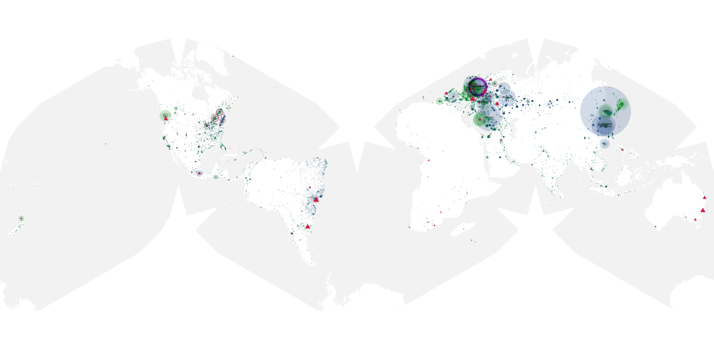</a><figcaption>Match TV. June 29–November 3, 2026; per-torrent downloader threshold of three; relative native scaling within this map.</figcaption></figure>

[Vector map](../resources/world-cup-stage1/vendor-match-tv.svg) · [Map data](../data/world-cup-stage1/vendor-match-tv.geojson.gz)

FOX · 51 torrents · 6,346,065 downloader memberships

<figure><a href="../resources/world-cup-stage1/vendor-fox.svg">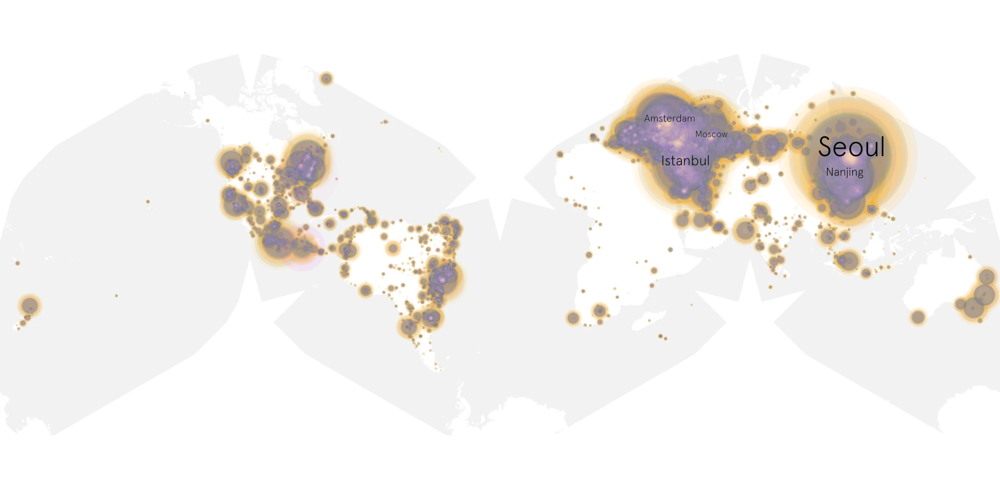</a><figcaption>FOX. June 29–November 3, 2026; per-torrent downloader threshold of three; relative native scaling within this map.</figcaption></figure>

[Vector map](../resources/world-cup-stage1/vendor-fox.svg) · [Map data](../data/world-cup-stage1/vendor-fox.geojson.gz)

BBC · 46 torrents · 5,477,453 downloader memberships

<figure><a href="../resources/world-cup-stage1/vendor-bbc.svg">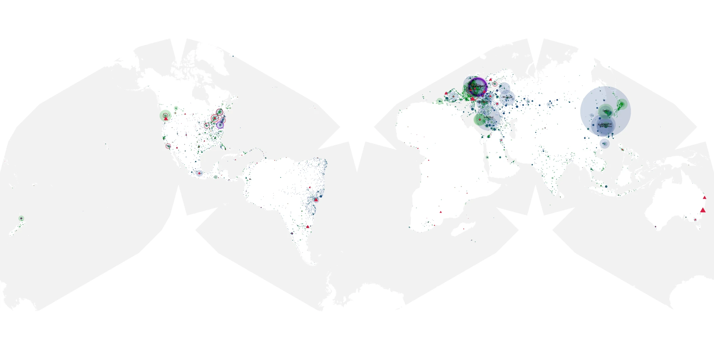</a><figcaption>BBC. June 29–November 3, 2026; per-torrent downloader threshold of three; relative native scaling within this map.</figcaption></figure>

[Vector map](../resources/world-cup-stage1/vendor-bbc.svg) · [Map data](../data/world-cup-stage1/vendor-bbc.geojson.gz)

TSN · 21 torrents · 2,891,497 downloader memberships

<figure><a href="../resources/world-cup-stage1/vendor-tsn.svg">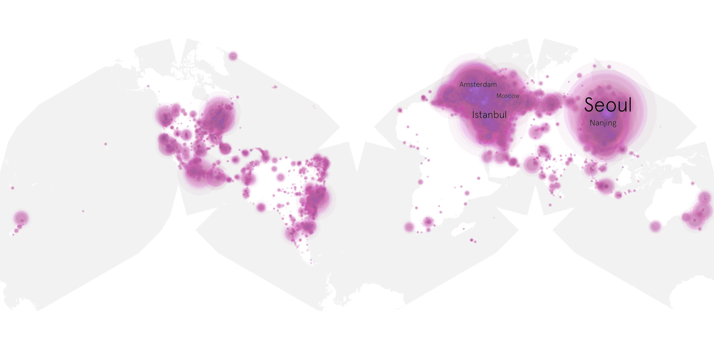</a><figcaption>TSN. June 29–November 3, 2026; per-torrent downloader threshold of three; relative native scaling within this map.</figcaption></figure>

[Vector map](../resources/world-cup-stage1/vendor-tsn.svg) · [Map data](../data/world-cup-stage1/vendor-tsn.geojson.gz)

BNT · 20 torrents · 2,030,496 downloader memberships

<figure><figcaption>BNT. June 29–November 3, 2026; per-torrent downloader threshold of three; relative native scaling within this map.</figcaption></figure>

[Vector map](../resources/world-cup-stage1/vendor-bnt.svg) · [Map data](../data/world-cup-stage1/vendor-bnt.geojson.gz)

ITV · 20 torrents · 1,476,594 downloader memberships

<figure><a href="../resources/world-cup-stage1/vendor-itv.svg">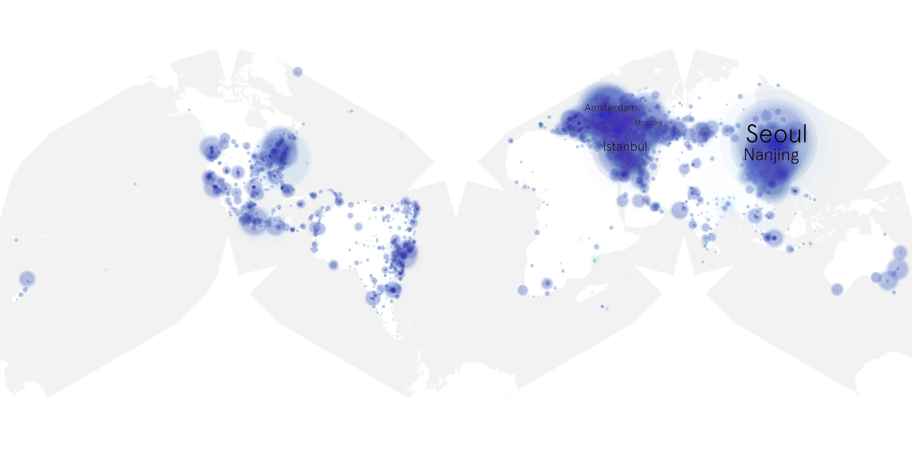</a><figcaption>ITV. June 29–November 3, 2026; per-torrent downloader threshold of three; relative native scaling within this map.</figcaption></figure>

[Vector map](../resources/world-cup-stage1/vendor-itv.svg) · [Map data](../data/world-cup-stage1/vendor-itv.geojson.gz)

Sport TV (Cyrillic label) · 16 torrents · 1,834,376 downloader memberships

<figure><a href="../resources/world-cup-stage1/vendor-sport-tv-cyrillic-label.svg">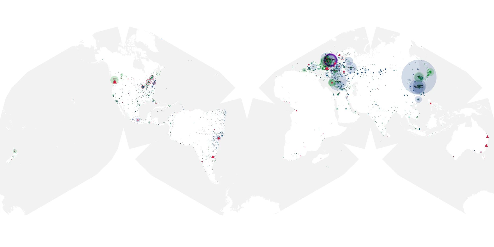</a><figcaption>Sport TV (Cyrillic label). June 29–November 3, 2026; per-torrent downloader threshold of three; relative native scaling within this map.</figcaption></figure>

[Vector map](../resources/world-cup-stage1/vendor-sport-tv-cyrillic-label.svg) · [Map data](../data/world-cup-stage1/vendor-sport-tv-cyrillic-label.geojson.gz)

MagentaTV / FUSSBALL.TV 1 · 9 torrents · 1,118,998 downloader memberships

<figure><a href="../resources/world-cup-stage1/vendor-fussball-tv-1.svg">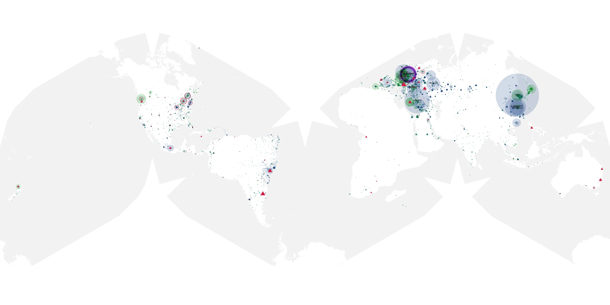</a><figcaption>MagentaTV / FUSSBALL.TV 1. June 29–November 3, 2026; per-torrent downloader threshold of three; relative native scaling within this map.</figcaption></figure>

[Vector map](../resources/world-cup-stage1/vendor-fussball-tv-1.svg) · [Map data](../data/world-cup-stage1/vendor-fussball-tv-1.geojson.gz)

MEGOGO · 9 torrents · 1,057,847 downloader memberships

<figure><a href="../resources/world-cup-stage1/vendor-megogo.svg">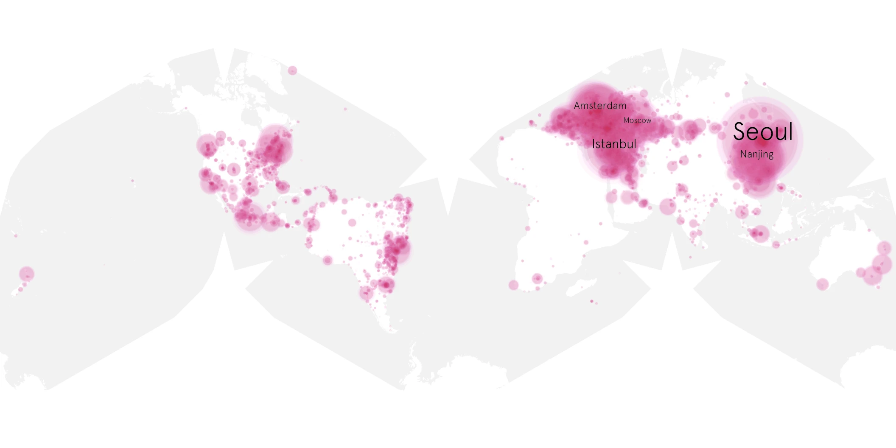</a><figcaption>MEGOGO. June 29–November 3, 2026; per-torrent downloader threshold of three; relative native scaling within this map.</figcaption></figure>

[Vector map](../resources/world-cup-stage1/vendor-megogo.svg) · [Map data](../data/world-cup-stage1/vendor-megogo.geojson.gz)

TVRI · 8 torrents · 797,782 downloader memberships

<figure><a href="../resources/world-cup-stage1/vendor-tvri.svg">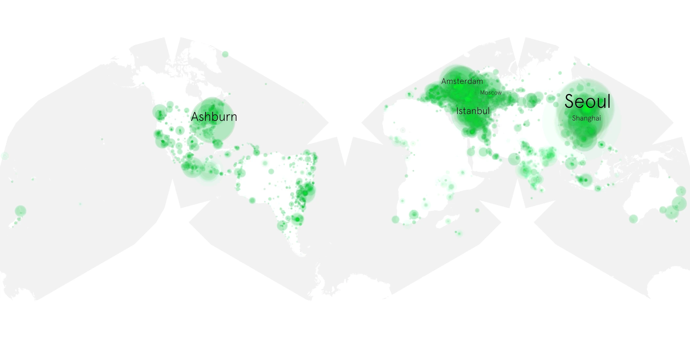</a><figcaption>TVRI. June 29–November 3, 2026; per-torrent downloader threshold of three; relative native scaling within this map.</figcaption></figure>

[Vector map](../resources/world-cup-stage1/vendor-tvri.svg) · [Map data](../data/world-cup-stage1/vendor-tvri.geojson.gz)

Antena / AntenaPlay · 7 torrents · 197,223 downloader memberships

<figure><a href="../resources/world-cup-stage1/vendor-antena-antenaplay.svg">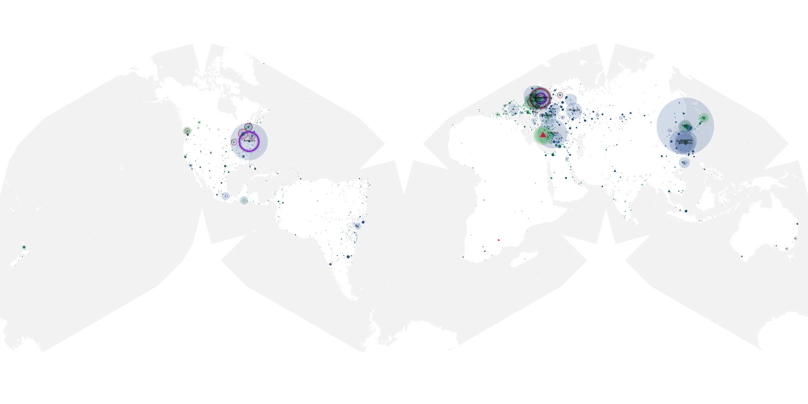</a><figcaption>Antena / AntenaPlay. June 29–November 3, 2026; per-torrent downloader threshold of three; relative native scaling within this map.</figcaption></figure>

[Vector map](../resources/world-cup-stage1/vendor-antena-antenaplay.svg) · [Map data](../data/world-cup-stage1/vendor-antena-antenaplay.geojson.gz)

ETV+ · 6 torrents · 648,766 downloader memberships

<figure><a href="../resources/world-cup-stage1/vendor-etv.svg">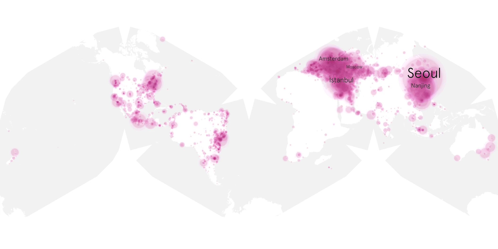</a><figcaption>ETV+. June 29–November 3, 2026; per-torrent downloader threshold of three; relative native scaling within this map.</figcaption></figure>

[Vector map](../resources/world-cup-stage1/vendor-etv.svg) · [Map data](../data/world-cup-stage1/vendor-etv.geojson.gz)

M6 · 4 torrents · 538,403 downloader memberships

<figure><a href="../resources/world-cup-stage1/vendor-m6.svg">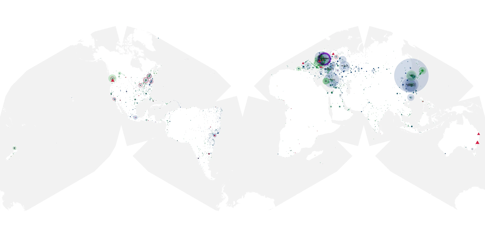</a><figcaption>M6. June 29–November 3, 2026; per-torrent downloader threshold of three; relative native scaling within this map.</figcaption></figure>

[Vector map](../resources/world-cup-stage1/vendor-m6.svg) · [Map data](../data/world-cup-stage1/vendor-m6.geojson.gz)

DAZN · 3 torrents · 313,784 downloader memberships

<figure><a href="../resources/world-cup-stage1/vendor-dazn.svg">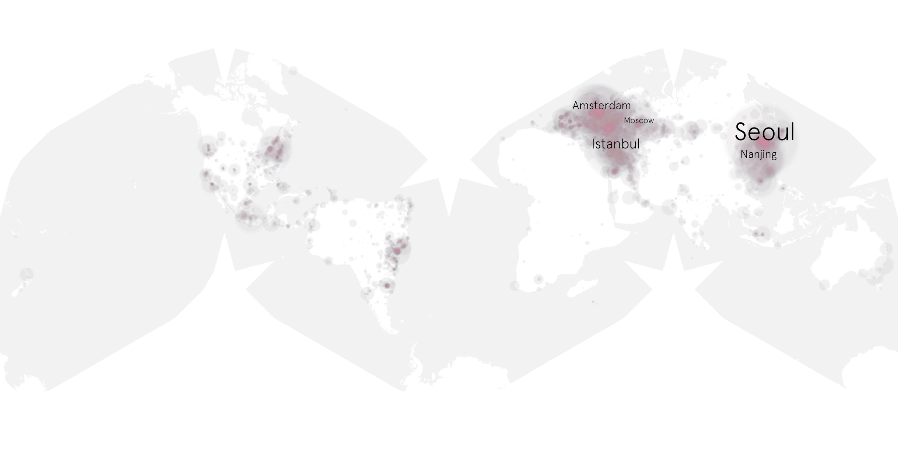</a><figcaption>DAZN. June 29–November 3, 2026; per-torrent downloader threshold of three; relative native scaling within this map.</figcaption></figure>

[Vector map](../resources/world-cup-stage1/vendor-dazn.svg) · [Map data](../data/world-cup-stage1/vendor-dazn.geojson.gz)

Rai · 3 torrents · 408,884 downloader memberships

<figure><a href="../resources/world-cup-stage1/vendor-rai.svg">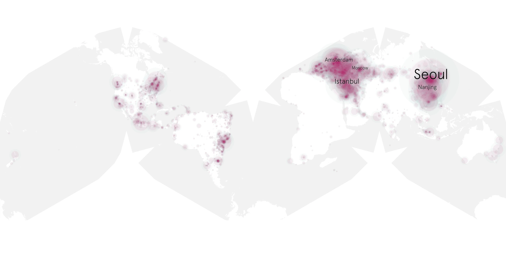</a><figcaption>Rai. June 29–November 3, 2026; per-torrent downloader threshold of three; relative native scaling within this map.</figcaption></figure>

[Vector map](../resources/world-cup-stage1/vendor-rai.svg) · [Map data](../data/world-cup-stage1/vendor-rai.geojson.gz)

RTVE · 2 torrents · 334,583 downloader memberships

<figure><figcaption>RTVE. June 29–November 3, 2026; per-torrent downloader threshold of three; relative native scaling within this map.</figcaption></figure>

[Vector map](../resources/world-cup-stage1/vendor-rtve.svg) · [Map data](../data/world-cup-stage1/vendor-rtve.geojson.gz)

SBS · 2 torrents · 311,241 downloader memberships

<figure><a href="../resources/world-cup-stage1/vendor-sbs.svg">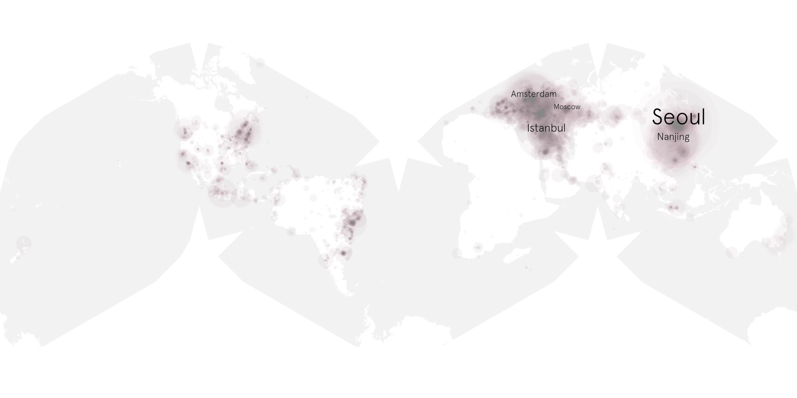</a><figcaption>SBS. June 29–November 3, 2026; per-torrent downloader threshold of three; relative native scaling within this map.</figcaption></figure>

[Vector map](../resources/world-cup-stage1/vendor-sbs.svg) · [Map data](../data/world-cup-stage1/vendor-sbs.geojson.gz)

ARD · 1 torrents · 116,292 downloader memberships

<figure><a href="../resources/world-cup-stage1/vendor-ard.svg">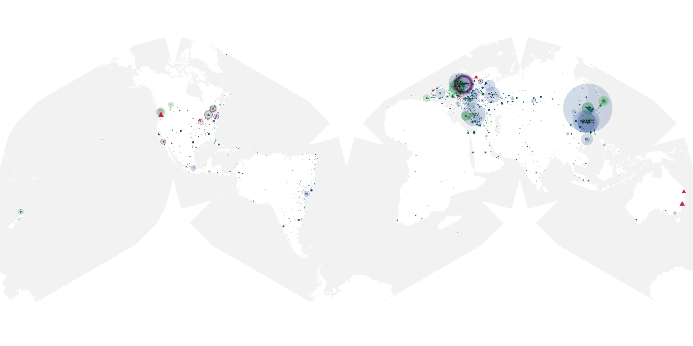</a><figcaption>ARD. June 29–November 3, 2026; per-torrent downloader threshold of three; relative native scaling within this map.</figcaption></figure>

[Vector map](../resources/world-cup-stage1/vendor-ard.svg) · [Map data](../data/world-cup-stage1/vendor-ard.geojson.gz)

NHK · 1 torrents · 93,516 downloader memberships

<figure><a href="../resources/world-cup-stage1/vendor-nhk.svg">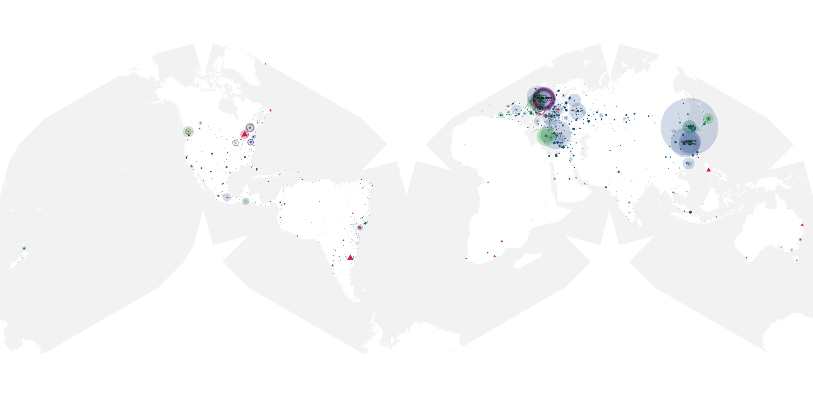</a><figcaption>NHK. June 29–November 3, 2026; per-torrent downloader threshold of three; relative native scaling within this map.</figcaption></figure>

[Vector map](../resources/world-cup-stage1/vendor-nhk.svg) · [Map data](../data/world-cup-stage1/vendor-nhk.geojson.gz)

Now TV · 1 torrents · 12 downloader memberships

<figure><a href="../resources/world-cup-stage1/vendor-now-tv.svg">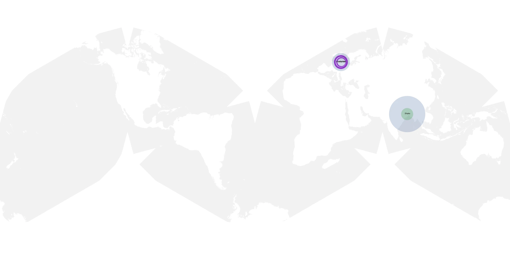</a><figcaption>Now TV. June 29–November 3, 2026; per-torrent downloader threshold of three; relative native scaling within this map.</figcaption></figure>

[Vector map](../resources/world-cup-stage1/vendor-now-tv.svg) · [Map data](../data/world-cup-stage1/vendor-now-tv.geojson.gz)

ZDF · 1 torrents · 129,017 downloader memberships

<figure><a href="../resources/world-cup-stage1/vendor-zdf.svg">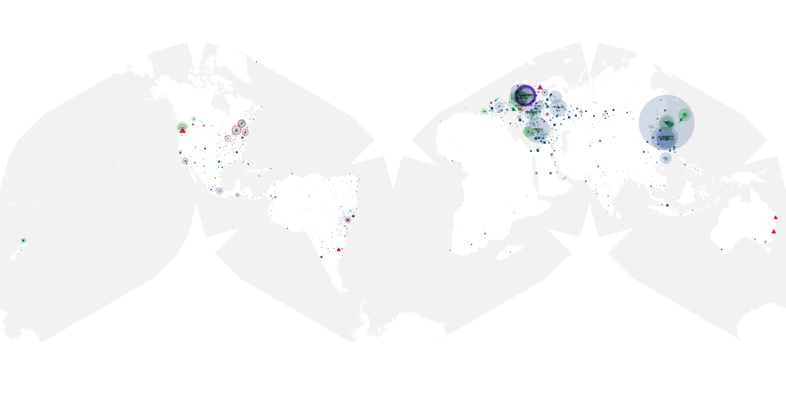</a><figcaption>ZDF. June 29–November 3, 2026; per-torrent downloader threshold of three; relative native scaling within this map.</figcaption></figure>

[Vector map](../resources/world-cup-stage1/vendor-zdf.svg) · [Map data](../data/world-cup-stage1/vendor-zdf.geojson.gz)

Unknown or conflicting · 133 torrents · 9,056,183 downloader memberships

<figure><figcaption>Unknown or conflicting. June 29–November 3, 2026; per-torrent downloader threshold of three; relative native scaling within this map.</figcaption></figure>

[Vector map](../resources/world-cup-stage1/vendor-unknown-or-conflicting.svg) · [Map data](../data/world-cup-stage1/vendor-unknown-or-conflicting.geojson.gz)

## FOX, Telemundo, and English-speaking viewers

The July 9–10 Associated Press report describes some English-speaking people choosing Telemundo's Spanish-language coverage. That is contextual reporting about viewing behavior. Torrent metadata records available content and observed distribution, so it cannot independently verify the language spoken by those viewers or their reasons for choosing a channel. [San Antonio Express-News / Associated Press](https://www.expressnews.com/sports/article/in-any-language-english-speakers-are-tuning-into-22339950.php)

This inventory supports a FOX-branded cohort, but **does not supply a defensible Telemundo cohort for a FOX–Telemundo swarm comparison**. Nor can the seven Spanish-audio torrents stand in for Telemundo: audio language and broadcaster are different attributes. A better study needs explicit broadcaster sampling, repeated frame evidence, matched games and observation ages, and separate consent-based evidence about actual viewing choices.

Sources, downloads, and counting rules

[Attribution CSV](../data/world-cup-stage1/vendor-attribution.csv) · [Primary visual review](../data/world-cup-stage1/vendor-visual-review.json) · [Earlier-frame checks](../data/world-cup-stage1/vendor-second-frame-review.json) · [Map provenance](../data/world-cup-stage1/vendor-maps.json)

All content joins use the [shared inventory](../data/world-cup-stage1/torrent-inventory.json.gz): **493 canonical BTIHA**, with verified hybrid-hash aliases. Alpha60 sampling began **June 29, 2026 — Round of 32**, and ends November 3 in this snapshot. Earlier-event media found later does not establish earlier sampling.

Geographic counts are **IP–torrent memberships**, with an IP counted once per canonical torrent and role within the stated interval. They are not unique people, viewing choices, completed downloads, transferred bytes, or ratings. An address can occur in both roles. Daily sums count the same membership again on another day.

Main geography uses **IPinfo and H3 resolution 8**, the highest resolution used here. The native minimum is **three downloaders per cell**; uploaders are retained only where that downloader threshold passes. Content comparisons filter each torrent separately. Overall country and city comparisons filter after aggregating torrents, so their totals differ. Country and city labels are representative locations within cells, and the finer grid does not improve IPinfo accuracy. Hosting, VPN, proxy and mobile flags overlap; each sensitivity exclusion is applied separately.

See the [H3r8 manifest](../H3r8/manifest.json), [generation and validation evidence](../data/world-cup-stage1/validation-summary.json), [complete analytical reductions](../data/world-cup-stage1/analysis.json.gz), and [methods and coverage](world-cup.html#methods). Source hashes make the published snapshot inspectable.

</article>
