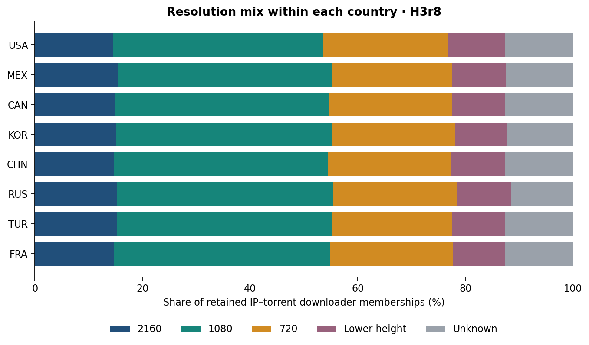

<link rel="stylesheet" href="../resources/world-cup-stage1/report.css">
<article class="wc-report" markdown="1">

<nav class="wc-nav" aria-label="World Cup reports"><a href="world-cup.html">Overview</a><a href="world-cup-swarm-media.html" aria-current="page">Formats and resolution</a><a href="world-cup-languages.html">Audio and subtitles</a><a href="world-cup-distro-en-es-fr.html">Language and geography</a><a href="world-cup-distro-usa-mex.html">North America and matches</a><a href="world-cup-ott-vendors.html">Broadcasters and services</a><a href="world-cup-asia-28.html">Asia-28 and China</a><a href="world-cup-southern.html">Latin America and South America</a><a href="world-cup-eur-27.html">EUR-27</a><a href="world-cup-2027-thoughts.html">Preparing for 2027</a></nav>

World Cup 2026 · Stage one · November 6, 2026

# Formats and resolution

1080-height video and AVC dominate the identified torrent inventory. Encoder coverage is too sparse to rank implementations across the whole swarm.

## What is distributed

Dimensions are available for **430 of 493 torrents (87.2%)**. The largest identified class is 1080 pixels high: 203 torrents. These are dimensions in the cached media probe, not a guarantee that every file in a multi-file torrent has that format. A 1080-height field also does not reliably distinguish progressive from interlaced material.

<table>
<thead><tr><th scope="col">Video height</th><th scope="col">Torrents</th><th scope="col">Share of all 493</th><th scope="col">Downloader memberships</th><th scope="col">Share of retained memberships</th></tr></thead>
<tbody>
<tr><td>2160 px high</td><td>59</td><td>12.0%</td><td>7,846,203</td><td>15.0%</td></tr>
<tr><td>1080 px high</td><td>203</td><td>41.2%</td><td>20,888,395</td><td>39.9%</td></tr>
<tr><td>720 px high</td><td>128</td><td>26.0%</td><td>11,915,133</td><td>22.8%</td></tr>
<tr><td>540 px high</td><td>8</td><td>1.6%</td><td>797,782</td><td>1.5%</td></tr>
<tr><td>480 px high</td><td>23</td><td>4.7%</td><td>3,221,222</td><td>6.2%</td></tr>
<tr><td>400 px high</td><td>9</td><td>1.8%</td><td>1,199,993</td><td>2.3%</td></tr>
<tr><td>unknown</td><td>63</td><td>12.8%</td><td>6,464,712</td><td>12.4%</td></tr>
</tbody></table>

<figure><a href="../resources/world-cup-stage1/resolution-country.svg"><picture></picture></a><figcaption>Country shares use the same per-torrent H3r8 threshold as the content analysis. Unknown metadata remains in the denominator; colors do not represent viewing quality or consumption. <a href="../resources/world-cup-stage1/resolution-country.svg">Open full-size chart (SVG)</a>.</figcaption></figure>

<table>
<thead><tr><th scope="col">Country</th><th scope="col">Largest height group</th><th scope="col">Group share</th><th scope="col">2160-height share</th></tr></thead>
<tbody>
<tr><td>United States</td><td>1080</td><td>39.1%</td><td>14.5%</td></tr>
<tr><td>Mexico</td><td>1080</td><td>39.8%</td><td>15.4%</td></tr>
<tr><td>Canada</td><td>1080</td><td>39.9%</td><td>14.9%</td></tr>
<tr><td>South Korea</td><td>1080</td><td>40.1%</td><td>15.1%</td></tr>
<tr><td>China</td><td>1080</td><td>39.8%</td><td>14.6%</td></tr>
<tr><td>Russia</td><td>1080</td><td>40.1%</td><td>15.3%</td></tr>
<tr><td>Türkiye</td><td>1080</td><td>40.0%</td><td>15.2%</td></tr>
<tr><td>France</td><td>1080</td><td>40.2%</td><td>14.7%</td></tr>
</tbody></table>

## Codecs, containers, and encoders

H.264 / AVC is the most common identified video codec, with **355 torrents (72.0% of all 493)**. Codec IDs from Matroska, MP4 and MPEG-TS are normalized into the same codec families. The independent fragment probe recognizes 348 Matroska-family containers, 36 MP4-family containers and 44 MPEG-TS containers; 65 torrents lack a usable container result. Those are probe container families, not filename extension counts.

<table>
<thead><tr><th scope="col">Video codec family</th><th scope="col">Torrents</th><th scope="col">Share of all 493</th></tr></thead>
<tbody>
<tr><td>H.264 / AVC</td><td>355</td><td>72.0%</td></tr>
<tr><td>H.265 / HEVC</td><td>60</td><td>12.2%</td></tr>
<tr><td>MPEG-2 video</td><td>11</td><td>2.2%</td></tr>
<tr><td>AV1</td><td>4</td><td>0.8%</td></tr>
<tr><td>Unknown</td><td>63</td><td>12.8%</td></tr>
</tbody></table>

Only **16 torrents (3.2%)** expose a video encoder tag: eight `obs_x264`, six `Lavc56.60.100 libx264`, and two `Lavc57.89.100 libx264`. All identified encoder tags point to x264, but **477 unknown encoder records prevent a claim about the most popular encoder across the whole inventory**. A codec is not an encoder implementation.

## Audio and metadata quality

<table>
<thead><tr><th scope="col">Audio property</th><th scope="col">Torrents</th><th scope="col">Share of all 493</th></tr></thead>
<tbody>
<tr><td>2 channels</td><td>339</td><td>68.8%</td></tr>
<tr><td>6 channels</td><td>91</td><td>18.5%</td></tr>
<tr><td>48,000 Hz sampling</td><td>359</td><td>72.8%</td></tr>
<tr><td>44,100 Hz sampling</td><td>71</td><td>14.4%</td></tr>
<tr><td>Unknown channels or sampling rate</td><td>63</td><td>12.8%</td></tr>
</tbody></table>

AAC is the dominant named audio family. Raw audio codec IDs, sampling rates and channels remain in the downloadable analysis. The reported 32-bit field on 98 records is not treated as proof of lossless audio or effective source precision.

Eight source frame-rate fields contain implausible readings above 6,000 frames per second. They are excluded from frame-rate conclusions. Independent `ffprobe` readings fall between 25.0 and 60.0 frames per second for those fragments; both readings are retained in the [metadata anomalies](../data/world-cup-stage1/media-anomalies.csv). Rates and durations derived from partial fragments should not be projected to a whole match.

## Findings to carry forward

1. **HD dominates the identified inventory.** The 203 1080-height and 128 720-height torrents together account for 67.1% of all hashes; availability and observed membership weight are separate measures.
2. **Codec compatibility appears important in this observed distribution.** AVC greatly exceeds HEVC and AV1 in identified torrent counts. This is a packaging observation, not evidence of which devices viewers own.
3. **Missing metadata is a material selection issue.** The 63 torrents without dimensions and the much larger encoder gap should remain visible in every regional comparison. Improve fragment decoding and file-level probing before interpreting finer quality preferences.

Sources, downloads, and counting rules

[Torrent inventory CSV](../data/world-cup-stage1/torrent-language-inventory.csv) · [Media anomaly checks](../data/world-cup-stage1/media-anomalies.csv) · [Packaging and probe evidence](../data/world-cup-stage1/supplement.json)

All content joins use the [shared inventory](../data/world-cup-stage1/torrent-inventory.json.gz): **493 canonical BTIHA**, with verified hybrid-hash aliases. Alpha60 sampling began **June 29, 2026 — Round of 32**, and ends November 3 in this snapshot. Earlier-event media found later does not establish earlier sampling.

Geographic counts are **IP–torrent memberships**, with an IP counted once per canonical torrent and role within the stated interval. They are not unique people, viewing choices, completed downloads, transferred bytes, or ratings. An address can occur in both roles. Daily sums count the same membership again on another day.

Main geography uses **IPinfo and H3 resolution 8**, the highest resolution used here. The native minimum is **three downloaders per cell**; uploaders are retained only where that downloader threshold passes. Content comparisons filter each torrent separately. Overall country and city comparisons filter after aggregating torrents, so their totals differ. Country and city labels are representative locations within cells, and the finer grid does not improve IPinfo accuracy. Hosting, VPN, proxy and mobile flags overlap; each sensitivity exclusion is applied separately.

See the [H3r8 manifest](../H3r8/manifest.json), [generation and validation evidence](../data/world-cup-stage1/validation-summary.json), [complete analytical reductions](../data/world-cup-stage1/analysis.json.gz), and [methods and coverage](world-cup.html#methods). Source hashes make the published snapshot inspectable.

</article>
